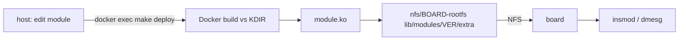

# Kernel Module Development

## When to Use This Skill

- You need to write, build, or load an out-of-tree kernel module (`.ko`) for a board.

## Prerequisites

- Docker running (`./lab docker status`, or the MCP `lab_docker_start`); image built with `libelf-dev`/`kmod` (`./lab docker build`).
- Board netbooting: kernel from `tftp/Image`, rootfs `nfs/<board>-rootfs` (the container exports it as `/workspace/nfs`). Do not use `shared/nfs/`.
- A `KDIR` that matches the **booted** kernel (see below). `KDIR` is set per board in [rpi4.mk](../../../shared/build_system/boards/rpi4.mk).

## Instructions

1. **Find what the board boots**: `./lab ssh -- uname -r` (e.g. `6.6.78-gbba53a117a4a-dirty`: version, git commit `-g<sha>`, `-dirty` if built from a modified tree).
2. **Check out the kernel source at that commit** in `shared/kernel/rpi-linux` (`git fetch --depth 1 origin <full-sha>` then `git checkout <full-sha>`; do not rely on `FETCH_HEAD`).
3. **Create KDIR from the booted Image** (one-time, minutes, no full build):
   `./lab docker exec make -C shared/kernel BOARD=rpi4 kdir-from-image KERNEL_RELEASE_SUFFIX=-gbba53a117a4a-dirty`
   Confirm `shared/kernel/build/rpi4/include/config/kernel.release` equals `uname -r` exactly.
4. **Create a module**: `cp -r shared/templates/kmod_project projects/<name>`; set `MODULE_NAME`.
5. **Build + deploy to the NFS rootfs**: `./lab docker exec make -C projects/<name> deploy`. Build output (including `<name>.ko`) lands in `projects/<name>/build/<board>/`, never next to your sources; the Makefile stages sources there because Kbuild on 6.6 cannot build external modules out-of-tree itself (`MO=` needs 6.13+).
6. **Load on the board**: `./lab ssh -- insmod /lib/modules/<ver>/extra/<name>.ko`, check `dmesg | tail`, unload with `rmmod <name>`.

## Editor IntelliSense

Red squiggles on `<linux/...>` includes mean the editor lacks kernel include paths (the Docker build is unaffected). One shared, committed config serves every module: [.vscode/c_cpp_properties.json](../../../.vscode/c_cpp_properties.json) at the repo root (open the repo root in VS Code; no per-module copy). It points at the kernel source in `shared/kernel/rpi-linux` and the build tree in `shared/kernel/build/rpi4`, so it needs KDIR first. It sets `compilerPath` empty because the host has no cross-compiler; the include paths, defines (`__KERNEL__`, `MODULE`, `KBUILD_MODNAME`) and force-includes (`kconfig.h`, `compiler_types.h`) replicate what Kbuild passes. For another board add a second named configuration to the same file. For clangd instead run `make -C projects/<name> compdb HOST_ROOT=<host repo path>` in Docker.

## Watching kernel messages

The board's BusyBox `dmesg` has no follow mode, so the rootfs ships a wrapper ([rootfs doc](../../../docs/raspi4/rootfs_busybox.md#8-following-the-kernel-log-dmesg--w)): `dmesg -w` prints the buffer then follows; `dmesg -W` follows new messages only. Over SSH: `./lab ssh -- dmesg -W` (Ctrl+C to stop). The serial console (`./lab console`) also shows kernel messages live.

## Gotchas

- Vermagic must match the board exactly (`modinfo <name>.ko | grep vermagic` vs `uname -r`/`uname -v`). The `-dirty` suffix is reproduced through `CONFIG_LOCALVERSION`, not git.
- `Module.symvers` only exists after a full kernel link, so the template builds with `KBUILD_MODPOST_WARN=1` (unresolved symbols are checked at `insmod`). Run a full `make -C shared/kernel build` and set `MODPOST_WARN=0` for strict checking.
- `docker exec` through the MCP runs as root: files it creates are root-owned on the host. `chown -R 1000:1000` them afterwards.
- If the board boots from SD (read-only squashfs), there is no `/lib/modules` and no NFS; deploy over SSH to `/tmp` instead.
