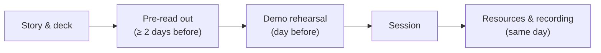

# KSS Session Checklist

Lessons carried from earlier sessions. Run through it for every new session: before the story is final, the day before, and after the call.

## 1. Audience on-ramp (while writing the story)

- **Assume at least one complete newcomer.** Every term is defined inline on first use; the first time a session says an acronym, the story defines it.
- **Publish a pre-read.** A one-page glossary of the terms the session uses, sent at least two days ahead. Keep it in `RESOURCES.md` under *Pre-read*. A newcomer should not have to ask what a term means mid-session.
- **Ask who is in the room.** In the invitation or the first minute, ask for experience level. Adjust depth, and decide what goes to the pre-read instead of the talk.
- **Plan one small hands-on challenge.** A tweak the audience can try afterwards (change one value, predict the result, check it). Listed in `RESOURCES.md` under *Try it yourself*. Concepts do not stick without practice.

## 2. Demo readiness (the day before)

A live demo that fails costs more than the demo is worth. Treat it as a deliverable.

- **Rehearse the full cold path, not just reachability.** If the demo is a boot, power-cycle and boot it; "the board answers ping" is not a rehearsal.
- **Record a fallback.** A 1–2 minute screen recording of a successful run, saved locally and ready to play. If the live demo fails once, switch to the recording rather than debugging in front of the room.
- **Set a time box.** Decide in advance: one retry, then the fallback. Put it in the step's cues.
- **Check the share path.** Whatever the audience needs to see (browser pages, dashboards, serial console) must be reachable from the machine doing the share, not only from the machine hosting it. Over remote sessions, forward ports first.
- **Prepare the commands.** Keep the exact demo commands in a file you can paste from, in the order you will run them.
- **Restore state after.** Note what the demo changes so it can be put back.

## 3. After the session (same day)

- **Share resources the same day, and announce them in the session.** Say where they will be ("everything is in `RESOURCES.md` in the repo") instead of promising links later.
- **Link the recording** in `RESOURCES.md` once it exists, and add the session's row link in the series README.
- **Check what was promised.** Skim the transcript for "I'll share…", "I'll follow up…", and capture each in `RESOURCES.md` or as a follow-up.
- **Log what the room asked.** Questions that needed a detour are candidates for a story beat next time. Add them to the story's *Review log* or the next session's notes.
- **Keep transcripts out of the repo** unless everyone in them agreed; they contain names and unedited speech.
