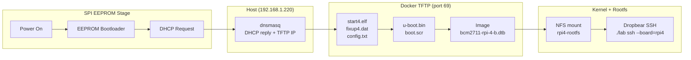
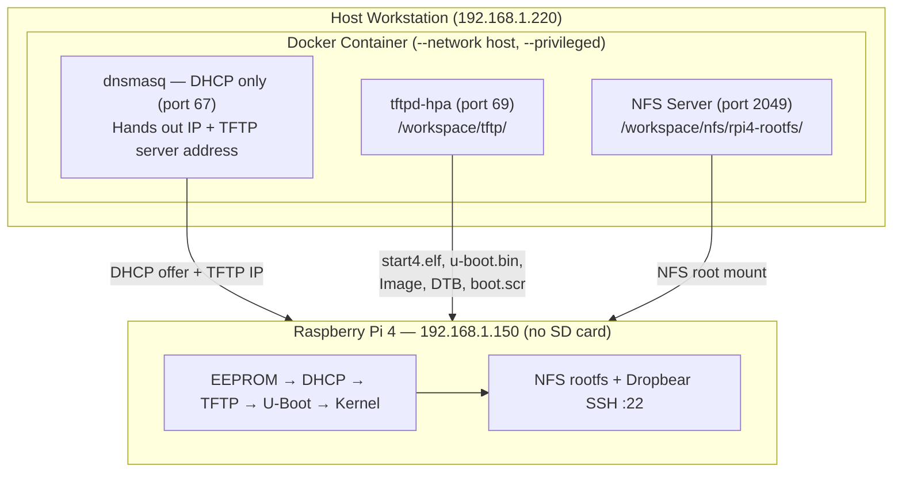

# Raspberry Pi 4: Eliminating the SD Card — Full Network Boot via EEPROM

The RPi4 SPI EEPROM bootloader (not the SD card) is the true first stage. It can be **reprogrammed to boot over the network (PXE/TFTP)** without any SD card at all. After a one-time EEPROM update, the Pi contacts a DHCP server on power-on, fetches the entire boot chain via TFTP, and mounts its root filesystem over NFS.

This guide uses the **Docker container's TFTP server** (already part of the lab infrastructure) as the single TFTP source for both the EEPROM firmware stage and the U-Boot kernel stage. dnsmasq provides DHCP only.



> [!NOTE]
> Standard Raspberry Pi 4 Model B does **not** have built-in eMMC (that is the Compute Module 4). The EEPROM only stores the boot *configuration*, not the firmware. Firmware (`start4.elf`) must still be served — but via TFTP from the host instead of from SD.

---

## Prerequisites

- Docker container built and runnable. See [Docker Setup Skill](../../.agents/skills/docker-setup/SKILL.md).
- BSP firmware files present in `shared/bsp/rpi4/` (committed in the repo).
- Host Ethernet interface connected to the Pi on the `192.168.1.0/24` subnet.

---

## 1. One-Time EEPROM Reprogramming

The EEPROM must be programmed once with `BOOT_ORDER=0xf12` (network-first: rightmost nibble 0x2) and `TFTP_PREFIX=0` (flat directory). After that, the SD card is no longer needed.

### Method A — From the Current Setup (Recommended)

Your current SD card already has a boot partition with U-Boot. You can flash the EEPROM using the GPU **recovery mode** — no RPi OS required. A helper script automates the process:

#### Step 1 — Generate the EEPROM recovery files
```bash
# From the repo root (host machine)
./tools/eeprom/prepare_netboot.sh
```

This downloads the official EEPROM firmware and `recovery.bin` from the [rpi-eeprom](https://github.com/raspberrypi/rpi-eeprom) repository, patches in the netboot config, and outputs ready-to-flash files in `tools/eeprom/output/`.

The patched config:
```ini
[all]
BOOT_UART=1
BOOT_ORDER=0xf12
BOOT_ORDER_TIMEOUT=5
TFTP_IP=192.168.1.220
TFTP_PREFIX=0
NETWORK_INSTALL_ENABLED=1
```

#### Step 2 — Copy to the SD card boot partition
```bash
# Mount the SD card (path varies by OS — adjust as needed)
cp tools/eeprom/output/recovery.bin  /media/$USER/bootfs/
cp tools/eeprom/output/pieeprom.bin  /media/$USER/bootfs/
cp tools/eeprom/output/pieeprom.sig  /media/$USER/bootfs/
cp tools/eeprom/output/pieeprom.upd  /media/$USER/bootfs/
```

#### Step 3 — Flash the EEPROM
1. Insert the SD card into the Pi and power on.
2. The GPU detects `recovery.bin` and enters recovery mode instead of booting normally.
3. The green activity LED flashes rapidly while the EEPROM is being written.
4. On success, the Pi reboots automatically and `pieeprom.upd` is renamed to `pieeprom.upd.bak`.

#### Step 4 — Remove the SD card
Power off, remove the SD card. On next power-on, the Pi will attempt network boot via TFTP.

### Method B — From RPi OS (Alternative)

If you prefer to use the official `rpi-eeprom-config` tool on the Pi itself:

1. Flash **Raspberry Pi OS Lite (64-bit)** with [Raspberry Pi Imager](https://www.raspberrypi.com/software/) to a microSD card and boot it.
2. Extract and edit the EEPROM config:
   ```bash
   sudo rpi-eeprom-config --out /tmp/boot.conf
   # Edit /tmp/boot.conf with the settings shown above
   sudo rpi-eeprom-config --apply /tmp/boot.conf
   sudo rpi-eeprom-config   # verify
   ```
3. Reboot and remove the SD card.

### BOOT_ORDER Reference

| Digit | Mode |
|:---:|:---|
| `0x1` | SD card |
| `0x2` | Network (PXE/TFTP) |
| `0x4` | USB mass storage |
| `0xf` | Restart from first mode |

Digits are tried right-to-left. `0xf12` = try network (0x2), then SD (0x1), then restart (0xf).

---

## 2. DHCP Server (dnsmasq — Inside Docker)

The Pi's EEPROM sends a DHCP broadcast over Ethernet. The Docker container includes `dnsmasq` (DHCP only — TFTP and NFS are handled by tftpd-hpa and nfs-kernel-server in the same container).

> [!WARNING]
> Do **not** enable `enable-tftp` in dnsmasq — it would conflict with tftpd-hpa on port 69. dnsmasq handles DHCP only.

### Enable dnsmasq at Container Start

The `lab` CLI reads `HOST_INTERFACE` and `HOST_IP` from your board profile (`shared/boards/rpi4.env`) and passes them into the container automatically:

```bash
./lab docker run                    # auto-detects board if only one exists
./lab docker run --board=rpi4       # explicit board selection
```

The board env file should contain:
```ini
HOST_INTERFACE="enp2s0"       # host NIC facing the Pi
HOST_IP="192.168.1.220"       # host IP on that subnet
```

You can also override via environment variables:
```bash
DNSMASQ_INTERFACE=enp2s0 HOST_IP=192.168.1.220 ./tools/docker/run.sh run
```

If neither the board env nor the env vars provide these values, dnsmasq is skipped — useful when running DHCP on the host or on a different machine.

### What the Container Configures

The entrypoint injects the runtime values into `/etc/dnsmasq.d/netboot.conf`:
```ini
# DHCP only — no TFTP (handled by tftpd-hpa)
interface=enp2s0
bind-interfaces
dhcp-range=192.168.1.150,192.168.1.160,255.255.255.0,12h
dhcp-boot=start4.elf,,192.168.1.220
log-dhcp
log-queries
```

### Customising DHCP (Optional)

To pin the Pi to a specific IP by MAC address, edit `tools/docker/dnsmasq-netboot.conf` and add:
```ini
dhcp-host=dc:a6:32:xx:xx:xx,rpi4,192.168.1.150
```

Then rebuild the Docker image: `./tools/docker/run.sh build`

> [!WARNING]
> If the host already runs a DHCP server (e.g., NetworkManager) on the same interface, it will conflict with dnsmasq on port 67. Either disable the host DHCP for that interface, or don't set the env vars and run dnsmasq on the host manually.

---

## 3. Populate the TFTP Directory

The Docker container serves TFTP from `tftp/` in the repo root (mounted as `/workspace/tftp` inside the container). Copy all BSP firmware files there so the EEPROM, U-Boot, and kernel stages are all served from one location:

```bash
# From the repo root
cp shared/bsp/rpi4/start4.elf   tftp/
cp shared/bsp/rpi4/fixup4.dat   tftp/
cp shared/bsp/rpi4/config.txt   tftp/
cp shared/bsp/rpi4/u-boot.bin   tftp/
cp shared/bsp/rpi4/boot.scr     tftp/
cp shared/bsp/rpi4/Image        tftp/
cp shared/bsp/rpi4/bcm2711-rpi-4-b.dtb tftp/
```

Start (or restart) the Docker container so the TFTP server picks up the files:
```bash
./tools/docker/run.sh run
```

Verify from inside the container:
```bash
ls /workspace/tftp/
# Expected: Image  bcm2711-rpi-4-b.dtb  boot.scr  config.txt
#           fixup4.dat  start4.elf  u-boot.bin
```

---

## 4. Network Topology

All three network services (DHCP, TFTP, NFS) run inside the Docker container with `--network host`.



---

## 5. Verifying Network Boot

### 5.1 Watch DHCP Handshake
```bash
sudo journalctl -fu dnsmasq
```

Expected:
```text
dnsmasq-dhcp: DHCPDISCOVER(enp2s0) dc:a6:32:xx:xx:xx
dnsmasq-dhcp: DHCPOFFER(enp2s0)    192.168.1.150 dc:a6:32:xx:xx:xx
```

### 5.2 Watch TFTP Transfers (Serial Console)

Open the serial console before powering on:
```bash
./lab console --board=rpi4
```

After power-on, the EEPROM stage downloads firmware via TFTP, then U-Boot runs `boot.scr` to fetch the kernel and DTB. The full boot sequence on serial:
```text
Net:   eth0: bcmgenet
TFTP from server 192.168.1.220; our IP address is 192.168.1.150
Filename 'start4.elf'.
...
==> Soliton ARM Embedded Linux Lab
==> Fetching kernel Image via TFTP...
==> Fetching Device Tree Blob via TFTP...
==> Booting Linux kernel...
[    2.xxx] NFS: Mounting 192.168.1.220:/workspace/nfs/rpi4-rootfs on /
==========================================================
 Welcome to Soliton ARM Embedded Linux Lab
 Kernel: 6.6.y on aarch64
 SSH:    root@192.168.1.150:22
==========================================================
```

### 5.3 Verify SSH Access

Once the banner appears:
```bash
./lab ssh --board=rpi4
```

### 5.4 Run Diagnostics

From inside the Docker container:
```bash
./lab doctor
```

---

## 6. Host Firewall Rules

If UFW is active on the host, allow all required ports:
```bash
sudo ufw allow 67/udp       # DHCP (dnsmasq)
sudo ufw allow 69/udp       # TFTP (Docker tftpd-hpa)
sudo ufw allow 2049/tcp     # NFS
sudo ufw allow 2049/udp
sudo ufw allow 111/tcp      # rpcbind
sudo ufw allow 111/udp
sudo ufw allow 20048/tcp    # NFS mountd (fixed port)
sudo ufw allow 20048/udp
```

---

## 7. Troubleshooting

### Pi gets IP but TFTP fails
- Confirm firmware files are in `tftp/`: `ls tftp/start4.elf`
- Check the Docker TFTP server is running: `./tools/docker/run.sh exec ls /workspace/tftp/`
- Port 69 (UDP) must not be blocked: `sudo ufw allow 69/udp`
- Verify `TFTP_PREFIX=0` is set in EEPROM config — without it, the Pi requests `<serial>/start4.elf` which won't exist in the flat `tftp/` directory

### Pi does not send DHCP request
- EEPROM boot order did not take effect. Re-verify: `sudo rpi-eeprom-config`
- Ethernet cable must be connected **before** powering on (EEPROM checks link state)
- Try `BOOT_ORDER=0xf2` (network-only, no fallback) to isolate the issue
- Enable `BOOT_UART=1` in EEPROM config and watch serial output for EEPROM-stage diagnostics

### dnsmasq fails to start
- Another DHCP server may hold port 67: `sudo ss -ulnp | grep :67`
- Disable NetworkManager's built-in DHCP for the Pi-facing interface, or set `bind-interfaces` in dnsmasq to avoid conflicts

### U-Boot fetches from wrong TFTP IP (times out with T T T)
- Corporate/office DHCP answered before the host because host UFW dropped DHCP port 67:
  ```bash
  sudo ufw allow 67/udp
  ```
- Ensure `dhcp-host=88:a2:9e:b3:cd:27,192.168.1.150,rpi4,infinite` and `dhcp-option=66,<HOST_IP>` are configured in `tools/docker/dnsmasq-netboot.conf`.

### "ERROR: Did not find a cmdline Flattened Device Tree" / Boot failed (err=-14)
- **Root cause:** U-Boot's default `fdt_addr_r` is `0x02600000`. When booting an arm64 uncompressed `Image` larger than ~36MB (our 64-bit kernel is ~41.5MB), U-Boot's `booti` relocation from `0x80000` to `0x200000` extends up to `0x2a40000`, clobbering the DTB loaded at `0x2600000`.
- **Fix:** Do NOT specify `fdt` in `tftp/pxelinux.cfg/default`. Omitting `fdt` forces U-Boot to use the VideoCore firmware-supplied device tree (`$fdt_addr`) in protected high memory, which is never overwritten and includes all GPU-injected board nodes.
- Also ensure `PROMPT 0` and `TIMEOUT 0` are in `pxelinux.cfg/default` for instant, non-interactive boot.

### SSH connection refused after boot
- Verify Dropbear is running on the Pi: `./lab console --board=rpi4` then `ps | grep dropbear`
- Check `rcS` started networking: `ifconfig eth0` should show `192.168.1.150`
- See [Adding SSH Access (Dropbear)](rootfs_busybox.md#6-adding-ssh-access-dropbear) for setup details

---

**Previous:** [U-Boot, TFTP & NFS Boot](uboot_tftp_boot.md) | **Next:** [Network Boot Deep Dive](netboot_deep_dive.md)
