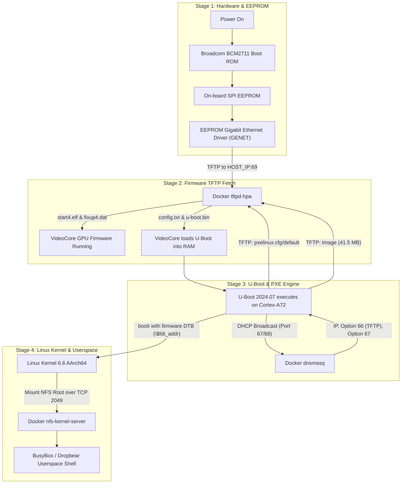

# Network Boot Deep Dive: Architecture, DHCP, dnsmasq, and Real-World Troubleshooting

This document provides a comprehensive technical breakdown of how the SD-card-free network boot pipeline works on the Raspberry Pi 4, the core networking protocols involved (DHCP, TFTP, NFS), how `dnsmasq` coordinates boot services within Docker, and the exact real-world engineering issues encountered and solved during lab bringup.

---

## 1. End-to-End Boot Architecture

In a standard Raspberry Pi setup, VideoCore firmware, U-Boot, the Linux kernel, and the root filesystem all reside on an SD card. In our lab, the SD card is eliminated entirely after a one-time EEPROM setup:



---

## 2. Core Networking Concepts

### 2.1 What is DHCP?
**DHCP (Dynamic Host Configuration Protocol)** is an application-layer network protocol operating over **UDP (ports 67 and 68)**. It enables a server to automatically assign IP addresses and network configuration parameters to client devices.

The standard client-server handshake follows the **DORA** sequence:
1. **Discover (`DHCPDISCOVER`)**: The client broadcasts from `0.0.0.0:68` to `255.255.255.255:67` requesting network configuration.
2. **Offer (`DHCPOFFER`)**: One or more DHCP servers respond with an IP address, lease time, and network options.
3. **Request (`DHCPREQUEST`)**: The client formally accepts an offer and notifies the network.
4. **Acknowledge (`DHCPACK`)**: The chosen server confirms the lease and commits the options.

#### Critical DHCP Options for Network Boot
DHCP supports modular metadata fields called **DHCP Options**:
- **Option 53 (Message Type):** Identifies Discover, Offer, Request, or Ack.
- **Option 1 (Subnet Mask):** e.g., `255.255.255.0`.
- **Option 3 (Router / Default Gateway):** Network egress gateway IP.
- **Option 66 (`tftp-server-name` / Next Server IP):** Specifies the hostname or IP address of the TFTP server from which the bootloader must fetch files.
- **Option 67 (`bootfile-name`):** Specifies the initial boot file (e.g. `boot.scr`, `pxelinux.0`).

### 2.2 What is dnsmasq?
[`dnsmasq`](https://thekelleys.org.uk/dnsmasq/doc.html) is a lightweight, easy-to-configure DNS forwarder, DHCP server, and network boot daemon. Unlike full enterprise DHCP engines (like ISC Kea or ISC DHCP), `dnsmasq`:
- Runs with minimal memory and CPU overhead.
- Supports fine-grained interface binding (`interface=enp2s0`, `bind-interfaces`).
- Allows targeting specific embedded hardware using MAC address pinning (`dhcp-host=...`).
- Integrates DHCP Option 66 / 67 injection in a single configuration file without complex database backends.

### 2.3 How Docker Orchestrates Network Services
In this monorepo, network boot infrastructure is containerized to ensure cross-platform reproducibility:
- **`--net=host` Networking:** The container shares the host network namespace so it can bind directly to the Ethernet interface (`enp2s0`) without NAT or bridge latency.
- **`tftpd-hpa` (UDP Port 69):** Serves `tftp/` directory containing GPU firmware, U-Boot, kernel `Image`, DTB, and PXE files.
- **`nfs-kernel-server` (TCP/UDP Port 2049):** Exports `/workspace/nfs/rpi4-rootfs` to the target board subnet.
- **`dnsmasq` (UDP Port 67):** Acts strictly as a targeted DHCP boot server for the Pi.

---

## 3. Configuration in Our Environment

### 3.1 `tools/docker/dnsmasq-netboot.conf`
The base template configured for our container:
```ini
# Listen only on the Pi-facing interface
bind-interfaces

# Pin the Pi MAC to a static IP with infinite lease
dhcp-host=88:a2:9e:b3:cd:27,192.168.1.150,rpi4,infinite

# DHCP IP pool range
dhcp-range=192.168.1.150,192.168.1.160,255.255.255.0,12h

# Network boot parameters
dhcp-option=66,192.168.1.220     # TFTP Server (Docker Host)
dhcp-option=67,boot.scr           # Default Bootfile Name

# Logging
log-dhcp
```

### 3.2 Dynamic Runtime Injection (`tools/docker/entrypoint.sh`)
When `./lab docker run` executes, it parses the active board profile (`HOST_INTERFACE` and `HOST_IP`) and updates `/etc/dnsmasq.d/netboot.conf` dynamically before launching the service:
```bash
if [[ -n "${DNSMASQ_INTERFACE:-}" && -n "${HOST_IP:-}" ]]; then
    _dnsmasq_conf="/etc/dnsmasq.d/netboot.conf"
    sed -i "s/^# interface=.*/interface=${DNSMASQ_INTERFACE}/" "${_dnsmasq_conf}"
    sed -i "s/^# dhcp-boot=.*/dhcp-boot=start4.elf,,${HOST_IP}/" "${_dnsmasq_conf}"
    sed -i "s/^dhcp-option=66,.*/dhcp-option=66,${HOST_IP}/" "${_dnsmasq_conf}"
    killall dnsmasq 2>/dev/null || true
    dnsmasq --conf-dir=/etc/dnsmasq.d
fi
```

### 3.3 PXE Boot Configuration (`shared/bsp/rpi4/pxelinux.cfg/default`)
```ini
DEFAULT linux
PROMPT 0
TIMEOUT 0

LABEL linux
  KERNEL Image
  APPEND console=ttyS0,115200 console=tty1 root=/dev/nfs rw rootwait nfsroot=192.168.1.220:/workspace/nfs/rpi4-rootfs,tcp,v3 ip=192.168.1.150:::255.255.255.0:rpi4:eth0:off earlycon=bcm2835aux,0xfe215040
```

---

## 4. Issues Encountered and Engineering Solutions

During bringup, several non-obvious failure modes appeared across different layers of the hardware, bootloader, kernel, and network stack.

### Issue 1: EEPROM Boot Order Evaluation Nibble Direction
- **Symptom:** Setting `BOOT_ORDER=0xf21` in EEPROM caused the Pi to still attempt SD card boot first, only falling back to network after a long timeout.
- **Root Cause:** The Raspberry Pi bootloader interprets `BOOT_ORDER` as a 32-bit hex value evaluated **right-to-left** (least-significant nibble first):
  - In `0xf21`, digit `1` (`0x1` = SD card) was evaluated first.
- **Solution:** Changed `BOOT_ORDER` to **`0xf12`**:
  - Nibble 0 (`2`): Network boot first.
  - Nibble 1 (`1`): SD card fallback.
  - Nibble 2 (`f`): Restart loop.

### Issue 2: GPU Recovery Flashing and Signature Verification
- **Symptom:** Copying only `pieeprom.upd` and `recovery.bin` to the SD card caused the green ACT LED to blink continuously without flashing the EEPROM.
- **Root Cause:** The VideoCore recovery bootloader (`recovery.bin`) requires a matching SHA256 digest file (`pieeprom.sig`) and expects the binary named `pieeprom.bin` in addition to `pieeprom.upd`.
- **Solution:** Updated `tools/eeprom/prepare_netboot.sh` to fetch `rpi-eeprom-digest` and automatically generate `pieeprom.sig`:
  ```bash
  rpi-eeprom-digest -i pieeprom.bin -o pieeprom.sig
  ```
  Once `recovery.bin`, `pieeprom.bin`, and `pieeprom.sig` were all on FAT32, the GPU confirmed:
  ```text
  Bootloader EEPROM is up to date
  hash: b3a7cdfb43920c51f82f5c0782da7ba89075fa7a131da1c917d416d27eb3c389
  ```

### Issue 3: Rogue Corporate DHCP & Option 66 Poisoning
- **Symptom:** When the Pi booted over the network, it sent TFTP requests to `192.168.0.218` (an unrelated corporate server) rather than our Docker host (`192.168.1.220`).
- **Root Cause:** When connected to an office network or shared switch, corporate DHCP servers broadcast DHCP offers with Option 66 pointing to corporate infrastructure.
- **Solution:**
  1. In the EEPROM configuration (`boot.conf`), hardcode:
     ```ini
     TFTP_IP=192.168.1.220
     ```
     This instructs the EEPROM stage to bypass whatever Option 66 the network router provided.
  2. In `tools/docker/dnsmasq-netboot.conf`, explicitly declare `dhcp-option=66,192.168.1.220`.

### Issue 4: Host Firewall (UFW) Dropping DHCP Broadcasts
- **Symptom:** EEPROM netboot succeeded in downloading `start4.elf` and `u-boot.bin`, but inside U-Boot, TFTP timed out (`T T T T T T T T`). U-Boot serial console reported:
  ```text
  TFTP from server 192.168.0.218; our IP address is 192.168.0.161
  ```
- **Root Cause:**
  - EEPROM used hardcoded `TFTP_IP` (port 69 was allowed in host firewall).
  - But U-Boot issued its own `dhcp` request.
  - On the host machine, **Ubuntu UFW firewall had default `policy DROP` on incoming packets**. Port 69 (TFTP) was allowed, but **UDP port 67 (DHCP) was blocked**.
  - As a result, the Docker container's `dnsmasq` never received U-Boot's DHCP broadcast. The corporate router was the only responder.
- **Solution:** Allowed DHCP UDP port 67 through UFW on the host:
  ```bash
  sudo ufw allow 67/udp
  ```
  Once opened, `dnsmasq` immediately intercepted the Pi's MAC address and assigned `192.168.1.150` with the correct next-server IP.

### Issue 5: U-Boot PXE Interactive Menu Prompt
- **Symptom:** U-Boot halted during boot, scrolling:
  ```text
  1:      Linux via NFS
  Enter choice: 
  ```
- **Root Cause:** `pxelinux.cfg` had a menu label defined without non-interactive controls, causing U-Boot's PXE engine to wait for serial keyboard input.
- **Solution:** Added non-interactive control directives to `pxelinux.cfg`:
  ```ini
  DEFAULT linux
  PROMPT 0
  TIMEOUT 0
  ```

### Issue 6: Kernel Relocation Overwriting Device Tree in RAM
- **Symptom:** U-Boot successfully downloaded `Image` (41.5 MB) and `bcm2711-rpi-4-b.dtb` (56 KB), then immediately failed:
  ```text
  Moving Image from 0x80000 to 0x200000, end=2a40000
  ERROR: Did not find a cmdline Flattened Device Tree
  Could not find a valid device tree
  Boot failed (err=-14)
  ```
- **Root Cause (Memory Collision):**
  - U-Boot's default Raspberry Pi memory layout defines:
    - `fdt_addr_r=0x02600000` (~38 MB from RAM start).
  - Our uncompressed arm64 Linux kernel `Image` is **41.5 MB** (`0x27a3200` bytes).
  - The `booti` command relocates the kernel to `0x00200000` (2 MB aligned). With BSS and margins, its end address was **`0x02a40000`**.
  - Range `0x00200000` – `0x02a40000` directly overlapped and destroyed `0x02600000`! When U-Boot checked the DTB magic bytes (`0xd00dfeed`), it found corrupted kernel data instead.
- **Solution:** Removed the `fdt` line from `pxelinux.cfg`.
  - In U-Boot's `boot/pxe_utils.c`, if no `fdt` is specified in the PXE label, U-Boot falls back to **`${fdt_addr}`**.
  - On the Raspberry Pi, `${fdt_addr}` points to the device tree loaded by VideoCore (`start4.elf`) at the **top of RAM** (`> 0x2e000000`), which is protected from kernel relocation and contains all GPU-discovered board properties.

---

## 5. Summary Checklist for Future Targets

When configuring network boot on any new embedded Linux target:
1. **Firewall:** Verify UDP port 67 (DHCP) and UDP port 69 (TFTP) are open on the host machine.
2. **DHCP Next-Server:** Ensure Option 66 points to the container/host IP, not a gateway or corporate server.
3. **Bootloader Memory Map:** Always calculate `kernel_start + kernel_size` to ensure it does not overlap `fdt_addr_r`, `ramdisk_addr_r`, or `scriptaddr`.
4. **Non-interactive Configuration:** Always specify `PROMPT 0` and `TIMEOUT 0` in PXE / extlinux configurations to ensure headless boot stability.
