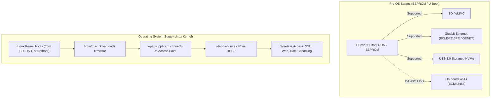

# Raspberry Pi 4 Wireless Networking (Wi-Fi) Setup & Credential Management

This document outlines the architecture, kernel requirements, firmware prerequisites, userspace tooling, and secure credential handling required to enable Wi-Fi on the Raspberry Pi 4 Model B.

---

## 1. Architectural Reality: EEPROM vs. Wi-Fi

Before designing the wireless workflow, it is important to distinguish what the Raspberry Pi 4 hardware can and cannot do over Wi-Fi:



> [!IMPORTANT]
> **Can the Pi do a zero-cable EEPROM netboot over Wi-Fi?**  
> **No.** The Broadcom BCM43455 wireless chip is an SDIO peripheral requiring proprietary firmware blobs, NVRAM regulatory calibration data, and a full 802.11 / WPA security stack (`wpa_supplicant`). Neither the Broadcom GPU ROM nor U-Boot contains a Wi-Fi driver or cryptographic WPA authenticator.
>
> **The Solution:**  
> Once the board boots its Linux kernel (from a minimal SD card, USB flash drive, or an initial Ethernet netboot), the Linux kernel initializes the `brcmfmac` driver and brings up `wlan0`. You can then disconnect Ethernet and move the Pi around completely wirelessly with a battery pack or USB-C power source.

---

## 2. Requirements Breakdown

Enabling Wi-Fi in our custom embedded Linux build requires three components:

1. **Linux Kernel Driver:** Broadcom FullMAC driver (`brcmfmac`) compiled with SDIO bus support.
2. **Proprietary Firmware Blobs:** The BCM43455 binary microcode and regulatory configuration in `/lib/firmware/brcm/`.
3. **Userspace Wireless Stack:** `wpa_supplicant` for WPA2/WPA3 authentication and BusyBox `udhcpc` for IP leasing.

---

## 3. Kernel Configuration

The Linux kernel must have wireless networking and the Broadcom SDIO driver enabled.

In `shared/bsp/rpi4/` (or via `make menuconfig` in the kernel build tree):

```ini
# Core Networking
CONFIG_NET=y
CONFIG_WIRELESS=y
CONFIG_CFG80211=y
CONFIG_MAC80211=y

# Broadcom FullMAC Driver
CONFIG_BRCMFMAC=y
CONFIG_BRCMFMAC_SDIO=y
CONFIG_BRCMFMAC_PROTO_BCDC=y

# Crypto modules for WPA2/WPA3
CONFIG_CRYPTO_AES=y
CONFIG_CRYPTO_ARC4=y
CONFIG_CRYPTO_ECB=y
CONFIG_CRYPTO_CCM=y
CONFIG_CRYPTO_GCM=y
CONFIG_CRYPTO_CMAC=y
```

---

## 4. Required Firmware Blobs

The `brcmfmac` driver queries `/lib/firmware/brcm/` at boot time for three files specific to the BCM43455 chip:

| File | Purpose | Source |
|---|---|---|
| `brcmfmac43455-sdio.bin` | Chipset firmware microcode | Official Raspberry Pi firmware repository |
| `brcmfmac43455-sdio.clm_blob` | Country Locale Matrix (RF transmission limits) | Official Raspberry Pi firmware repository |
| `brcmfmac43455-sdio.txt` | NVRAM board-specific calibration settings | Official Raspberry Pi firmware repository |

### Populating the Rootfs with Firmware:
```bash
# In the Docker build container or host:
mkdir -p /workspace/nfs/rpi4-rootfs/lib/firmware/brcm/

# Download the BCM43455 firmware suite
FW_BASE="https://raw.githubusercontent.com/RPi-Distro/firmware-nonfree/master/brcm"
curl -sSL "${FW_BASE}/brcmfmac43455-sdio.bin" -o /workspace/nfs/rpi4-rootfs/lib/firmware/brcm/brcmfmac43455-sdio.bin
curl -sSL "${FW_BASE}/brcmfmac43455-sdio.clm_blob" -o /workspace/nfs/rpi4-rootfs/lib/firmware/brcm/brcmfmac43455-sdio.clm_blob
curl -sSL "${FW_BASE}/brcmfmac43455-sdio.txt" -o /workspace/nfs/rpi4-rootfs/lib/firmware/brcm/brcmfmac43455-sdio.txt
```

---

## 5. Efficient & Secure Wi-Fi Credential Management

### The Problem
- **Hardcoding credentials in committed files is a major security risk.**
- Plaintext passwords in `wpa_supplicant.conf` can be leaked into Git repositories.
- Different developers or deployment environments (office vs. home lab) use different SSIDs.

### The Solution: 3-Tier Secret Isolation

```text
┌──────────────────────────────────────────────────────────┐
│ Tier 1: Local Secrets File (Never Committed)             │
│ shared/boards/rpi4.env (Already in .gitignore)          │
│ WIFI_SSID="Office_5G"                                    │
│ WIFI_PSK="SecretPassword123"                             │
│ WIFI_COUNTRY="IN"                                        │
└─────────────────────────────┬────────────────────────────┘
                              │
                              ▼  tools/target/configure_wifi.sh
┌──────────────────────────────────────────────────────────┐
│ Tier 2: WPA Pre-Shared Key Generation (Hashed)           │
│ Uses wpa_passphrase to hash plaintext into 256-bit PSK   │
│ psk=8a34d28f09...                                        │
└─────────────────────────────┬────────────────────────────┘
                              │
                              ▼  Injected into Rootfs
┌──────────────────────────────────────────────────────────┐
│ Tier 3: Target Rootfs Configuration                      │
│ /etc/wpa_supplicant/wpa_supplicant.conf (chmod 600)      │
└──────────────────────────────────────────────────────────┘
```

#### Step 1: Declare Credentials in `shared/boards/rpi4.env`
This file is already ignored by `.gitignore` (`shared/boards/*.env`):

```bash
# Wi-Fi Configuration
WIFI_SSID="YourNetworkSSID"
WIFI_PSK="YourWpaPassword"
WIFI_COUNTRY="US"   # 2-letter ISO country code (e.g., US, IN, DE, GB)
```

#### Step 2: Automated Wi-Fi Config Generator Script
Create a helper script `tools/target/configure_wifi.sh`:

```bash
#!/usr/bin/env bash
# ==============================================================================
# configure_wifi.sh — Generate /etc/wpa_supplicant/wpa_supplicant.conf securely
# ==============================================================================
set -euo pipefail

BOARD_ENV="shared/boards/rpi4.env"
ROOTFS_DIR="nfs/rpi4-rootfs"

if [[ ! -f "${BOARD_ENV}" ]]; then
    echo "❌ Error: ${BOARD_ENV} not found. Copy from shared/boards/board.env.example"
    exit 1
fi

source "${BOARD_ENV}"

if [[ -z "${WIFI_SSID:-}" || -z "${WIFI_PSK:-}" ]]; then
    echo "⚠ Wi-Fi credentials not set in ${BOARD_ENV}; skipping Wi-Fi configuration."
    exit 0
fi

CONF_DIR="${ROOTFS_DIR}/etc/wpa_supplicant"
mkdir -p "${CONF_DIR}"

# Generate secure wpa_supplicant.conf using hashed PSK
echo "❯ Generating secure wpa_supplicant.conf for SSID: ${WIFI_SSID}..."

# Compute hashed PSK using wpa_passphrase if available, otherwise write directly
if command -v wpa_passphrase &>/dev/null; then
    WPA_BLOCK="$(wpa_passphrase "${WIFI_SSID}" "${WIFI_PSK}" | grep -v '#psk=')"
else
    # Fallback template
    WPA_BLOCK="network={\n    ssid=\"${WIFI_SSID}\"\n    psk=\"${WIFI_PSK}\"\n}"
fi

cat > "${CONF_DIR}/wpa_supplicant.conf" <<EOF
ctrl_interface=/var/run/wpa_supplicant
update_config=1
country=${WIFI_COUNTRY:-US}

${WPA_BLOCK}
EOF

chmod 600 "${CONF_DIR}/wpa_supplicant.conf"
echo "✔ Secure Wi-Fi configuration written to ${CONF_DIR}/wpa_supplicant.conf"
```

---

## 6. Automating Wi-Fi Startup at Boot (`rcS`)

In our minimal BusyBox userspace, the init script (`/etc/init.d/rcS`) manages service startup.

Add the wireless initialization block into `/etc/init.d/rcS`:

```sh
# ── Wi-Fi Initialization ──────────────────────────────────────────
if [ -f /etc/wpa_supplicant/wpa_supplicant.conf ] && [ -d /sys/class/net/wlan0 ]; then
    echo "❯ Starting Wi-Fi on wlan0..."
    ifconfig wlan0 up
    
    # Start wpa_supplicant daemon
    wpa_supplicant -B -i wlan0 -c /etc/wpa_supplicant/wpa_supplicant.conf -P /var/run/wpa_supplicant.pid
    
    # Request DHCP lease in background (-b)
    udhcpc -i wlan0 -b -p /var/run/udhcpc.wlan0.pid -s /usr/share/udhcpc/default.script
fi
```

---

## 7. Verifying Wireless Connection

After booting with Wi-Fi configured:

1. **Check wireless link status:**
   ```bash
   iw dev wlan0 link
   ```
   *Expected output:* `Connected to aa:bb:cc:dd:ee:ff (on wlan0), SSID: YourNetworkSSID, freq: 5180`

2. **Verify IP assignment:**
   ```bash
   ip -4 addr show wlan0
   ```
   *Expected output:* `inet 192.168.1.185/24 brd 192.168.1.255 scope global wlan0`

3. **Verify SSH over Wi-Fi:**
   From your development host machine:
   ```bash
   ssh root@192.168.1.185
   ```

---

## 8. Summary & Transition to Wireless Development

| Setup Phase | Wired EEPROM Netboot (Current) | Wireless Mode (Planned) |
|---|---|---|
| **Boot Medium** | Network TFTP (Ethernet required) | Minimal SD Card / USB Boot |
| **Physical Tether** | Ethernet cable + Power cable | **Power cable / Battery pack only** |
| **Mobility** | Restricted to workstation desk | **Freely mobile across office / lab** |
| **Rootfs** | Docker NFS Server | Local ext4 or Wireless NFS overlay |
| **Console Access** | USB-to-UART Serial (`./lab console`) | Wireless SSH (`./lab ssh --board=rpi4`) |
