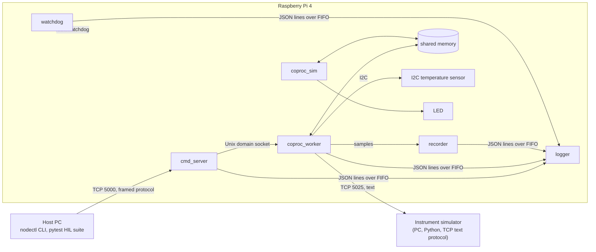

# KryptoC7 Embedded Linux Training Plan

## Table of Contents

1. [About This Programme](#1-about-this-programme)
2. [Before You Start](#2-before-you-start)
3. [How the Programme Runs](#3-how-the-programme-runs)
4. [Schedule at a Glance](#4-schedule-at-a-glance)
5. [Week 1 - Linux for Embedded Developers and the Hardware View of an SoC](#5-week-1---linux-for-embedded-developers-and-the-hardware-view-of-an-soc)
6. [Week 2 - Boot, Cross-Build and Deploy](#6-week-2---boot-cross-build-and-deploy)
7. [Week 3 - Communication and IPC](#7-week-3---communication-and-ipc)
8. [Week 4 - Real-Time on Linux, Debugging, Testing and CI](#8-week-4---real-time-on-linux-debugging-testing-and-ci)
9. [Weeks 5-6 - Mini Project: Sensor Node Gateway](#9-weeks-5-6---mini-project-sensor-node-gateway)

---

## 1. About This Programme

This is a six-week, full-time training programme for engineers joining the KryptoC7 team. It follows the C++ onboarding and runs before you get access to the team's repositories and lab hardware. Everything in it uses an off-the-shelf board and public documentation, so you can start on day one.

The programme covers one thing: **Linux application firmware on an ARM board**. There is no microcontroller or electronics track. Where the real system has a real-time co-processor, you will work against a simulator process, so the Linux-side concepts (shared memory, heartbeats, ring buffers, framed protocols) can still be practised for real.

By the end of the programme you will be able to:

- read an SoC manual and reach hardware from Linux user space (memory-mapped registers, I2C devices, GPIO);
- cross-compile a C++ service in a container, deploy it to a target over SSH, run it under systemd and debug it remotely;
- design and implement a framed binary protocol over TCP, with CRC, timeouts and resynchronisation;
- build a multi-process Linux service that exchanges data with a co-processor through shared memory and survives faults;
- measure latency and jitter on Linux and explain the results;
- test hardware-dependent code on the host with mocks, test the real target with Python, and gate everything with CI.

Weeks 1-4 each teach one module and end with a small assignment that practises the concept. Weeks 5-6 are a mini project in which you build a complete, realistic system from the pieces.

---

## 2. Before You Start

### Prerequisites

- C++ onboarding completed: RAII, smart pointers, `std::thread`, `std::function`, templates basics, GoogleTest.
- C++ for hardware-facing code: fixed-width integer types, bit manipulation, packed and aligned structs, `volatile`, calling C from C++ with `extern "C"`. If the C++ onboarding did not cover these, read up on them before Week 1; they are used from Week 1 onwards.
- Comfortable with a Linux shell, SSH and Git branches and pull requests.
- Basic Python 3: scripts, `argparse`, `socket`, `struct`, `pytest`.

### Kit

| Item | Purpose |
|------|---------|
| Raspberry Pi 4 with SD card, power supply, Ethernet cable | Embedded Linux target (stands in for the ARM Linux side of a controller board) |
| USB-to-UART adapter (3.3 V) | Serial console to the Pi for boot debugging |
| I2C temperature sensor breakout (LM75, TMP102 or BME280) | An on-board device to read over I2C from user space |
| 1 LED with resistor, 1 push button, breadboard, jumper wires | GPIO output and input |

**Wiring note:** the Pi GPIO pins are 3.3 V and not 5 V tolerant. Power the sensor from the Pi's 3.3 V pin, share ground, and never connect or disconnect wires while the Pi is powered. This is the only electronics knowledge the programme requires.

### Host machine

Windows laptop with WSL2 (Ubuntu 22.04 or later) or a Linux VM, Docker, VS Code, `gdb-multiarch`, Python 3.10+, and a GitHub account for your training repository.

---

## 3. How the Programme Runs

**Weekly rhythm**

| Day | Activity |
|-----|----------|
| Monday - Wednesday morning | Lectures, reading and guided labs on the week's topics |
| Wednesday afternoon - Friday noon | Assignment work |
| Friday afternoon | Five-minute demo per person, then pull request review with your mentor |

**Assignments**

- You work individually in your own Git repository, one branch per assignment.
- Each assignment is handed in as a pull request. The PR contains the code and a short `README.md` with: what you built, how to run it, the evidence asked for (screenshots, measurements, logs) and anything that did not work.
- Your mentor reviews the PR for correctness, error handling, readability and the acceptance criteria. Expect at least one round of changes. An assignment is complete when the PR is approved and merged.
- You may carry one assignment into the next week once. After that, scope is cut together with your mentor.

**Mentor review checklist**

- [ ] Acceptance criteria met, with the evidence attached
- [ ] Builds with `-Wall -Wextra -Werror`; no static-analysis warnings
- [ ] Error paths handled: timeouts, disconnects, invalid input
- [ ] No busy-waiting where a blocking call or an event would do
- [ ] Tests exist where the assignment asks for them
- [ ] The README is enough for someone else to run it

---

## 4. Schedule at a Glance

| Week | Module | Assignment | You hand in |
|------|--------|------------|-------------|
| 1 | Linux for embedded developers; the hardware view of an SoC; hardware access from user space | A1 Hardware from user space | `i2c-tool` and `devmem-tool`, with the register explained against the SoC manual |
| 2 | Boot chain, device tree, systemd, watchdog; cross-compilation in Docker; SSH deploy; remote GDB | A2 Cross-built service | A daemon cross-compiled in Docker, deployed by script, running under systemd; a `gdbserver` session |
| 3 | Processes, threads, IPC, shared memory, sockets, protocol design, `boost::asio` | A3 Shared-memory heartbeat | Frame codec with host unit tests; `coproc_sim` and `gateway` processes; status served over TCP |
| 4 | Real-time on Linux; debugging, testing and CI | A4 Measure and test | Jitter histograms, mock-based unit tests, a green CI run |
| 5-6 | Mini project | Sensor Node Gateway | A complete multi-process system with watchdog, HIL tests, CI and a fault demo |

---

## 5. Week 1 - Linux for Embedded Developers and the Hardware View of an SoC

### Days 1-2 - Linux for embedded developers

**Topics**

- Processes and the shell: `ps`, `top`, `/proc/<pid>`, signals, exit codes, `nohup`, job control.
- The file system as the hardware interface: `/dev`, `/sys`, `/proc`, udev, permissions and groups (`gpio`, `i2c`, `dialout`).
- File descriptors: `open`/`read`/`write`/`ioctl`, blocking versus non-blocking I/O, `poll`.
- `strace` to see what a program really does; `dmesg` and `journalctl` to see what the kernel and services say.
- SSH keys, `~/.ssh/config`, `ProxyJump` through a jump host, `scp`/`rsync`, serial console with `picocom`.
- Git for daily work: feature branches, rebase, small commits, pull requests.

### Days 3-5 - The hardware view of an SoC and hardware access from user space

**Topics**

- What is on an SoC: CPU cores, caches, on-chip RAM, DDR controller, buses, peripherals (UART, I2C, SPI, timers, GPIO) and co-processors. How the kernel, the device tree and the datasheet describe the same hardware.
- Reading the SoC peripheral manual: the memory map, a peripheral's register table, bit fields, reserved bits, read-modify-write.
- Physical versus virtual addresses, why user space needs `mmap` to reach a register, what the MMU and caches mean for memory-mapped I/O (`volatile`, ordering).
- `/dev/mem` and `mmap`: reading a peripheral register directly. Why this is a last resort and when it is still used.
- GPIO with `libgpiod`: lines, directions, edge events, debouncing in software.
- I2C with `i2c-dev`: addressing, register reads and writes, `i2cdetect`/`i2cget`/`i2cset`, what a hung bus looks like from software.
- Overview only: UART with `termios`, SPI with `spidev`, PWM via `/sys/class/pwm`.

**References:** *The Linux Programming Interface* (Kerrisk), chapters on file I/O and processes; BCM2711 ARM Peripherals manual; `libgpiod` and `i2c-tools` documentation.

### Assignment A1 - Hardware from user space

**Goal:** reach two kinds of hardware from user space and explain what you touched.

**Tasks** (compile natively on the Pi this week)

1. `i2c-tool`: read the temperature sensor once per second and print the value in degrees Celsius. Use `i2c-dev` directly, not a library. Compare your raw bytes with `i2cget` and show both in the README.
2. `devmem-tool`: map `/dev/mem` and read one peripheral register, for example the system timer counter. Take `--address` on the command line. In the README, show the register's entry in the BCM2711 peripherals manual and explain the value you read.
3. Stretch (optional): `gpio-tool` that lights the LED while the button is held, using `libgpiod` edge events, not polling.

**Done when**

- Both tools print `--help`, return a non-zero exit code on error and close every descriptor and mapping they open.
- Unplugging the sensor produces a clear error message, not a crash or a hang.
- The README explains physical versus virtual addresses in a few sentences.
- Everything compiles with `-Wall -Wextra -Werror`.

**Hand in:** PR with both tools, the README and a terminal capture of each tool running.

---

## 6. Week 2 - Boot, Cross-Build and Deploy

**Topics**

- Boot chain: SoC boot ROM, firmware and bootloader (U-Boot in general, the Pi's firmware in particular), kernel, device tree, init. What runs when, and where it can fail.
- Device tree and overlays: enabling I2C and PWM; reading `/proc/device-tree`.
- systemd: units, dependencies and ordering, `Restart=` policies, environment files, `journalctl -u`. Init scripts as the legacy equivalent and how they differ.
- Hardware watchdog from Linux (`/dev/watchdog`): timeout, reset reasons, and what a service must check before kicking it.
- Root filesystems: read-only root, logs on `tmpfs`, NFS root for development; overview of Buildroot and Yocto.
- Cross-compilation: `aarch64-linux-gnu-gcc`, sysroots, linking against target libraries, why host and target builds must be kept separate.
- A reproducible toolchain in Docker: an image with the cross compiler, Boost and spdlog built for the target.
- Deploying: `scp` through `ProxyJump`, restarting services remotely, a deploy script, versioning the binary with the Git hash.
- Remote debugging with `gdbserver` and a cross GDB; symbol files; debugging optimised code.

**References:** *Mastering Embedded Linux Programming* (Simmonds), chapters on toolchains, bootloaders, init and debugging; `systemd.service(5)`, `systemd.unit(5)`; Raspberry Pi documentation on `config.txt` and device tree overlays.

### Assignment A2 - Cross-built service

**Goal:** take a program from source on your laptop to a supervised service on the target, and debug it there.

**Tasks**

1. Write a `Dockerfile` for a build image with the `aarch64` cross toolchain. Cross-compile `i2c-tool` from A1 as a daemon, `tempd`, that logs the temperature to the journal every second.
2. Write a systemd unit for `tempd` with `Restart=on-failure` and a deploy script that copies the binary over SSH, installs the unit, restarts the service and tails its log.
3. Attach `gdbserver` to the running daemon from your laptop and hit a breakpoint in the I2C read.
4. Stretch (optional): kick `/dev/watchdog` only while sensor reads succeed, and show the Pi rebooting when the sensor is unplugged.

**Done when**

- `./build.sh` and `./deploy.sh` each run with one command from a clean checkout.
- `systemctl status tempd` shows the service running after a reboot.
- `kill -9` on the daemon is followed by an automatic restart, visible in the journal.
- A screenshot of the `gdbserver` session at the breakpoint is in the PR.

**Hand in:** PR with the Dockerfile, build and deploy scripts, the unit file, the daemon source and the README.

---

## 7. Week 3 - Communication and IPC

**Topics**

- Processes versus threads, `fork`/`exec`, signals and graceful shutdown, supervising child processes.
- Threads: `std::thread`, mutexes, condition variables, atomics, thread-safe queues, deadlock and races, ThreadSanitizer.
- Inter-process communication: pipes and named FIFOs, Unix domain sockets, POSIX shared memory with `mmap`; when to pick which.
- A shared-memory ring buffer with sequence numbers for a producer in one process and a consumer in another; memory ordering at the level needed to get it right.
- Sockets: TCP server and client, UDP, `poll`/`epoll`, non-blocking I/O, partial reads.
- Protocol design: start-of-frame, length, command code, payload, CRC-16; sequence numbers; acknowledgement, timeout and retry; resynchronising after a corrupted frame; endianness and struct packing; never trusting a length field.
- Text protocols: Telnet-style line-based command/response, terminators, parsing with timeouts, keeping a connection alive; TCP versus UDP for device communication.
- `boost::asio`: `io_context`, async accept/read/write, timers, strands, one `io_context` per worker as a serialisation tool.
- Time: monotonic versus realtime clocks, `timerfd`, sleeping accurately, measuring latency.
- Multi-process service design: a supervisor, health checks, restart on failure, a central logger with structured (JSON) log lines and rotation.

**References:** *The Linux Programming Interface* (Kerrisk), chapters on IPC, shared memory and sockets; *Beej's Guide to Network Programming*; the Boost.Asio tutorial.

### Assignment A3 - Shared-memory heartbeat

**Goal:** build the two halves of a co-processor interface, a producer in shared memory and a gateway that watches it, and expose the result over a framed TCP protocol.

**Tasks**

1. Write a half-page protocol spec: frame layout with start byte, length, sequence number, command, payload and CRC-16; two commands, `PING` and `GET_STATUS`; one error reply. Implement the frame encoder/decoder and CRC as a small library with no I/O dependencies. Unit test it on the host with GoogleTest: a good frame, a corrupted CRC, and a frame split across two reads.
2. `coproc_sim`: a process that stands in for the real-time co-processor. Every millisecond it increments a heartbeat word and writes a sample with a sequence number into a ring buffer, both in POSIX shared memory. Pausing it with `SIGSTOP` simulates a dead co-processor.
3. `gateway`: a process that maps the same shared memory, detects a stalled heartbeat within 100 ms, counts dropped samples using the sequence numbers, and serves `PING` and `GET_STATUS` (heartbeat age, sample count, dropped count) over a `boost::asio` TCP server using your frame codec. Both processes shut down cleanly on `SIGTERM`.

**Done when**

- Host unit tests pass for the good, corrupted and split-frame cases.
- A Python client on your laptop gets a `GET_STATUS` reply while `coproc_sim` runs at full rate.
- `kill -STOP` on `coproc_sim` is reported in `GET_STATUS` within 100 ms; `kill -CONT` recovers without restarting `gateway`.
- The README contains a diagram of the two processes and the shared-memory layout.
- The host build of `gateway` runs clean under ThreadSanitizer.

**Hand in:** PR with the spec, the codec library and tests, both processes, the Python client and the README.

---

## 8. Week 4 - Real-Time on Linux, Debugging, Testing and CI

### Days 1-2 - Real-time on Linux

**Topics**

- Determinism, latency, jitter and deadlines. Hard versus soft real-time. Why time-critical loops live on a co-processor while Linux does orchestration, and what that means for the Linux side: never block the co-processor, drain buffers before they overflow, watch the heartbeat.
- Linux scheduling: `SCHED_OTHER` versus `SCHED_FIFO`/`SCHED_RR`, priorities, CPU affinity and isolation, `nice`.
- Periodic work done right: `timerfd` and `clock_nanosleep` with absolute deadlines, not `sleep` in a loop.
- Measuring: `cyclictest`, your own jitter histogram, the effect of load (`stress-ng`) and of pinning.
- Overview only: `PREEMPT_RT`, priority inversion and priority inheritance in mutexes.

### Days 3-5 - Debugging, testing and CI

**Topics**

- Debugging on the target: `gdbserver`, core dumps and `coredumpctl`, `strace`, `perf top`, `/proc/<pid>/status` and `smaps` for memory; AddressSanitizer and ThreadSanitizer on the host build.
- Host-based unit testing of hardware-dependent code: interfaces for the I2C device, shared memory and clock; stubs and mocks with GoogleMock; dependency injection.
- Hardware-in-the-loop (HIL) tests: `pytest` suites that drive the real target over TCP and SSH, including restart and fault cases.
- Builds and CI: CMake with toolchain files for the host test build and the cross build; a GitHub Actions pipeline that builds everything, runs host tests and static analysis (`cppcheck`, `clang-tidy`) on every pull request; the deploy script as a pipeline step.
- Robustness checklist: watchdog strategy, timeouts on every blocking call, fail-safe behaviour on error, parameter validation, reset-cause reporting, a flight-recorder buffer dumped on fault.

**References:** Linux Foundation real-time wiki (`cyclictest`, scheduling policies); GoogleTest and GoogleMock documentation; *Professional CMake* (Scott) or the CMake toolchain-file documentation; GitHub Actions documentation.

### Assignment A4 - Measure and test

**Goal:** put numbers on timing behaviour, make hardware-dependent logic testable without hardware, and gate it with CI.

**Tasks**

1. Make the `coproc_sim` loop `timerfd`-driven and pin it to one core. Record a histogram of the interval between iterations under `stress-ng`, once with `SCHED_OTHER` and once with `SCHED_FIFO`. Report both histograms and explain the difference.
2. Put the shared-memory access in `gateway` behind an interface and write GoogleMock unit tests for the heartbeat-timeout and dropped-sample logic that run on the host.
3. Convert the build to CMake with a toolchain file for the cross build and a native configuration for the tests. Add a GitHub Actions workflow that cross-builds `gateway` and `coproc_sim` and runs the host unit tests on every pull request.

**Done when**

- The two histograms, with minimum, maximum and 99th percentile, and a short explanation are in the README.
- The host unit tests run with no hardware attached and cover both the stalled-heartbeat and dropped-sample cases.
- CI is green on the final commit, and a pull request with a deliberately failing test is shown to be blocked.

**Hand in:** PR with the updated processes, tests, CMake files, workflow file and README.

---

## 9. Weeks 5-6 - Mini Project: Sensor Node Gateway

### 9.1 Overview

You will build the Linux-side firmware of a small controller node. A simulated real-time co-processor produces samples at 1 kHz and drives one output. Your gateway exposes the node to a host PC over TCP, records data, logs everything centrally, supervises the health of the system with a hardware watchdog, and recovers from faults without human intervention. The scope is modest; the quality bar is what matters: timeouts everywhere, clean shutdowns, tests as proof, and a README that lets someone else run it.

The assignments gave you the building blocks: hardware access (A1), cross-build and deploy (A2), the frame codec and the shared-memory simulator (A3), tests and CI (A4). The mini project turns them into the multi-process layout, fault handling and test coverage that real controller firmware has.

You work individually. Your mentor acts as the customer and reviews the design before you build.

### 9.2 System Components

| Component | Runs on | Responsibility |
|-----------|---------|----------------|
| `coproc_sim` | Pi | Stands in for the real-time co-processor. 1 kHz `SCHED_FIFO` loop: heartbeat, sample ring buffer, command/status handshake, drives the LED. |
| `cmd_server` | Pi | Accepts host connections on TCP 5000, decodes frames, dispatches commands, replies. |
| `coproc_worker` | Pi | Owns the shared-memory interface, the I2C sensor and the instrument connection. Detects faults. Keeps the flight recorder. |
| `recorder` | Pi | Writes samples and telemetry to rotating CSV files. |
| `logger` | Pi | Collects JSON log lines from all processes over a named FIFO and writes rotating log files with spdlog. |
| `watchdog` | Pi | Checks the health of every process and the co-processor and kicks `/dev/watchdog` only when everything is healthy. |
| Instrument simulator | PC | Python TCP server speaking a Telnet-style text protocol (`*IDN?`, `MEAS?`). Provided as a starting point; you may extend it. |
| `nodectl` | PC | Python command-line client for the host protocol. |
| HIL suite | PC | `pytest` suite that drives the real Pi over TCP and SSH. |

### 9.3 Interfaces

**Host protocol** (TCP port 5000, binary, little-endian)

| Field | Size | Notes |
|-------|------|-------|
| SOF | 1 | `0xA5` |
| LEN | 2 | Length of CMD + PAYLOAD |
| SEQ | 1 | Echoed in the reply |
| CMD | 1 | Command code; replies set bit 7 |
| PAYLOAD | LEN - 1 | Command specific |
| CRC16 | 2 | CRC-16/CCITT over LEN, SEQ, CMD and PAYLOAD |

| Command | Code | Request payload | Reply payload |
|---------|------|-----------------|---------------|
| `PING` | `0x01` | none | firmware version string |
| `GET_STATUS` | `0x02` | none | see [FR-7](#94-functional-requirements) |
| `GET_SAMPLES` | `0x03` | `count` (u16, max 512) | `count` samples of `{seq u32, timestamp_ns u64, value i32}` |
| `SET_OUTPUT` | `0x04` | `value` (u8, 0-100) | status byte |
| Error reply | `0xFF` | - | error code (u8): `BAD_CRC`, `UNKNOWN_CMD`, `BAD_PAYLOAD`, `COPROC_TIMEOUT`, `COPROC_DEAD`, `BUSY` |

**Shared memory** (`/dev/shm/coproc`, one segment, layout documented in your README)

- Header: magic, layout version, `heartbeat` (u32, +1 per millisecond), `status` (u32 bit field: output value, safe-state flag, fault flag), `command` (u32), `command_seq` (u32, incremented by the gateway), `command_ack_seq` (u32, set by the co-processor when executed), ring `head` index.
- Ring buffer: 4096 entries of `{seq u32, timestamp_ns u64, value i32}`; the co-processor writes one entry per millisecond and never blocks.

**Instrument protocol** (TCP port 5025, text, `\n` terminated)

- `*IDN?` returns an identification string; `MEAS?` returns one floating-point value. The simulator can be stopped and started at will and has a `--stall` option that accepts connections but never answers.

**Logging**

- Every process writes one JSON object per line to the named FIFO `/run/node/log.fifo`: `ts`, `level`, `proc`, `msg`, plus any key-value context. The log level is set by an environment file read by systemd.

### 9.4 Functional Requirements

| ID | Requirement |
|----|-------------|
| FR-1 | `cmd_server` implements all commands in 9.3 and serves at least two host connections at the same time. A corrupted frame is discarded with an error reply and the stream is resynchronised on the next SOF. An unknown command or bad payload gets the matching error reply; the connection stays open. |
| FR-2 | Commands that do not depend on each other may run in parallel. Commands that write to the co-processor are executed one at a time, in arrival order. |
| FR-3 | `coproc_worker` executes `SET_OUTPUT` through the shared-memory command/ack handshake. If the co-processor has not acknowledged within 50 ms the host receives `COPROC_TIMEOUT`. |
| FR-4 | `coproc_worker` detects a stalled heartbeat within 100 ms, raises a fault, and reports `COPROC_DEAD` to any command that needs the co-processor until the heartbeat resumes. Recovery is automatic and does not restart any process. |
| FR-5 | `coproc_worker` drains the ring buffer with no dropped samples while the system is healthy, and counts dropped samples using the sequence numbers when it is not. |
| FR-6 | `coproc_worker` reads the I2C temperature sensor once per second and polls the instrument with `MEAS?` once per second with a 500 ms timeout. A failure of either is flagged within one second and never blocks command handling or sample draining. The instrument connection reconnects automatically with backoff. |
| FR-7 | `GET_STATUS` returns: heartbeat age (ms), sample rate (Hz), dropped samples (total), current output value, safe-state flag, sensor OK flag, instrument OK flag, uptime (s), and the last fault code with its timestamp. |
| FR-8 | `coproc_sim` returns the output to its safe value (LED off) and sets the safe-state flag if it has not received a command or keep-alive from the gateway for 5 seconds. |
| FR-9 | `recorder` appends one CSV line per sample (timestamp, seq, value) and one line per second of telemetry (temperature, instrument value, status) to files that rotate every minute. Gaps in the sequence are logged. Files are flushed and closed on `SIGTERM`. |
| FR-10 | All processes log through `logger` as described in 9.3. `logger` keeps at most five files of 10 MB each. Each fault is logged exactly once, with context, when it occurs and once when it clears. |
| FR-11 | `watchdog` kicks `/dev/watchdog` (15 s timeout) only while every gateway process is alive, the co-processor heartbeat is alive and the sensor is OK. Otherwise it stops kicking and the Pi reboots. The watchdog can be disabled through the environment file for development. |
| FR-12 | `coproc_worker` keeps the last 5 seconds of samples and status words in memory and dumps them to a timestamped file when a fault is raised. |
| FR-13 | All processes are systemd services, started in dependency order (`logger`, `coproc_sim`, `coproc_worker`, `recorder`, `cmd_server`, `watchdog`) with `Restart=on-failure`, and shut down cleanly on `SIGTERM` within 2 seconds. After a cold boot the node answers `GET_STATUS` within 30 seconds with no manual steps. |

### 9.5 Non-Functional Requirements

| ID | Requirement |
|----|-------------|
| NFR-1 | CMake build with a toolchain file. One command builds the cross image, one command cross-builds all binaries, one command builds and runs the host tests. |
| NFR-2 | One command deploys to the Pi: copies binaries, installs units and the environment file, restarts services, tails the log. `PING` returns the Git hash the binaries were built from. |
| NFR-3 | Host unit tests with GoogleTest/GoogleMock cover at least: frame codec (good, corrupted, split, oversize), heartbeat stall detection, dropped-sample counting, command/ack handshake including timeout, and `GET_STATUS` encoding. |
| NFR-4 | A `pytest` HIL suite runs against the real Pi over TCP and SSH and covers every command plus the acceptance tests in 9.6. It passes on the final commit. |
| NFR-5 | GitHub Actions on every pull request: cross-build, host tests, `cppcheck`; artifacts published. The pipeline is green on the final commit. |
| NFR-6 | `-Wall -Wextra -Werror`; the host build runs clean under AddressSanitizer and ThreadSanitizer; no busy-wait loops; every blocking call has a timeout. |
| NFR-7 | `PING` round trip from the PC under 20 ms at the 99th percentile while sampling runs; `GET_SAMPLES` with 512 samples under 100 ms. |
| NFR-8 | README with: architecture diagram, protocol specification, shared-memory layout, build/deploy/run instructions, the demo script, and known limitations. |

### 9.6 Acceptance Tests and Demo

Each test is also a case in the HIL suite. The final demo runs them live.

| ID | Scenario | Expected result |
|----|----------|-----------------|
| AT-1 | Cold boot the Pi. | All services start in order; `GET_STATUS` answers within 30 s with all health flags OK. |
| AT-2 | `nodectl set-output 60`. | LED brightness changes within 100 ms; `GET_STATUS` shows output 60 and safe-state off. |
| AT-3 | `nodectl record --seconds 30`, then plot the CSV. | A continuous 1 kHz sample stream with no sequence gaps and 30 telemetry lines. |
| AT-4 | Send a frame with a wrong CRC, then a valid `PING`. | Error reply `BAD_CRC`, then a normal `PING` reply on the same connection. |
| AT-5 | Stop the instrument simulator for 10 s, then restart it. | Instrument flag goes false within 1 s, one fault logged; flag returns true after restart with no manual action; command handling unaffected throughout. |
| AT-6 | `kill -9 coproc_worker`. | systemd restarts it within 2 s; `recorder` logs the gap; a client command during the outage gets a clear error, not a hang. |
| AT-7 | `kill -STOP coproc_sim` for 3 s, then `kill -CONT`. | `COPROC_DEAD` reported within 100 ms; flight-recorder file written; recovery is automatic; dropped-sample count increases and then stays constant. |
| AT-8 | Stop `coproc_sim` for 20 s with the watchdog enabled. | LED goes to safe state after 5 s; the Pi reboots after the watchdog timeout; AT-1 passes again after the reboot. |
| AT-9 | `nodectl stress --rate 200` for 60 s. | No errors, no dropped samples, `PING` latency within NFR-7. |
| AT-10 | `systemctl stop` of each service in turn. | Each stops within 2 s; CSV and log files are intact and complete. |

### 9.7 Milestones

| When | Milestone | Review |
|------|-----------|--------|
| Week 5, Tuesday | Design review: architecture diagram, process list, shared-memory layout, protocol spec, unit and HIL test plan | Mentor approves before implementation continues |
| Week 5, Friday | Vertical slice: `cmd_server` -> `coproc_worker` -> `coproc_sim` end to end for `PING`, `GET_STATUS` and `SET_OUTPUT`; `logger` in place; everything deployed by script and running under systemd | Demo AT-1, AT-2, AT-4 |
| Week 6, Wednesday | Feature complete: `recorder`, sensor and instrument polling, `watchdog`, flight recorder, HIL suite, CI green | Demo AT-3, AT-5, AT-6, AT-7 |
| Week 6, Friday | Final demo and code walkthrough | All acceptance tests live, including AT-8 |

### 9.8 Deliverables and Evaluation

**Deliverables**

- One Git repository containing all Pi processes, the PC tooling, the HIL suite, the build and deploy scripts, the CI workflow and the README.
- A 15-minute demo to the team following the acceptance tests, followed by a 15-minute code walkthrough.

**Evaluation**

| Area | Weight | What is assessed |
|------|--------|------------------|
| Functionality | 40 % | Acceptance tests AT-1 to AT-10 passing live |
| Robustness | 20 % | Timeouts, error paths, clean shutdown, behaviour under faults and load |
| Tests and CI | 20 % | Unit and HIL coverage of the requirements; CI gating; tests as the proof |
| Code quality | 10 % | Readability, structure, interfaces that allow host testing, warnings-clean |
| Documentation and demo | 10 % | README completeness, protocol and layout accuracy, clarity of the walkthrough |

A pass requires all of AT-1 to AT-7 passing and CI green on the final commit. AT-8 to AT-10 and the remaining criteria determine the grade.
