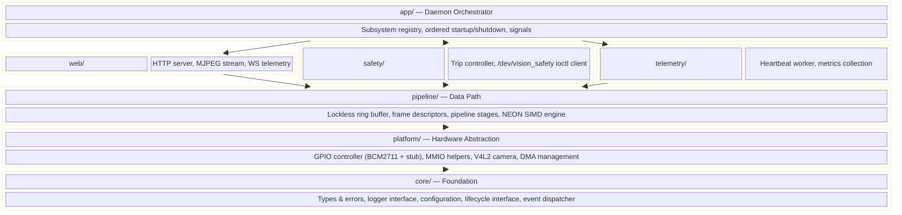
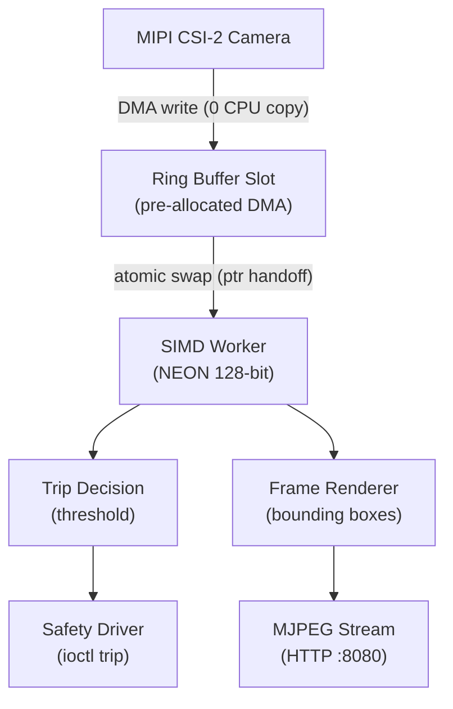
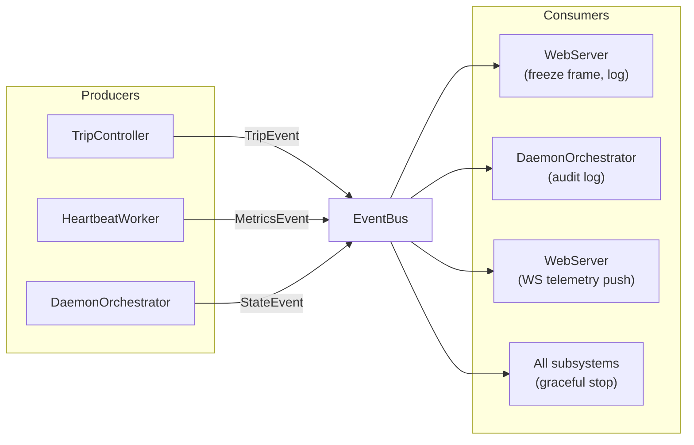
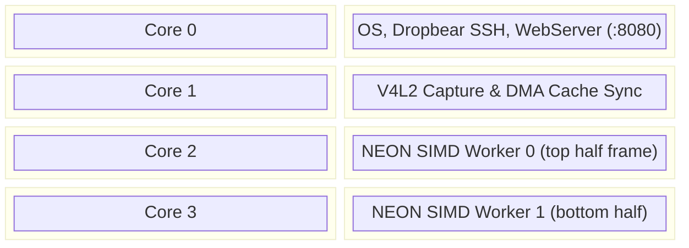

# VisionEdge Software Architecture

> **Project:** VisionEdge Industrial In-Line Inspection & Safety Gateway  
> **Target:** Raspberry Pi 4 (BCM2711 / Quad-Core Cortex-A72 / AArch64)  
> **Language:** C++20 (with `std::expected` polyfill for GCC 11)  
> **Scope:** Daemon architecture spanning Phases 1–5

---

## 1. Architecture Overview

The system is organized into **seven modules** arranged in strict dependency layers. Upper layers depend on lower layers; lower layers never depend on upper layers.



### Dependency Rules

1. **Downward only:** A module may depend on any module below it, never above.
2. **No circular dependencies:** If `pipeline/` uses `core/`, then `core/` must never include anything from `pipeline/`.
3. **`core/` depends on nothing** (except the C++ standard library and POSIX).
4. **`app/` depends on everything** — it is the composition root where all subsystems are wired together.

---

## 2. Design Principles

| Principle | How It's Applied |
|---|---|
| **Dependency Injection** | Every component receives its dependencies (logger, config, hardware interfaces) via constructor. No singletons, no global state. The `app/` layer is the sole composition root. |
| **Interface-Based Hardware Access** | All hardware (GPIO, camera, safety driver, metrics source) is accessed through abstract interfaces. Real implementations target BCM2711; stub/synthetic implementations enable x86 host testing. |
| **Zero-Copy Hot Path** | Video frames (1080p @ 60fps = ~180 MB/s) flow through the system via pointer handoff in a lockless ring buffer. No `memcpy` on the data path. |
| **Event Dispatcher for Control** | Infrequent control events (safety trips, state changes, telemetry) use a typed pub/sub `EventBus`. This decouples producers from consumers without the overhead of a message broker. |
| **Uniform Subsystem Lifecycle** | Every major component implements `ISubsystem` (`init`/`start`/`stop`/`name`/`state`). The orchestrator manages N subsystems generically. |
| **Explicit Error Propagation** | All fallible operations return `expected<T, Error>`. No exceptions on real-time paths. A polyfill provides C++23 semantics on GCC 11. |
| **Conditional Compilation** | ARM-only code (NEON intrinsics, `/dev/mem` MMIO, V4L2) is isolated in dedicated source files and swapped at build time via `ARCH` detection. |

---

## 3. Module Decomposition

### 3.1 `core/` — Foundation

The bottom layer. Zero hardware dependencies. Provides the vocabulary types and contracts used by every other module.

| Component | Responsibility |
|---|---|
| `types.hpp` | `Error` type (error code + context string), `expected<T,Error>` polyfill alias, common type aliases |
| `logger.hpp` | `ILogger` abstract interface (`log`, `set_level`). Concrete implementations: `ConsoleLogger` (ANSI color to stdout), `FileLogger` (plaintext to file), `NullLogger` (for tests) |
| `config.hpp` | `DaemonConfig` struct with layered resolution: compiled defaults → config file (`/etc/visiond.conf`) → CLI args |
| `lifecycle.hpp` | `ISubsystem` interface: `init()`, `start()`, `stop()`, `name()`, `state()` |
| `event.hpp` | Lightweight typed event dispatcher: `EventBus::publish<T>(event)`, `EventBus::subscribe<T>(callback)` |

**`expected<T, Error>` polyfill strategy:**

The Docker toolchain (Ubuntu 22.04) ships GCC 11, which does not support C++23 `std::expected`. A minimal polyfill in `types.hpp` provides the same API:

```cpp
// core/types.hpp
#if __cpp_lib_expected >= 202211L
    #include <expected>
    template <typename T, typename E>
    using expected = std::expected<T, E>;
    using std::unexpected;
#else
    // Minimal polyfill: discriminated union with value()/error()/has_value()
    // ~80 lines, supports move semantics, constexpr where possible
    template <typename T, typename E>
    class expected { /* ... */ };

    template <typename E>
    class unexpected { /* ... */ };
#endif
```

When the toolchain is upgraded to GCC 12+ or Clang 16+, the polyfill becomes a transparent pass-through.

### 3.2 `platform/` — Hardware Abstraction Layer

Abstracts all hardware interactions behind interfaces. Each interface has at least two implementations: a real hardware backend and a host-side stub for x86 testing.

| Component | Interface | Real Implementation | Stub/Mock |
|---|---|---|---|
| `gpio.hpp` | `IGpioController` | `Bcm2711GpioController` (MMIO via `/dev/mem` or kernel driver) | `StubGpioController` (logs calls, no hardware) |
| `mmio.hpp` | (helper) | `MmioRegion` — RAII wrapper for `mmap`/`munmap` of physical addresses | N/A (not used on host) |
| `camera.hpp` | `ICameraSource` | `V4l2CameraSource` (real V4L2 `/dev/video0`) | `SyntheticCameraSource` (generates test patterns) |
| `dma.hpp` | (helper) | `DmaBufHandle` — RAII wrapper for `dma-buf` file descriptors, cache sync ops | N/A |

The GPIO interface intentionally covers both Phase 2 (`/dev/mem` MMIO) and Phase 3 (kernel driver ioctl). When the kernel platform driver replaces `/dev/mem`, only the `IGpioController` implementation swaps — all consumers remain unchanged.

### 3.3 `pipeline/` — Data Path

The performance-critical module. Handles video frame flow from capture to processing with **zero copies on the hot path**.

| Component | Responsibility |
|---|---|
| `frame.hpp` | `FrameDescriptor` struct: pointer to pixel data, width, height, stride, pixel format, timestamp, DMA fd, sequence number. Lightweight metadata (~64 bytes) — no ownership of pixel buffers. |
| `ring_buffer.hpp` | `LocklessTripleBuffer<T>` — atomic index-swap triple buffer for single-producer / single-consumer frame exchange. No mutexes, no allocations on the hot path. |
| `stage.hpp` | `IPipelineStage` interface: `process(FrameDescriptor&) → expected<void, Error>`. Stages are composable: `CaptureStage → DiffStage → ThresholdStage → RenderStage`. |
| `simd_engine.hpp` | `ISIMDEngine` interface with `pixel_diff_threshold()`. Two implementations: `NeonSIMDEngine` (ARM NEON 128-bit intrinsics, processes 16 pixels/cycle) and `ScalarSIMDEngine` (portable C++ fallback). |

**Why a lockless ring buffer instead of an event bus for frames:**
The camera DMA writes directly into a pre-allocated ring buffer slot. The ring buffer swaps an atomic index to "publish" the frame. The SIMD stage reads the frame in-place via pointer. The only thing that moves is a `FrameDescriptor` (~64 bytes of metadata). Copying 2M-pixel frame buffers through any intermediary would saturate the memory bus.

### 3.4 `safety/` — Safety Subsystem

Encapsulates the safety interlock logic, including the kernel driver interface.

| Component | Responsibility |
|---|---|
| `driver_client.hpp` | `ISafetyDriver` interface: `arm()`, `disarm()`, `trip()`, `poll_event()`, `status()`. Real implementation uses `ioctl()` on `/dev/vision_safety`. Test implementation simulates trip events. |
| `trip_controller.hpp` | `TripController` — consumes SIMD anomaly counts, applies threshold policy, and invokes `ISafetyDriver::trip()` when an optical boundary breach is detected. Decoupled from the SIMD engine and the driver. |

### 3.5 `telemetry/` — Metrics & Monitoring

System health collection, separated from formatting and presentation.

| Component | Responsibility |
|---|---|
| `metrics.hpp` | `SystemMetrics` struct (CPU%, memory, uptime, temperatures) and `IMetricsSource` interface: `sample() → SystemMetrics`. Real implementation parses `/proc/stat`, `/proc/meminfo`, `/proc/uptime`. Test implementation returns synthetic data. |
| `heartbeat.hpp` | `HeartbeatWorker` — a periodic `ISubsystem` that calls `IMetricsSource::sample()` and publishes results via `EventBus`. Responsible only for scheduling; not for parsing or formatting. |

### 3.6 `web/` — Embedded Web Server (Phase 5)

Lightweight HTTP + WebSocket server embedded directly in `visiond`.

| Component | Responsibility |
|---|---|
| `server.hpp` | `WebServer` — `ISubsystem` implementation using mongoose v7.14. Binds to configurable port (default `:8080`). Routes: `/` (JSON API descriptor), `/stream.mjpg` (MJPEG), `/ws/telemetry` (WebSocket). Dashboard is a standalone HTML file (`web/dashboard.html`) connected via CORS. |
| `stream.hpp` | `MjpegStream` — subscribes to pipeline frame events, JPEG-encodes processed frames, pushes multipart boundaries to HTTP clients. `WsTelemetry` — subscribes to heartbeat and safety events, broadcasts JSON over WebSocket. |

### 3.7 `app/` — Daemon Orchestrator

The composition root. This is the only module that knows about all other modules. It wires dependencies together and manages the daemon lifecycle.

| Component | Responsibility |
|---|---|
| `daemon.hpp/cpp` | `DaemonOrchestrator` — owns all `ISubsystem` instances. Provides: subsystem registration, dependency-ordered `init()` → `start()`, reverse-ordered `stop()`, POSIX signal handling, and graceful shutdown. |

`main.cpp` is minimal — it parses config, constructs the composition root, and runs:

```cpp
int main(int argc, char* argv[]) {
    auto config = visiond::DaemonConfig::parse(argc, argv);
    if (config.show_help) { /* ... */ return 0; }

    visiond::ConsoleLogger logger;
    logger.set_level(config.log_level);

    visiond::DaemonOrchestrator daemon(logger, config);

    // Register subsystems (order matters for init/start)
    daemon.add<visiond::HeartbeatWorker>(/* injected deps */);
    // Phase 2+: daemon.add<visiond::GpioSubsystem>(...);
    // Phase 3+: daemon.add<visiond::SafetySubsystem>(...);
    // Phase 4+: daemon.add<visiond::CaptureSubsystem>(...);
    // Phase 5+: daemon.add<visiond::WebServer>(...);

    return daemon.run();  // init → start → wait for signal → stop
}
```

---

## 4. Data Flow

### 4.1 Hot Path: Video Frame Pipeline (Zero-Copy)



**Key invariant:** No `memcpy` or `std::copy` on any frame buffer in the hot path. Frames are accessed in-place via pointer from `FrameDescriptor`. Cache coherency is managed explicitly via `DMA_BUF_IOCTL_SYNC` before CPU reads.

### 4.2 Control Path: Event Dispatcher

For infrequent, latency-tolerant events (safety trips, state transitions, telemetry updates), a lightweight typed event dispatcher decouples producers from consumers:



The `EventBus` is a simple `std::unordered_map<type_index, vector<function>>` with mutex protection. It is used only for control events (tens of events per second), never for frame data.

---

## 5. Key Interface Signatures

### 5.1 `ISubsystem` — Subsystem Lifecycle

```cpp
namespace visiond {

enum class SubsystemState { CREATED, INITIALIZED, RUNNING, STOPPED, FAILED };

class ISubsystem {
public:
    virtual ~ISubsystem() = default;

    virtual expected<void, Error> init()  = 0;  // Allocate resources, validate config
    virtual expected<void, Error> start() = 0;  // Begin operation (launch threads, open devices)
    virtual void                  stop()  = 0;  // Cease operation, join threads, release resources

    virtual std::string_view  name()  const = 0;
    virtual SubsystemState    state() const = 0;
};

} // namespace visiond
```

### 5.2 `ILogger` — Logging Contract

```cpp
namespace visiond {

enum class LogLevel { DEBUG, INFO, WARN, ERROR };

class ILogger {
public:
    virtual ~ILogger() = default;
    virtual void log(LogLevel level, std::string_view msg) = 0;
    virtual void set_level(LogLevel level) = 0;
};

} // namespace visiond
```

### 5.3 `IGpioController` — GPIO Hardware Abstraction

```cpp
namespace visiond {

enum class PinMode   { INPUT, OUTPUT };
enum class PinLevel  { LOW, HIGH };
enum class PullMode  { NONE, UP, DOWN };

class IGpioController {
public:
    virtual ~IGpioController() = default;
    virtual expected<void, Error> init()                               = 0;
    virtual expected<void, Error> set_mode(uint8_t pin, PinMode mode)  = 0;
    virtual expected<void, Error> set_pull(uint8_t pin, PullMode pull) = 0;
    virtual expected<void, Error> write(uint8_t pin, PinLevel level)   = 0;
    virtual expected<PinLevel, Error> read(uint8_t pin)                = 0;
};

} // namespace visiond
```

### 5.4 `ICameraSource` — Video Capture Abstraction

```cpp
namespace visiond {

struct CameraConfig {
    uint32_t    width{1920};
    uint32_t    height{1080};
    uint32_t    fps{30};
    PixelFormat format{PixelFormat::YUYV};
    uint32_t    buffer_count{4};
};

class ICameraSource {
public:
    virtual ~ICameraSource() = default;
    virtual expected<void, Error>            open(const CameraConfig& cfg) = 0;
    virtual expected<void, Error>            start_streaming()             = 0;
    virtual expected<FrameDescriptor, Error> dequeue_frame()               = 0;
    virtual void                             return_frame(uint32_t index)  = 0;
    virtual void                             stop_streaming()              = 0;
};

} // namespace visiond
```

### 5.5 `IMetricsSource` — Telemetry Abstraction

```cpp
namespace visiond {

struct SystemMetrics {
    float    cpu_usage_percent{0.0f};
    double   uptime_seconds{0.0};
    uint64_t mem_total_kb{0};
    uint64_t mem_free_kb{0};
    uint64_t mem_available_kb{0};
};

class IMetricsSource {
public:
    virtual ~IMetricsSource() = default;
    virtual SystemMetrics sample() = 0;
};

} // namespace visiond
```

### 5.6 `ISafetyDriver` — Safety Interlock Abstraction

```cpp
namespace visiond {

struct SafetyStatus {
    bool     armed{false};
    bool     tripped{false};
    uint64_t trip_timestamp_ns{0};
    uint32_t trip_count{0};
};

class ISafetyDriver {
public:
    virtual ~ISafetyDriver() = default;
    virtual expected<void, Error>         arm()        = 0;
    virtual expected<void, Error>         disarm()     = 0;
    virtual expected<void, Error>         trip()       = 0;
    virtual expected<bool, Error>         poll_event(int timeout_ms) = 0;
    virtual expected<SafetyStatus, Error> status()     = 0;
};

} // namespace visiond
```

### 5.7 `IPipelineStage` — Composable Processing

```cpp
namespace visiond {

class IPipelineStage {
public:
    virtual ~IPipelineStage() = default;
    virtual std::string_view          name() const                  = 0;
    virtual expected<void, Error>     process(FrameDescriptor& fd)  = 0;
};

} // namespace visiond
```

Stages are chained: `CaptureStage → DiffStage → ThresholdStage → RenderStage`. Each reads/writes the `FrameDescriptor` in-place (zero-copy).

### 5.8 `ISIMDEngine` — Vectorized Compute Abstraction

```cpp
namespace visiond {

class ISIMDEngine {
public:
    virtual ~ISIMDEngine() = default;
    virtual std::string_view name() const = 0;

    // Returns count of anomalous pixels exceeding threshold
    virtual uint32_t pixel_diff_threshold(const uint8_t* current_frame,
                                          const uint8_t* baseline_frame,
                                          size_t num_pixels,
                                          uint8_t threshold) = 0;
};

} // namespace visiond
```

Two implementations:
- `NeonSIMDEngine` — ARM NEON 128-bit intrinsics, processes 64 pixels per unrolled loop (4 × 16-byte vector registers). Target: 1.2 ms/frame at 1080p.
- `ScalarSIMDEngine` — Portable C++ loop. Used for host-side development and correctness verification.

---

## 6. Directory Structure

```
projects/vision-edge/
├── Makefile                              # Recursive src/ discovery, ARCH-conditional compilation
├── .clangd
├── README.md
├── docs/
│   ├── user_guide.md                     # Build, deploy, and operate visiond
│   ├── design/
│   │   └── architecture.md               # This document
│   └── phases/                           # Step-by-step implementation guides
│
├── include/visiond/
│   ├── core/
│   │   ├── types.hpp                     # Error, expected<T,E> polyfill, aliases
│   │   ├── logger.hpp                    # ILogger interface
│   │   ├── config.hpp                    # DaemonConfig (defaults → file → CLI)
│   │   ├── lifecycle.hpp                 # ISubsystem, SubsystemState
│   │   ├── event.hpp                     # EventBus (typed pub/sub)
│   │   └── events.hpp                    # MetricsEvent, FrameEvent, TripEvent
│   │
│   ├── platform/
│   │   ├── gpio.hpp                      # IGpioController, PinMode, PinLevel
│   │   ├── mmio.hpp                      # MmioRegion RAII helper
│   │   ├── camera.hpp                    # ICameraSource
│   │   ├── camera_types.hpp              # CameraConfig (extracted model)
│   │   └── dma.hpp                       # DmaBufHandle, cache sync helpers
│   │
│   ├── pipeline/
│   │   ├── frame.hpp                     # FrameDescriptor (metadata + ptr)
│   │   ├── ring_buffer.hpp               # LocklessTripleBuffer<T>
│   │   ├── stage.hpp                     # IPipelineStage interface
│   │   └── simd_engine.hpp               # ISIMDEngine interface
│   │
│   ├── safety/
│   │   ├── driver_client.hpp             # ISafetyDriver
│   │   ├── types.hpp                     # SafetyStatus, TripPolicy (extracted models)
│   │   └── trip_controller.hpp           # TripController policy
│   │
│   ├── telemetry/
│   │   ├── metrics.hpp                   # IMetricsSource, SystemMetrics
│   │   └── heartbeat.hpp                 # HeartbeatWorker (ISubsystem)
│   │
│   └── web/
│       ├── server.hpp                    # WebServer (ISubsystem)
│       ├── stream.hpp                    # MjpegStream, WsTelemetry classes
│       ├── jpeg.hpp                      # JPEG encoding utility
│       └── shared_state.hpp              # Thread-safe bridge (EventBus ↔ mongoose)
│
├── src/
│   ├── main.cpp                          # Minimal: parse config, build orchestrator, run
│   │
│   ├── app/
│   │   └── daemon.cpp                    # DaemonOrchestrator implementation
│   │
│   ├── core/
│   │   ├── logger.cpp                    # ConsoleLogger, FileLogger
│   │   ├── config.cpp                    # CLI parsing + config file loading
│   │   └── event.cpp                     # EventBus implementation
│   │
│   ├── platform/
│   │   ├── gpio_bcm2711.cpp              # Bcm2711GpioController (real MMIO)
│   │   ├── gpio_stub.cpp                 # StubGpioController (host testing)
│   │   ├── camera_v4l2.cpp               # V4l2CameraSource
│   │   └── camera_synthetic.cpp          # SyntheticCameraSource (test patterns)
│   │
│   ├── pipeline/
│   │   ├── simd_neon.cpp                 # NeonSIMDEngine (ARM NEON intrinsics)
│   │   └── simd_scalar.cpp               # ScalarSIMDEngine (portable fallback)
│   │
│   ├── safety/
│   │   ├── driver_client.cpp             # Real ioctl on /dev/vision_safety
│   │   └── trip_controller.cpp           # Threshold policy engine
│   │
│   ├── telemetry/
│   │   ├── metrics_procfs.cpp            # ProcfsMetricsSource (/proc parsing)
│   │   └── heartbeat.cpp                 # HeartbeatWorker (periodic sampler)
│   │
│   └── web/
│       ├── server.cpp                    # WebServer subsystem + mongoose routing
│       ├── stream.cpp                    # MjpegStream (frame → JPEG → SharedState)
│       ├── telemetry.cpp                 # WsTelemetry (metrics/trip → JSON → SharedState)
│       ├── jpeg.cpp                      # JPEG encoding (stb_image_write wrapper)
│       ├── vendor_mongoose.c             # Compiles mongoose v7.14 from vendor/
│       └── vendor_stb.cpp               # Compiles stb_image_write from vendor/
│
├── kernel/                               # Phase 3 — out-of-tree kernel module
│   ├── vision_safety.c                   # Platform driver source
│   ├── Makefile                          # Kernel module kbuild
│   ├── include/
│   │   └── uapi/
│   │       └── vision_safety_uapi.h      # Shared ioctl definitions (kernel + userspace)
│   └── dts/
│       └── bcm2711-visionedge-overlay.dts
│
├── tests/
│   ├── unit/                             # Host-compilable unit tests
│   │   ├── test_config.cpp
│   │   ├── test_ring_buffer.cpp
│   │   ├── test_trip_controller.cpp
│   │   └── test_event_bus.cpp
│   └── integration/                      # On-target integration tests
│       └── test_gpio_toggle.cpp
│
└── docs/phases/                          # Step-by-step implementation guides
    ├── README.md
    ├── phase1_daemon_bringup.md
    ├── phase2_cpu_memory_mmio.md
    ├── phase3_kernel_safety_driver.md
    ├── phase4_video_dma_neon.md
    └── phase5_productization.md
```

---

## 7. Multi-Core SMP Pinning Strategy

The Cortex-A72 has 4 cores. Each major workload is pinned to a dedicated core via `pthread_setaffinity_np` to eliminate scheduling jitter on the real-time path:



Core pinning is configured via `DaemonConfig` and applied by the `DaemonOrchestrator` during `start()`. The SIMD frame is partitioned vertically (top/bottom halves) so two workers process in parallel without contention.

---

## 8. Phase-to-Module Mapping

Each phase incrementally activates modules. Nothing is thrown away — each phase builds on the previous.

| Phase | Modules Built | Key Interfaces Introduced | Deliverable |
|---|---|---|---|
| **Phase 1** | `core/*`, `telemetry/*`, `app/` | `ISubsystem`, `ILogger`, `IMetricsSource`, `EventBus` | Daemon boots, heartbeat runs, clean shutdown |
| **Phase 2** | `platform/gpio*`, `platform/mmio`, `pipeline/ring_buffer`, `pipeline/frame` | `IGpioController`, `LocklessTripleBuffer`, `FrameDescriptor` | GPIO toggle via MMIO, lockless buffer passes data between threads |
| **Phase 3** | `safety/*`, `kernel/*` | `ISafetyDriver`, `TripController` | `/dev/vision_safety` ioctl, <10µs IRQ trip, DT overlay |
| **Phase 4** | `platform/camera*`, `platform/dma`, `pipeline/simd*`, `pipeline/stage` | `ICameraSource`, `IPipelineStage`, `ISIMDEngine` | V4L2 zero-copy capture, NEON 15x acceleration, SMP pinning |
| **Phase 5** | `web/*`, buildroot configs | `WebServer`, `MjpegStream`, `WsTelemetry` | Live dashboard at :8080, <2.5s cold boot, SquashFS + OverlayFS |

### Phase Transition Points

- **Phase 1 → 2:** `DaemonOrchestrator` gains a GPIO subsystem. `main.cpp` adds one `daemon.add<>(...)` call. Zero changes to `core/` or `telemetry/`.
- **Phase 2 → 3:** The `IGpioController` implementation swaps from `/dev/mem` MMIO to kernel driver ioctl. All consumers (safety, pipeline) are unaffected.
- **Phase 3 → 4:** Pipeline stages are composed and registered. The lockless ring buffer (Phase 2) now carries real camera frames instead of synthetic data.
- **Phase 4 → 5:** `WebServer` subscribes to `EventBus` for metrics and frame events. No changes to pipeline or safety modules.

---

## 9. Toolchain Constraints

| Constraint | Impact | Mitigation |
|---|---|---|
| Docker base: Ubuntu 22.04 | GCC 11 for `aarch64-linux-gnu-g++` | `expected<T,E>` polyfill in `core/types.hpp` |
| C++20 mode (`-std=c++20`) | No C++23 features (`expected`, ranges views) | Polyfill for `expected`; avoid `std::ranges` in hot paths |
| ARM NEON intrinsics (`arm_neon.h`) | Cannot compile on x86 host | Conditional compilation: `#ifdef __aarch64__` selects NEON; else scalar |
| Static linking (`-static`) | No dynamic library loading | All code compiled into a single binary; kernel module is separate |
| Kernel module (Phase 3) | Requires kernel headers matching the running kernel | Out-of-tree build with `KDIR` pointing to kernel source in workspace |

---

## 10. Build System Considerations

The Makefile includes `shared/build_system/framework.mk`. Source discovery needs to recurse into `src/` subdirectories:

```makefile
# Recursive source discovery
SRCS := $(shell find src -name '*.cpp')
```

For conditional compilation (NEON vs scalar, real GPIO vs stub), the Makefile excludes files by `ARCH`:

```makefile
ifeq ($(ARCH),arm64)
    # ARM target: exclude host stubs
    SRCS_EXCLUDE := src/platform/gpio_stub.cpp \
                    src/pipeline/simd_scalar.cpp \
                    src/platform/camera_synthetic.cpp
else
    # Host build: exclude ARM-specific files
    SRCS_EXCLUDE := src/platform/gpio_bcm2711.cpp \
                    src/pipeline/simd_neon.cpp \
                    src/platform/camera_v4l2.cpp
endif

SRCS := $(filter-out $(SRCS_EXCLUDE), $(shell find src -name '*.cpp'))
```
