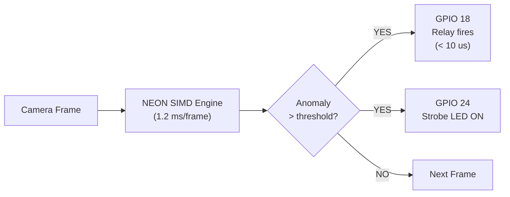

# VisionEdge Operator Guide

> How to use the VisionEdge industrial inspection and safety gateway.

---

## What is VisionEdge?

VisionEdge is an edge camera appliance that runs on a Raspberry Pi 4. It does three things:

1. **Captures live video** from a MIPI CSI-2 or USB camera
2. **Inspects every frame** for optical boundary intrusions or defects using NEON SIMD vectorized processing
3. **Trips a hardware safety interlock** (relay + strobe) in under 10 microseconds when a breach is detected

An operator monitors the system through a web dashboard accessible from any browser on the same network.

---

## Hardware Setup

### Connections

```
Raspberry Pi 4
├── USB-C power (5V 3A)
├── Ethernet cable → factory LAN
├── Camera Module → MIPI CSI-2 ribbon cable (or USB camera)
└── GPIO header
    ├── Pin 12 (GPIO 18) → Safety relay signal (active LOW)
    ├── Pin 16 (GPIO 23) → Optical trigger sensor input
    └── Pin 18 (GPIO 24) → Warning strobe LED
```

### Power On

Plug in the USB-C power supply. The system boots to operational state automatically:

| Time | What happens |
|---|---|
| 0.0 s | Power applied |
| 0.4 s | GPU firmware loads |
| 0.9 s | U-Boot starts kernel |
| 1.9 s | Linux kernel initializes camera + safety hardware |
| 2.4 s | visiond is running, safety interlock is armed, video is streaming |

No login, no configuration, no interaction required. The appliance is operational within seconds of receiving power.

### Power Off

Pull the power plug at any time. The system uses a read-only filesystem — there is nothing to corrupt. On next power-on, it boots identically.

---

## Web Dashboard

### Accessing the Dashboard

#### Same network (direct access)

1. Connect your computer to the same network as the RPi4
2. Open a browser and navigate to `http://<rpi4-ip>:8080/`
3. The dashboard loads directly from the appliance — no files to install

#### Different network (SSH tunnel)

If your workstation is on a different subnet from the Pi (e.g., office Wi-Fi vs lab LAN), use an SSH tunnel through the Linux dev host:

**On Windows (PowerShell) or macOS/Linux terminal:**

```bash
ssh -L 8080:<rpi4-ip>:8080 <user>@<linux-host-ip> -N
```

Example:

```bash
ssh -L 8080:192.168.1.150:8080 soliton@192.168.1.220 -N
```

Keep the terminal open, then navigate to `http://localhost:8080/` in your browser. The `-N` flag opens the tunnel without a shell; omit it to get a shell and tunnel simultaneously.

If the dashboard shows "Connecting" — verify the appliance is powered on and reachable on the network.

### Dashboard Layout

```
┌────────────────────────────────────────────────────────────┐
│  VisionEdge                              ● 192.168.1.150  │
├────────────────────────────────────┬───────────────────────┤
│                                    │  CPU                  │
│                                    │  12.5%  ████░░░░░░░░  │
│                                    │                       │
│        Live Camera Feed            │  MEMORY               │
│                                    │  34.2%  ████████░░░░  │
│        (MJPEG video stream)        │                       │
│                                    │  ANOMALIES            │
│                                    │  0                    │
│                                    │                       │
│                                    │  SAFETY               │
│                                    │  ● Armed              │
│                                    │                       │
│                                    │  TRIP COUNT           │
│                                    │  0                    │
└────────────────────────────────────┴───────────────────────┘
```

### Understanding the Gauges

#### CPU

Current processor load as a percentage. Color changes with severity:

| Color | Range | Meaning |
|---|---|---|
| Green | 0 – 65% | Normal operating load |
| Yellow | 65 – 85% | Elevated load — system still functional |
| Red | 85 – 100% | Critical — may impact frame processing |

#### Memory

RAM usage as a percentage. Same green/yellow/red color scale as CPU.

#### Anomalies

Number of pixels in the current frame that exceed the difference threshold. This is the raw count from the NEON SIMD inspection engine.

| Value | Color | Meaning |
|---|---|---|
| 0 | White | No intrusion detected |
| > 0 | Red | Pixels crossed the optical boundary threshold |

When the anomaly count exceeds the trip policy threshold, the safety system activates.

#### Safety

Current state of the hardware safety interlock:

| State | Indicator | Meaning |
|---|---|---|
| **Disarmed** | Grey dot | System is not monitoring — relay inactive |
| **Armed** | Green dot (glowing) | Actively monitoring — relay will trip on breach |
| **Tripped** | Red dot (pulsing) | Breach detected — relay has fired, strobe is on |

When tripped, the red dot pulses to draw attention. The safety state remains tripped until the system is reset.

#### Trip Count

Total number of safety trips since the appliance was powered on. Resets to zero on reboot. Turns yellow when any trips have occurred.

### Connection Status

The top-right corner shows the connection state:

| Display | Meaning |
|---|---|
| `192.168.1.150` (green dot) | Connected — receiving live telemetry |
| `Reconnecting` (red dot) | Lost connection — retrying every 3 seconds |
| `Connecting` (grey dot) | Initial connection in progress |

If the connection drops, the dashboard automatically reconnects. No manual intervention needed.

---

## Safety System

### How It Works



The camera captures frames continuously. Each frame is compared against a baseline using vectorized pixel differencing. If the number of anomalous pixels exceeds the configured threshold, the safety system trips immediately:

1. **Relay fires** (GPIO 18 goes LOW) — cuts machine power or activates interlock
2. **Strobe LED activates** (GPIO 24 goes HIGH) — visual warning
3. **Dashboard updates** — safety state turns red, trip count increments
4. **Incident frame frozen** — the triggering frame is preserved for review

### Response Time

The hardware trip response is under **10 microseconds** from detection to relay activation. This is achieved through a kernel-level interrupt handler that writes directly to the GPIO hardware registers, bypassing userspace scheduling entirely.

### After a Trip

The appliance continues running after a trip. The camera keeps streaming and the dashboard remains accessible. To reset:

- **Power cycle** the appliance (pull and reapply power)
- The system boots clean with the safety interlock re-armed automatically

---

## Configuration

The appliance runs with sensible defaults. For custom settings, pass command-line options:

| Option | Default | Description |
|---|---|---|
| `-p, --port <port>` | `8080` | Web server port |
| `-i, --interval <ms>` | `1000` | Telemetry update interval (milliseconds) |
| `-l, --log-level <level>` | `info` | Logging: `debug`, `info`, `warn`, `error` |
| `--ntp-server <ip>` | *(none)* | NTP server IP — syncs system clock on startup (use dev host IP in NFS boot mode) |
| `--cam-width <px>` | `1920` | Camera capture width |
| `--cam-height <px>` | `1080` | Camera capture height |
| `--cam-fps <fps>` | `30` | Camera frame rate |
| `--diff-threshold <0-255>` | `25` | Pixel difference threshold for anomaly detection |
| `--core-capture <id>` | `1` | Pin capture thread to specific CPU core |

Example — run with 720p at 60 FPS with a tighter threshold:

```bash
/usr/local/bin/visiond --cam-width 1280 --cam-height 720 --cam-fps 60 --diff-threshold 15
```

Example — NFS/network boot (no RTC): sync clock from Docker dev host on startup:

```bash
vision-edge -d --port 8080 --ntp-server 192.168.1.220
```

In production mode, these options are set in the init script at `/etc/init.d/S99visiond`.

---

## LED Indicators

| LED / Relay | Pin | Normal State | Trip State |
|---|---|---|---|
| **Safety relay** | GPIO 18 (Pin 12) | HIGH (relay open) | LOW (relay closed — machine interlock active) |
| **Strobe LED** | GPIO 24 (Pin 18) | OFF | ON (steady) |
| **Trigger sensor** | GPIO 23 (Pin 16) | Input — monitored for falling edge | N/A |

---

## Troubleshooting

| Symptom | Check | Action |
|---|---|---|
| No video in dashboard | Camera ribbon cable seated? | Reseat the MIPI CSI-2 cable, power cycle |
| Dashboard shows "Connecting" | Is the RPi4 powered on? | Check power LED, verify Ethernet link |
| Dashboard shows "Reconnecting" | Network issue | Verify both devices are on the same subnet; if on different subnets use SSH tunnel (see [Accessing the Dashboard](#accessing-the-dashboard)) |
| High CPU (red) | Normal under load | If sustained >95%, reduce `--cam-fps` or resolution |
| False trips | Threshold too sensitive | Increase `--diff-threshold` (default 25, try 40-50) |
| No trips when expected | Threshold too loose | Decrease `--diff-threshold` (try 10-15) |
| Relay not firing | Wiring | Verify GPIO 18 connection, check relay module power |
| System won't boot | SD card / network | Dev mode: check Docker is running. Prod mode: reseat SD card |
| Log timestamps show 1970-01-01 | No RTC, NTP not synced | Pi has no hardware clock. Sync on startup: `vision-edge --ntp-server <docker-host-ip>`. Or set manually: `ssh root@<pi-ip> "date -s \"$(date -u '+%Y-%m-%d %H:%M:%S')\""` |
