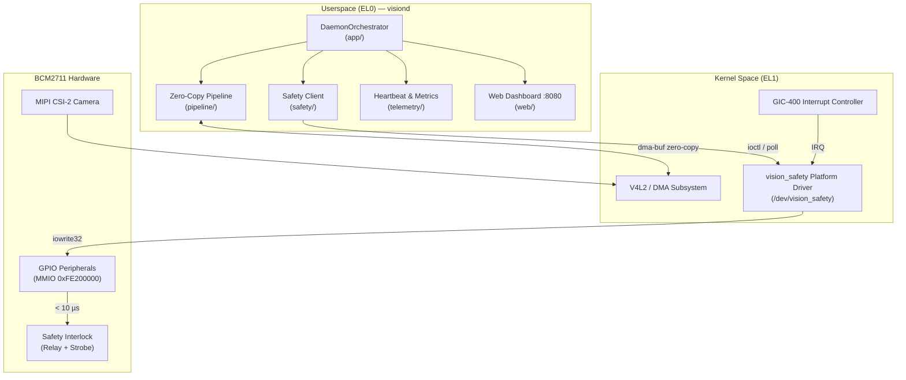
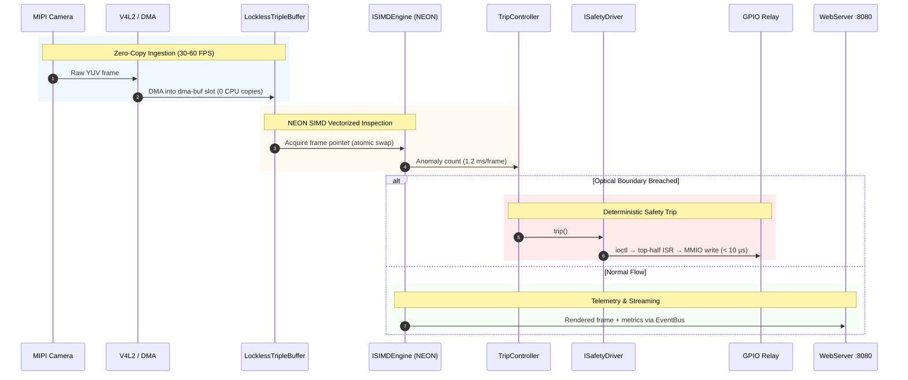
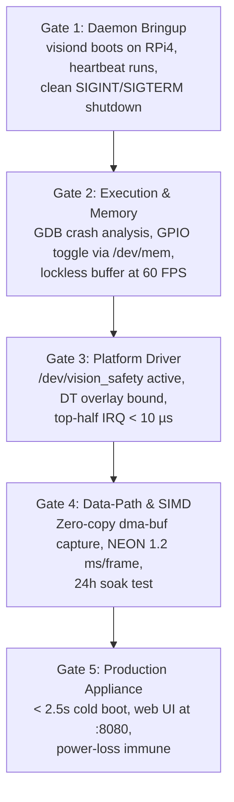

# VisionEdge: Implementation Roadmap

> **Target Platform:** Raspberry Pi 4 Model B (BCM2711 / Quad-Core Cortex-A72 / AArch64)  
> **Development Environment:** Docker Container (`arm-lab-dev`) via `./lab` CLI  
> **Target Access:** SD-Free Network Boot (U-Boot TFTP + NFS RootFS + Dropbear SSH)  
> **Architecture Reference:** [design/architecture.md](../design/architecture.md)

---

## 1. Monorepo Infrastructure Status

| Infrastructure Layer | Status | VisionEdge Role |
|---|---|---|
| **Toolchain & Container** | **Ready** | Dockerized `aarch64-linux-gnu-g++` (C++20) cross-compiles `visiond` and kernel modules |
| **Board Bootloader** | **Ready** | U-Boot 2024.07 AArch64 via TFTP + PXE boot |
| **Linux Kernel** | **Ready** | 64-bit kernel with V4L2 camera driver support, custom LKM loading |
| **Root Filesystem** | **Ready** | BusyBox NFS rootfs exported from Docker at `/workspace/nfs/rpi4-rootfs/` |
| **Device Communication** | **Ready** | Dropbear SSH (`./lab ssh`), Serial UART (`./lab console`), GDB (`./lab gdb`) |
| **Build & Deploy CLI** | **Ready** | `./lab build`, `./lab deploy`, `./lab run` |

---

## 2. System Architecture

See [design/architecture.md](../design/architecture.md) for the full specification. Summary:



---

## 3. End-to-End Data Flow



---

## 4. Hardware Wiring (BCM2711 GPIO Pinout)

```
Raspberry Pi 4 40-Pin Header (J8)
Pin 01: 3.3V Power ------------> Logic VDD
Pin 02: 5.0V Power ------------> Relay Module VCC
Pin 06: Ground ----------------> Common GND
Pin 08: GPIO 14 (TXD0) --------> USB-UART RX (Serial Console: 115200 baud)
Pin 10: GPIO 15 (RXD0) --------> USB-UART TX (Serial Console: 115200 baud)
Pin 12: GPIO 18 (PWM0 / OUT) --> Hardware Interlock Relay Signal (Active LOW)
Pin 16: GPIO 23 (IN / IRQ) ----> Optical Safety Trigger Sensor (Falling Edge)
Pin 18: GPIO 24 (OUT) ---------> Emergency Strobe Warning LED
```

---

## 5. Phase-by-Phase Implementation

Each phase builds on the previous one's modules. See the [architecture doc](../design/architecture.md) for the full module map.

| Phase | Focus | Modules Built | Guide |
|---|---|---|---|
| **1** | **Foundation & Daemon Bringup** | `core/*`, `telemetry/*`, `app/` | [Phase 1](phase1_daemon_bringup.md) |
| **2** | **CPU Internals, Memory & GPIO HAL** | `platform/gpio*`, `platform/mmio`, `pipeline/ring_buffer`, `pipeline/frame` | [Phase 2](phase2_cpu_memory_mmio.md) |
| **3** | **Kernel Driver & Safety Subsystem** | `kernel/*`, `safety/*` | [Phase 3](phase3_kernel_safety_driver.md) |
| **4** | **Video Pipeline & NEON SIMD** | `platform/camera*`, `platform/dma`, `pipeline/simd*`, `pipeline/stage` | [Phase 4](phase4_video_dma_neon.md) |
| **5** | **Productization & Instant Boot** | `web/*`, Buildroot configs | [Phase 5](phase5_productization.md) |

### Phase Structure

Each phase document follows the same structure:

1. **Goal & Scope** — what this phase delivers and which architecture modules it builds
2. **Build Steps** — concrete implementation steps with file paths and code snippets (delegatable to AI)
3. **Exploration Exercises** — optional hands-on deep-dives for platform understanding
4. **Verification Gate** — pass/fail checklist

---

## 6. Verification Gates


