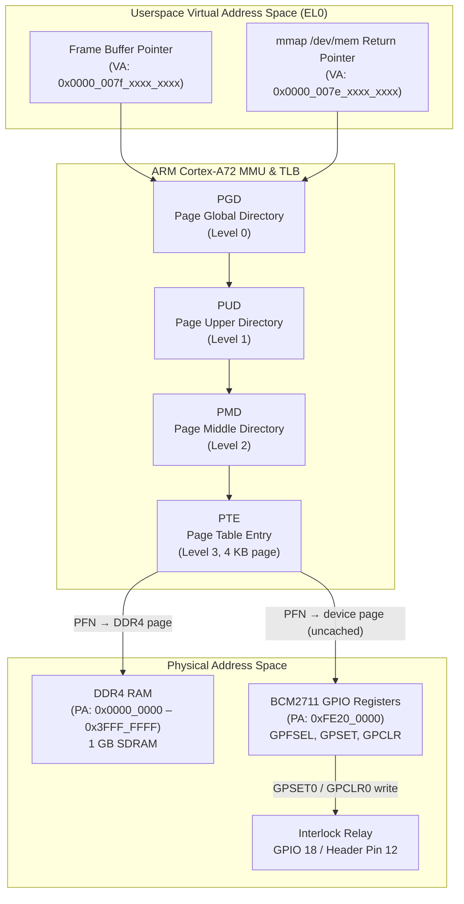

# Phase 2: CPU Internals, Memory & GPIO HAL

> **Goal:** Build the GPIO hardware abstraction layer with BCM2711 MMIO, implement the lockless triple-buffer and frame descriptor for the video pipeline, and deepen low-level ARM Cortex-A72 platform literacy.  
> **Modules Built:** `platform/gpio*`, `platform/mmio`, `pipeline/ring_buffer`, `pipeline/frame`  
> **Interfaces Introduced:** `IGpioController`, `LocklessTripleBuffer`, `FrameDescriptor`  
> **Architecture Reference:** [design/architecture.md](../design/architecture.md)  
> **Milestone:** Gate 2 (Execution & Memory Engineering)

---

## 0. Background: How User Space Talks to Hardware

Before diving into the implementation, it helps to understand the layers between your C++ code and the physical GPIO pins on the RPi4.

### The Hardware

The BCM2711 chip controls GPIO pins through **registers** — small memory locations at fixed physical addresses. For example, writing a `1` to bit 18 of the register at physical address `0xFE20001C` makes GPIO pin 18 go HIGH. These registers aren't RAM — they're wired directly to hardware circuits. But the CPU accesses them the same way it accesses RAM: by reading/writing to a memory address. This is called **Memory-Mapped I/O (MMIO)**.

### The Protection Problem

Your daemon runs in **user space (EL0)** — a restricted CPU privilege level. The Linux kernel runs in **kernel space (EL1)** with full hardware access. User space code **cannot** access physical addresses directly; the CPU would fault and kill your process. This is intentional — it prevents a buggy app from corrupting hardware.

So how does user space talk to hardware? Two paths:

### Path A: Kernel Driver (the production way — Phase 3)

A **kernel driver** is code that runs inside the kernel at EL1. Your code makes a **system call** (e.g. `write()`, `read()`) which causes the CPU to switch privilege from EL0 to EL1. The kernel driver validates the request, performs the hardware register access, and returns control to your code. The kernel exposes drivers as device files in `/dev/` — you interact with hardware by reading/writing files.

```
Your code (EL0) → syscall → Kernel GPIO driver (EL1) → hardware register
```

Safe, permission-controlled, but adds syscall overhead per operation.

### Path B: /dev/mem + mmap (the learning shortcut — Phase 2)

`/dev/mem` is a special device file that gives raw access to any physical address. By calling `mmap()` on it, the kernel creates a page table entry that maps a virtual pointer in your process directly to the hardware registers. After setup, every read/write through that pointer reaches hardware with zero kernel involvement — no syscalls, no validation, no protection.

```
Your code (EL0) → mmap(/dev/mem) [one-time setup]
                → volatile uint32_t* write → hardware register [direct, no kernel]
```

Fast, but dangerous — nothing stops you from writing to the wrong register. Requires root. Not for production.

### Why Phase 2 Uses /dev/mem

Phase 2 uses the `/dev/mem` path so you see exactly how hardware registers work — the physical addresses, the bit fields, the read-modify-write patterns. Phase 3 replaces the implementation with a proper kernel driver. The `IGpioController` interface stays unchanged; only the factory adds a new backend.

### Key Terms

| Term | What it is |
|---|---|
| **Register** | A small memory location wired to hardware circuits (not RAM) |
| **MMIO** | Hardware registers accessed via memory addresses |
| **User space (EL0)** | Where your program runs — restricted, can't touch hardware directly |
| **Kernel space (EL1)** | Where Linux runs — full hardware access |
| **System call** | The mechanism to ask the kernel to do something (`open`, `read`, `write`, `mmap`) |
| **Kernel driver** | Code inside the kernel that manages a specific piece of hardware |
| `/dev/mem` | Backdoor: lets user space map any physical address (requires root) |
| `/dev/` files | How the kernel exposes drivers to user space |
| **mmap** | Maps a physical address (or file) into your process's virtual address space |

---

## 1. Context & Objectives

Phase 1 established the daemon skeleton: the `ISubsystem` lifecycle, `EventBus`, telemetry heartbeat, and the `DaemonOrchestrator`. The daemon boots, logs metrics, and shuts down cleanly.

Phase 2 builds the **hardware abstraction** and **data pipeline** foundations on top of that skeleton. Four capabilities are added — each deepening a different aspect of embedded systems literacy:

1. **CPU Execution:** Trace ARM64 crash state and registers (`x0`–`x30`, `sp`, `pc`, `far_el1`) via remote GDB. Reconstruct the exact C++ source line from a fault address.
2. **MMU Translation:** Walk the ARMv8-A 4-level page tables from a userspace virtual address through `/proc/self/pagemap` to its physical DDR4 page. Understand how `mmap()` creates mappings the MMU can resolve.
3. **Userspace MMIO:** Control BCM2711 GPIO hardware directly from userspace via `/dev/mem` + `mmap()`, bypassing the kernel GPIO subsystem. This is the Phase 2 GPIO implementation; Phase 3 replaces it with a proper kernel driver — but the `IGpioController` interface remains unchanged.
4. **Data Queuing:** Implement a lockless triple-buffer for zero-lock frame exchange between the camera capture thread and the SIMD processing worker. No mutexes, no allocations on the hot path.

All new code follows the architecture's dependency injection principle: components receive `ILogger&` and other dependencies via constructor. No singletons, no global macros.

---

## 2. Memory & Hardware Architecture

The following diagram shows the complete address-space view from a userspace pointer to the physical hardware. Understanding this path is essential for both the MMIO GPIO implementation and the pagemap exercises.



**Key observations:**
- The same MMU translation machinery resolves both normal DRAM and device MMIO pages — the difference is page table attributes (cacheable vs device-nGnRE).
- `mmap("/dev/mem", ..., 0xFE200000)` creates a PTE that maps directly to the GPIO register block. A `volatile uint32_t*` write to the mapped pointer reaches the hardware in a single store instruction.
- Frame buffer pointers resolve to cacheable DDR4 pages — the CPU prefetcher and L1/L2 caches are active, which is why spatial locality matters (see Exercise 3).

---

## 3. Files Created

| Module | Header | Source | Purpose |
|---|---|---|---|
| platform | `include/visiond/platform/gpio.hpp` | — | `IGpioController` interface, `PinMode`, `PinLevel`, `PullMode` enums |
| platform | `include/visiond/platform/mmio.hpp` | — | `MmioRegion` RAII wrapper for `mmap`/`munmap` |
| platform | `include/visiond/platform/gpio_factory.hpp` | `src/platform/gpio_factory.cpp` | `GpioBackend` enum, `make_gpio()` factory |
| platform | `include/visiond/platform/gpio_subsystem.hpp` | — | `GpioSubsystem` `ISubsystem` adapter |
| platform | — | `src/platform/gpio_bcm2711.cpp` | `Bcm2711GpioController`: real `/dev/mem` MMIO for BCM2711 |
| pipeline | `include/visiond/pipeline/frame.hpp` | — | `FrameDescriptor` struct (metadata + buffer pointer) |
| pipeline | `include/visiond/pipeline/ring_buffer.hpp` | — | `LocklessTripleBuffer<T>` template |

---

## 4. Build Steps

### Step 1: MmioRegion RAII Helper (`platform/mmio.hpp`)

Before implementing the GPIO controller, create a reusable RAII wrapper that opens `/dev/mem`, maps a physical address range into the process virtual address space, and unmaps on destruction. This keeps resource management out of the GPIO logic.

```cpp
// include/visiond/platform/mmio.hpp
#pragma once
#include <labkit/types.hpp>
#include <labkit/expected.hpp>
#include <cstddef>
#include <cstdint>
#include <sys/mman.h>
#include <fcntl.h>
#include <unistd.h>

namespace visiond {
using labkit::expected;
using labkit::unexpected;
using labkit::Error;
using labkit::ErrorCode;

class MmioRegion {
public:
    // Map `length` bytes starting at physical address `phys_addr`
    static expected<MmioRegion, Error> create(off_t phys_addr, size_t length) {
        int fd = ::open("/dev/mem", O_RDWR | O_SYNC);
        if (fd < 0)
            return unexpected<Error>(Error{ErrorCode::PERMISSION_DENIED,
                    "Failed to open /dev/mem (requires root or CAP_SYS_RAWIO)"});

        void* ptr = ::mmap(nullptr, length, PROT_READ | PROT_WRITE,
                           MAP_SHARED, fd, phys_addr);
        ::close(fd);  // fd no longer needed after mmap

        if (ptr == MAP_FAILED)
            return unexpected<Error>(Error{ErrorCode::IO_ERROR,
                    "mmap failed for physical address"});

        return MmioRegion(ptr, length);
    }

    ~MmioRegion() {
        if (base_) ::munmap(base_, length_);
    }

    // Move-only (no copying a mapped region)
    MmioRegion(MmioRegion&& o) noexcept : base_(o.base_), length_(o.length_) {
        o.base_ = nullptr;
        o.length_ = 0;
    }
    MmioRegion& operator=(MmioRegion&& o) noexcept {
        if (this != &o) {
            if (base_) ::munmap(base_, length_);
            base_ = o.base_;
            length_ = o.length_;
            o.base_ = nullptr;
            o.length_ = 0;
        }
        return *this;
    }
    MmioRegion(const MmioRegion&) = delete;
    MmioRegion& operator=(const MmioRegion&) = delete;

    volatile uint32_t* as_u32() const {
        return static_cast<volatile uint32_t*>(base_);
    }

private:
    MmioRegion(void* base, size_t length) : base_(base), length_(length) {}

    void*  base_{nullptr};
    size_t length_{0};
};

} // namespace visiond
```

**Design notes:**
- The factory function `create()` returns `expected<MmioRegion, Error>` — callers handle the failure case explicitly.
- The file descriptor is closed immediately after `mmap()` — the mapping remains valid.
- `as_u32()` returns a `volatile` pointer because MMIO registers have side effects on read/write and must not be optimized away by the compiler.

---

### Step 2: IGpioController Interface (`platform/gpio.hpp`)

Define the hardware abstraction interface from the [architecture doc](../design/architecture.md). This interface is consumed by every module that needs GPIO access and is stable across Phase 2 (MMIO) → Phase 3 (kernel driver) transitions.

```cpp
// include/visiond/platform/gpio.hpp
#pragma once
#include <labkit/types.hpp>
#include <labkit/expected.hpp>
#include <cstdint>

namespace visiond {
using labkit::expected;
using labkit::unexpected;
using labkit::Error;
using labkit::ErrorCode;

enum class PinMode  { INPUT, OUTPUT };
enum class PinLevel { LOW, HIGH };
enum class PullMode { NONE, UP, DOWN };

class IGpioController {
public:
    virtual ~IGpioController() = default;
    virtual expected<void, Error> init()                               = 0;
    virtual expected<void, Error> set_mode(uint8_t pin, PinMode mode)  = 0;
    virtual expected<void, Error> set_pull(uint8_t pin, PullMode pull) = 0;
    virtual expected<void, Error> write(uint8_t pin, PinLevel level)   = 0;
    virtual expected<PinLevel, Error> read(uint8_t pin)                = 0;
};

} // namespace visiond
```

**Why a virtual interface and not a template policy?** The GPIO implementation is selected once at startup and never changes during runtime. Virtual dispatch adds ~2 ns per call — negligible for GPIO operations (millisecond-scale relay control). The benefit is trivial testability: unit tests inject a mock `IGpioController` without any template machinery.

---

### Step 3: Bcm2711GpioController (`src/platform/gpio_bcm2711.cpp`)

The real hardware implementation. Uses `MmioRegion` to map the BCM2711 GPIO register block and performs direct register manipulation for pin configuration and I/O.

**BCM2711 GPIO register layout:**

| Register | Offset | Purpose |
|---|---|---|
| GPFSEL0–GPFSEL5 | 0x00–0x14 | Function select (3 bits per pin, 10 pins per register) |
| GPSET0 | 0x1C | Set output HIGH (write-1-to-set) |
| GPSET1 | 0x20 | Set output HIGH for GPIO 32–57 |
| GPCLR0 | 0x28 | Set output LOW (write-1-to-clear) |
| GPCLR1 | 0x2C | Set output LOW for GPIO 32–57 |
| GPLEV0 | 0x34 | Read pin level (GPIO 0–31) |
| GPLEV1 | 0x38 | Read pin level (GPIO 32–57) |
| GPIO_PUP_PDN_CNTRL_REG0–3 | 0xE4–0xF0 | Pull-up/down (2 bits per pin, BCM2711-specific) |

```cpp
// src/platform/gpio_bcm2711.cpp
#include "visiond/platform/gpio.hpp"
#include "visiond/platform/mmio.hpp"
#include <labkit/logger.hpp>
#include <memory>
#include <optional>
#include <utility>

namespace visiond {
using labkit::ILogger;
using labkit::LogLevel;

namespace {
constexpr off_t  BCM2711_GPIO_BASE = 0xFE200000;
constexpr size_t GPIO_BLOCK_SIZE   = 4096;

// Register offsets as uint32_t word indices
constexpr uint32_t GPFSEL0   = 0x00 / 4;
constexpr uint32_t GPSET0    = 0x1C / 4;
constexpr uint32_t GPCLR0    = 0x28 / 4;
constexpr uint32_t GPLEV0    = 0x34 / 4;
constexpr uint32_t GPIO_PUP_PDN_CNTRL_REG0 = 0xE4 / 4;
constexpr uint8_t  MAX_GPIO_PIN = 57;
} // namespace

class Bcm2711GpioController : public IGpioController {
public:
    explicit Bcm2711GpioController(ILogger& logger) : logger_(logger) {}

    expected<void, Error> init() override {
        auto region = MmioRegion::create(BCM2711_GPIO_BASE, GPIO_BLOCK_SIZE);
        if (!region.has_value())
            return unexpected<Error>(region.error());

        mmio_.emplace(std::move(region.value()));
        regs_ = mmio_->as_u32();
        logger_.log(LogLevel::INFO, "BCM2711 GPIO mapped at PA 0xFE200000");
        return {};
    }

    expected<void, Error> set_mode(uint8_t pin, PinMode mode) override {
        if (pin > MAX_GPIO_PIN)
            return unexpected<Error>(Error{ErrorCode::INVALID_ARG, "Pin out of range"});

        uint32_t reg_index = GPFSEL0 + (pin / 10);
        uint32_t bit_shift = (pin % 10) * 3;

        uint32_t val = regs_[reg_index];
        val &= ~(0b111u << bit_shift);                    // Clear 3-bit field
        if (mode == PinMode::OUTPUT)
            val |= (0b001u << bit_shift);                  // 001 = output
        regs_[reg_index] = val;                            // INPUT = 000 (default)
        return {};
    }

    expected<void, Error> set_pull(uint8_t pin, PullMode pull) override {
        if (pin > MAX_GPIO_PIN)
            return unexpected<Error>(Error{ErrorCode::INVALID_ARG, "Pin out of range"});

        // BCM2711 uses GPIO_PUP_PDN registers (2 bits per pin, 16 pins per reg)
        uint32_t reg_index = GPIO_PUP_PDN_CNTRL_REG0 + (pin / 16);
        uint32_t bit_shift = (pin % 16) * 2;
        uint32_t pull_val = 0b00;  // NONE
        if (pull == PullMode::UP)   pull_val = 0b01;
        if (pull == PullMode::DOWN) pull_val = 0b10;

        uint32_t val = regs_[reg_index];
        val &= ~(0b11u << bit_shift);
        val |= (pull_val << bit_shift);
        regs_[reg_index] = val;
        return {};
    }

    expected<void, Error> write(uint8_t pin, PinLevel level) override {
        if (pin > MAX_GPIO_PIN)
            return unexpected<Error>(Error{ErrorCode::INVALID_ARG, "Pin out of range"});

        uint32_t bank = pin / 32;
        uint32_t bit  = pin % 32;

        if (level == PinLevel::HIGH)
            regs_[GPSET0 + bank] = (1u << bit);   // Write-1-to-set
        else
            regs_[GPCLR0 + bank] = (1u << bit);   // Write-1-to-clear

        return {};
    }

    expected<PinLevel, Error> read(uint8_t pin) override {
        if (pin > MAX_GPIO_PIN)
            return unexpected<Error>(Error{ErrorCode::INVALID_ARG, "Pin out of range"});

        uint32_t bank = pin / 32;
        uint32_t bit  = pin % 32;
        uint32_t level = regs_[GPLEV0 + bank];

        return (level & (1u << bit)) ? PinLevel::HIGH : PinLevel::LOW;
    }

private:
    ILogger&    logger_;
    std::optional<MmioRegion> mmio_;   // Populated during init()
    volatile uint32_t* regs_{nullptr};
};

// Factory function — allows gpio_factory.cpp to create without seeing the class definition
std::unique_ptr<IGpioController> make_bcm2711_gpio(ILogger& logger) {
    return std::make_unique<Bcm2711GpioController>(logger);
}

} // namespace visiond
```

**Key design decisions:**
- `ILogger&` is injected via constructor — no `LOG_ERROR` macros that would require a global logger.
- `init()` returns `expected<void, Error>` so the `DaemonOrchestrator` can report and handle mapping failures.
- `mmio_` is `std::optional<MmioRegion>` because `MmioRegion` has no default constructor (it's move-only, created by the `create()` factory). The `init()` method uses `mmio_.emplace(...)` to construct it in place.
- The GPFSEL calculation uses `pin / 10` and `(pin % 10) * 3` because each GPFSEL register holds 10 pins at 3 bits each.
- GPSET/GPCLR are write-1-to-set/write-1-to-clear registers — writing a 0 bit has no effect, so there's no read-modify-write race.
- The file exports a `make_bcm2711_gpio()` free function so the factory (Step 4) can create the controller without including the class definition. This keeps `Bcm2711GpioController` entirely private to the `.cpp` file.

---

### Step 4: GPIO Factory and Subsystem Adapter

Two small pieces connect the BCM2711 implementation to the daemon lifecycle: a **factory** that selects the GPIO backend, and a **subsystem adapter** that wraps `IGpioController` into the `ISubsystem` interface the orchestrator expects.

#### gpio_factory.hpp / gpio_factory.cpp

The factory decouples `main.cpp` from concrete GPIO implementations. Adding a new backend (e.g. a kernel-driver backend in Phase 3) means adding one enum value and one case — no changes to `main.cpp` or the subsystem adapter.

```cpp
// include/visiond/platform/gpio_factory.hpp
#pragma once
#include "visiond/platform/gpio.hpp"
#include <labkit/logger.hpp>
#include <memory>

namespace visiond {
using labkit::ILogger;

enum class GpioBackend {
    BCM2711,        // Phase 2: userspace MMIO via /dev/mem
    // KERNEL,      // Phase 3: kernel driver via /dev/visiond-gpio
};

std::unique_ptr<IGpioController> make_gpio(GpioBackend backend, ILogger& logger);

} // namespace visiond
```

```cpp
// src/platform/gpio_factory.cpp
#include "visiond/platform/gpio_factory.hpp"

namespace visiond {

std::unique_ptr<IGpioController> make_bcm2711_gpio(ILogger& logger);

std::unique_ptr<IGpioController> make_gpio(GpioBackend backend, ILogger& logger) {
    switch (backend) {
        case GpioBackend::BCM2711: return make_bcm2711_gpio(logger);
    }
    return nullptr;
}

} // namespace visiond
```

**Design notes:**
- `make_bcm2711_gpio()` is forward-declared (not `#include`d) — the `Bcm2711GpioController` class stays completely private to `gpio_bcm2711.cpp`.
- The `switch` has no `default` case so the compiler warns if a new `GpioBackend` enumerator is added without a corresponding factory case.
- There is no `StubGpioController` and no arch-conditional source exclusion. GPIO compiles on all platforms. On non-RPi4 hosts, `init()` fails gracefully when `/dev/mem` cannot be opened, and the `DaemonOrchestrator` logs the error and continues.

#### gpio_subsystem.hpp

The subsystem adapter wraps any `IGpioController` into the `ISubsystem` lifecycle interface. It lives in its own header so `main.cpp` stays a clean composition root.

```cpp
// include/visiond/platform/gpio_subsystem.hpp
#pragma once
#include "visiond/platform/gpio.hpp"
#include <labkit/lifecycle.hpp>
#include <memory>
#include <string_view>
#include <utility>

namespace visiond {
using labkit::SubsystemState;
using labkit::ISubsystem;

// Adapter: wraps IGpioController into ISubsystem for the orchestrator
class GpioSubsystem : public ISubsystem {
public:
    explicit GpioSubsystem(std::unique_ptr<IGpioController> ctrl)
        : ctrl_(std::move(ctrl)) {}

    expected<void, Error> init() override {
        state_ = SubsystemState::INITIALIZED;
        return ctrl_->init();
    }
    expected<void, Error> start() override {
        state_ = SubsystemState::RUNNING;
        return {};
    }
    void stop() override {
        state_ = SubsystemState::STOPPED;
    }
    std::string_view   name()  const override { return "gpio"; }
    SubsystemState     state() const override { return state_; }

private:
    std::unique_ptr<IGpioController> ctrl_;
    SubsystemState state_{SubsystemState::CREATED};
};

} // namespace visiond
```

**Why a separate header?** The adapter is trivial (~20 lines) but putting it in `main.cpp` would mix composition-root logic with class definitions. A dedicated header keeps `main.cpp` focused on wiring and lets other translation units (e.g. integration tests) reuse the adapter.

---

### Step 5: FrameDescriptor (`pipeline/frame.hpp`)

A lightweight struct (~64 bytes) describing a video frame without owning its pixel buffer. This is the metadata that flows through the lockless ring buffer — the actual pixel data stays in pre-allocated DMA buffers.

```cpp
// include/visiond/pipeline/frame.hpp
#pragma once
#include <cstdint>

namespace visiond {

enum class PixelFormat : uint8_t {
    YUYV,       // 16bpp packed YUV 4:2:2 (V4L2 default)
    NV12,       // 12bpp planar YUV 4:2:0 (hardware codec input)
    RGB24,      // 24bpp packed RGB
    GRAY8,      // 8bpp grayscale
};

struct FrameDescriptor {
    uint8_t*    data{nullptr};       // Pointer to pixel buffer (not owned)
    uint32_t    width{0};            // Frame width in pixels
    uint32_t    height{0};           // Frame height in pixels
    uint32_t    stride{0};           // Bytes per row (may include padding)
    PixelFormat format{PixelFormat::YUYV};
    uint64_t    timestamp_ns{0};     // Monotonic clock timestamp
    int         dma_fd{-1};          // DMA-BUF fd (-1 if not DMA-backed)
    uint32_t    sequence{0};         // Frame sequence counter
};

} // namespace visiond
```

**Why not `std::vector<uint8_t>` for pixel data?** A 1080p YUYV frame is ~4 MB. At 60 FPS, copying that through any intermediary saturates the memory bus at ~240 MB/s. Instead, the camera DMA writes directly into pre-allocated buffers, and only the `FrameDescriptor` (64 bytes of metadata) moves through the ring buffer. The `data` pointer refers to the DMA buffer in-place.

---

### Step 6: LocklessTripleBuffer (`pipeline/ring_buffer.hpp`)

An atomic index-swap triple buffer for single-producer / single-consumer frame exchange. Three buffer slots rotate through three roles: **write** (producer is filling it), **shared** (most recently completed frame), and **read** (consumer is processing it).

```cpp
// include/visiond/pipeline/ring_buffer.hpp
#pragma once
#include <array>
#include <atomic>
#include <cstdint>

namespace visiond {

/// Lockless triple buffer for single-producer / single-consumer exchange.
///
/// The producer writes to one slot while the consumer reads from another.
/// A third "shared" slot holds the most recently published frame. Publishing
/// and acquiring swap atomic indices — no mutexes, no allocations.
///
/// Memory ordering:
///   - publish() uses acquire-release on the shared index exchange to ensure
///     the producer's writes to the buffer are visible to the consumer.
///   - acquire() uses acquire-release on the shared index exchange to ensure
///     the consumer sees the producer's writes before reading the buffer.
template <typename T>
class LocklessTripleBuffer {
public:
    LocklessTripleBuffer() {
        write_idx_.store(0, std::memory_order_relaxed);
        read_idx_.store(1, std::memory_order_relaxed);
        shared_idx_.store(2, std::memory_order_relaxed);
    }

    // -- Producer API --

    /// Get a reference to the current write buffer.
    /// The producer fills this buffer with new data.
    T& get_write_buffer() {
        return buffers_[write_idx_.load(std::memory_order_relaxed)];
    }

    /// Publish the completed write buffer, making it available to the consumer.
    /// Swaps the write index with the shared index atomically.
    void publish() {
        uint32_t old_write = write_idx_.load(std::memory_order_relaxed);
        uint32_t new_write = shared_idx_.exchange(old_write,
                                                  std::memory_order_acq_rel);
        write_idx_.store(new_write, std::memory_order_release);
    }

    // -- Consumer API --

    /// Acquire the most recently published buffer for reading.
    /// Swaps the read index with the shared index atomically.
    T& acquire_read_buffer() {
        uint32_t old_read = read_idx_.load(std::memory_order_relaxed);
        uint32_t new_read = shared_idx_.exchange(old_read,
                                                 std::memory_order_acq_rel);
        read_idx_.store(new_read, std::memory_order_relaxed);
        return buffers_[new_read];
    }

private:
    std::array<T, 3>       buffers_{};
    std::atomic<uint32_t>  write_idx_;
    std::atomic<uint32_t>  read_idx_;
    std::atomic<uint32_t>  shared_idx_;
};

} // namespace visiond
```

**Why triple-buffering instead of a double-buffer or ring queue?**
- **Double-buffer** requires the producer to block until the consumer releases the shared buffer. At 60 FPS with variable processing time, this causes frame drops.
- **Ring queue** (N-slot) requires size management and can overwrite unread frames under back-pressure.
- **Triple-buffer** guarantees the consumer always gets the *most recent* frame (skipping stale ones), the producer never blocks, and there is always a free slot to write into. For real-time vision inspection, reading the latest frame is more important than reading every frame.

---

### Step 7: Wire GPIO into DaemonOrchestrator

The `DaemonOrchestrator` manages subsystems through the `ISubsystem` interface. The `GpioSubsystem` adapter (Step 4) wraps `IGpioController` into `ISubsystem`, and the factory (Step 4) selects the concrete backend. Wiring in `main.cpp` is two includes and one `daemon.add()` call — zero changes to `telemetry/`.

```cpp
// src/main.cpp (Phase 2 additions shown in context)
#include "visiond/app/config.hpp"
#include "visiond/telemetry/metrics.hpp"
#include "visiond/telemetry/heartbeat.hpp"
#include "visiond/platform/gpio_subsystem.hpp"
#include "visiond/platform/gpio_factory.hpp"
#include "visiond/app/daemon.hpp"
#include <labkit/spdlog_logger.hpp>

int main(int argc, char* argv[]) {
    // ... config, logger, event_bus, metrics_source ...
    visiond::DaemonOrchestrator daemon(logger, config);

    daemon.add(std::make_unique<visiond::HeartbeatWorker>(
        logger, metrics_source, event_bus, config.heartbeat_interval_ms));

    daemon.add(std::make_unique<visiond::GpioSubsystem>(
        visiond::make_gpio(visiond::GpioBackend::BCM2711, logger)));

    return daemon.run();
}
```

**What changed vs Phase 1:** Two `#include`s (`gpio_subsystem.hpp`, `gpio_factory.hpp`) and one `daemon.add()` call. There is no `#ifdef __aarch64__` — GPIO registers unconditionally. On non-RPi4 hosts, `Bcm2711GpioController::init()` fails gracefully when `/dev/mem` cannot be opened, and the orchestrator logs the error and continues with the remaining subsystems.

**Why no stub?** A stub would mask real initialization errors and add a code path that never runs on the target. The factory pattern makes adding new backends (Phase 3 kernel driver) a one-line change — add a `GpioBackend::KERNEL` case — without touching `main.cpp` or the subsystem adapter.

---

### Step 8: Build and deploy

Use the same lab CLI workflow as Phase 1:

```bash
# Cross-compile inside Docker (ARM64 target)
./lab docker exec -- ./lab build vision-edge --board rpi4

# Deploy to RPi4 NFS rootfs
./lab docker exec -- ./lab deploy vision-edge --board rpi4

# Run on target (requires root for /dev/mem access)
./lab docker exec -- ./lab run vision-edge --board rpi4

# Host build for development (GPIO init fails gracefully on non-RPi4)
./lab build vision-edge
```

---

## 5. Exploration Exercises

These exercises build low-level platform understanding. They don't produce shipping code — they build the mental model needed for Phases 3–4.

### Exercise 1: Remote GDB Crash Debugging

Inject a deliberate fault into `visiond`, generate a core dump on the RPi4, and reconstruct the crash from CPU registers.

**1. Enable core dumps on the target:**

```bash
./lab ssh --board=rpi4 "ulimit -c unlimited && echo '/tmp/core.%e.%p' > /proc/sys/kernel/core_pattern"
```

**2. Add a deliberate null dereference (temporary, in a test branch):**

```cpp
// Temporary crash injection — remove after exercise
void trigger_test_crash() {
    volatile int* bad_ptr = reinterpret_cast<volatile int*>(0xDEADBEEF);
    *bad_ptr = 42;  // SIGSEGV — Data Abort at EL0
}
```

Call this from `init()` of any subsystem so it fires during daemon startup.

**3. Launch remote GDB:**

```bash
./lab gdb --project=vision-edge --board=rpi4
```

**4. Inspect the crash state:**

```gdb
(gdb) bt                     # Backtrace — find the faulting function
(gdb) info registers          # All general-purpose registers
(gdb) print/x $pc            # Program counter — faulting instruction address
(gdb) print/x $sp            # Stack pointer
(gdb) print/x $x0            # First argument / return value register
(gdb) print/x $x30           # Link register (return address)
(gdb) list *$pc               # Source line at the faulting address
```

**What to verify:** The `pc` register should point to the `str` instruction that writes to `0xDEADBEEF`. `list *$pc` should show the exact C++ line (`*bad_ptr = 42`). The backtrace should show the call chain from `main` → `DaemonOrchestrator::run` → subsystem `init()` → `trigger_test_crash`.

---

### Exercise 2: Virtual-to-Physical Address Translation

Implement a diagnostic helper that reads `/proc/self/pagemap` to translate a userspace virtual address to its physical DDR4 page.

**The pagemap format** (per `Documentation/admin-guide/mm/pagemap.rst`):
- Each VA page has an 8-byte entry at offset `(va / page_size) * 8`
- Bit 63: page present
- Bits 54–0: physical page frame number (PFN)

```cpp
#include <fcntl.h>
#include <unistd.h>
#include <cstdint>
#include <cstdio>

uintptr_t virt_to_phys(void* vaddr) {
    uintptr_t va = reinterpret_cast<uintptr_t>(vaddr);
    long page_size = sysconf(_SC_PAGESIZE);       // 4096 on RPi4
    uintptr_t page_offset = va % page_size;
    uint64_t  pfn_index   = va / page_size;

    int fd = open("/proc/self/pagemap", O_RDONLY);
    if (fd < 0) {
        perror("open pagemap");
        return 0;
    }

    uint64_t entry = 0;
    off_t offset = pfn_index * sizeof(uint64_t);
    if (pread(fd, &entry, sizeof(entry), offset) != sizeof(entry)) {
        close(fd);
        return 0;
    }
    close(fd);

    // Bit 63: page present flag
    if (!(entry & (1ULL << 63))) {
        return 0;  // Page not present (swapped out or not yet faulted in)
    }

    // Bits 54:0 = physical page frame number
    uint64_t pfn = entry & ((1ULL << 55) - 1);
    return (pfn * page_size) + page_offset;
}
```

**Verification steps:**

```bash
# Allocate a buffer in visiond, print its VA and translated PA
# Then cross-reference with /proc/iomem on the target:
./lab ssh --board=rpi4 "cat /proc/iomem | head -20"
```

The PA returned by `virt_to_phys()` should fall within the `System RAM` range shown in `/proc/iomem` (typically `0x00000000`–`0x3FFFFFFF` for 1 GB RPi4). Reading pagemap requires `CAP_SYS_ADMIN` or root.

---

### Exercise 3: Cache Architecture Benchmarking

The Cortex-A72 has a 32 KB L1 data cache (2-way set associative) and a 1 MB L2 cache (16-way). Cache lines are 64 bytes. Understanding cache behavior is critical for Phase 4's SIMD pixel processing.

**Benchmark: sequential (row-major) vs strided (column-major) pixel access**

```cpp
#include <chrono>
#include <cstdint>
#include <cstdio>
#include <vector>

void benchmark_access_pattern() {
    constexpr uint32_t W = 1920, H = 1080;
    std::vector<uint8_t> image(W * H);

    // Row-major: access pixels left-to-right, top-to-bottom
    auto t0 = std::chrono::steady_clock::now();
    volatile uint64_t sum = 0;
    for (uint32_t y = 0; y < H; ++y)
        for (uint32_t x = 0; x < W; ++x)
            sum += image[y * W + x];
    auto t1 = std::chrono::steady_clock::now();

    // Column-major: access pixels top-to-bottom, left-to-right
    auto t2 = std::chrono::steady_clock::now();
    sum = 0;
    for (uint32_t x = 0; x < W; ++x)
        for (uint32_t y = 0; y < H; ++y)
            sum += image[y * W + x];
    auto t3 = std::chrono::steady_clock::now();

    auto row_us = std::chrono::duration_cast<std::chrono::microseconds>(t1 - t0).count();
    auto col_us = std::chrono::duration_cast<std::chrono::microseconds>(t3 - t2).count();
    std::printf("Row-major: %ld µs | Column-major: %ld µs | Ratio: %.1fx\n",
                row_us, col_us, static_cast<double>(col_us) / row_us);
}
```

**Measure cache misses with `perf`:**

```bash
./lab ssh --board=rpi4 "perf stat -e L1-dcache-load-misses,L1-dcache-loads ./visiond --benchmark-cache"
```

**Why row-major is faster:** Sequential access (stride = 1 byte) triggers the hardware prefetcher and benefits from spatial locality — each cache line fetch (64 bytes) services the next 64 pixel reads. Column-major access (stride = 1920 bytes) jumps across cache lines on every pixel, evicting useful data and defeating the prefetcher. Expect a 3–8x performance difference on the Cortex-A72.

This directly impacts Phase 4: NEON SIMD loads (`vld1q_u8`) read 16 contiguous bytes — they benefit enormously from row-major layout and L1 cache hits.

---

## 6. Verification Gate

All items must pass before proceeding to Phase 3.

- [ ] `Bcm2711GpioController` toggles GPIO 18 on real RPi4 hardware (relay clicks or LED lights)
- [ ] Host build compiles and runs — GPIO `init()` fails gracefully with `/dev/mem` error, daemon continues
- [ ] `LocklessTripleBuffer` sustains 60 FPS exchange between 2 threads with zero mutex locks
- [ ] `FrameDescriptor` is exactly a lightweight POD (~64 bytes, no heap allocations)
- [ ] Core dump generated and analyzed via GDB — PC matched to source line
- [ ] Virtual address resolved to physical DRAM page via pagemap
- [ ] No changes to `telemetry/` module (Phase 1 code untouched)
