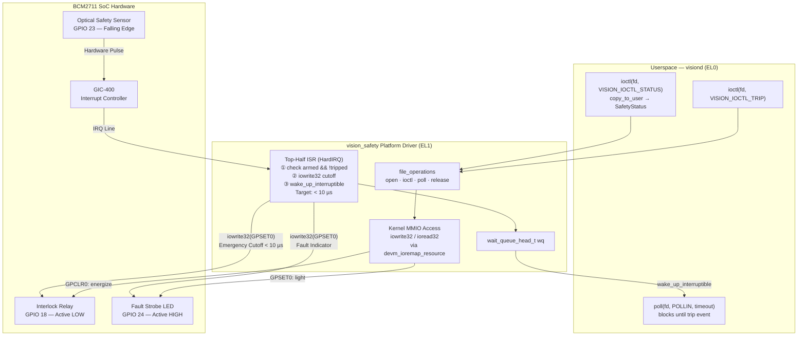

# Phase 3: Kernel Platform Driver & Safety Subsystem

> **Goal:** Build the `vision_safety` Linux platform driver with Device Tree binding, BCM2711 MMIO via kernel primitives, and a deterministic top-half ISR achieving sub-10µs safety cutoff. Implement the userspace `ISafetyDriver` client and `TripController` policy engine.  
> **Modules Built:** `kernel/*`, `safety/*`  
> **Interfaces Introduced:** `ISafetyDriver`, `TripController`  
> **Architecture Reference:** [design/architecture.md](../design/architecture.md)  
> **Milestone:** Gate 3 (Platform Engineer)

---

## 1. Why a Kernel Driver?

Phase 2's `Bcm2711GpioController` proved that userspace MMIO via `/dev/mem` can toggle hardware registers. That was a deliberate stepping stone — a way to understand the memory-mapped peripheral model before doing it properly. In a production safety system, `/dev/mem` is unacceptable for three reasons:

1. **Security:** `/dev/mem` exposes the **entire physical address space** — every register, every page of DRAM — to any process with `CAP_SYS_RAWIO`. A single bug or exploit in the daemon could corrupt kernel memory, DMA descriptors, or other peripherals. A kernel driver exposes only its own well-defined ioctl interface.

2. **No Hardware Interrupts:** Userspace has no path to receive hardware interrupts from the ARM GIC-400. Without kernel IRQ registration, the only option is polling — burning CPU cycles spinning on a register and introducing non-deterministic latency. A kernel top-half ISR fires within microseconds of the GIC assertion, enabling the sub-10µs cutoff guarantee.

3. **Hardware Contention:** Raw MMIO from userspace has no serialization. Two threads performing read-modify-write on the same GPIO function-select register will race. Kernel spinlocks (`spin_lock_irqsave`) provide the atomic access guarantee that the BCM2711's single-ported GPIO register block requires.

---

## 2. Driver Architecture



---

## 3. Files Created

| Module | File | Purpose |
|---|---|---|
| kernel | `kernel/dts/bcm2711-visionedge-overlay.dts` | Device Tree overlay — pin muxing, IRQ binding for `vision_safety` |
| kernel | `kernel/include/uapi/vision_safety_uapi.h` | Shared UAPI header: ioctl magic, command numbers, status struct |
| kernel | `kernel/vision_safety.c` | Platform driver: probe, remove, file_ops, top-half ISR |
| kernel | `kernel/Makefile` | Out-of-tree kbuild for cross-compiling the `.ko` |
| safety | `include/visiond/safety/driver_client.hpp` | `ISafetyDriver` interface + `DriverClient` declaration |
| safety | `src/safety/driver_client.cpp` | `DriverClient` — real ioctl client for `/dev/vision_safety` |
| safety | `include/visiond/safety/trip_controller.hpp` | `TripController` policy engine declaration |
| safety | `src/safety/trip_controller.cpp` | Threshold logic: anomaly count → trip decision |

---

## 4. Build Steps

### Step 1: Device Tree Overlay (`kernel/dts/bcm2711-visionedge-overlay.dts`)

The overlay binds our driver to three GPIO pins and configures the falling-edge interrupt on the optical sensor input.

```dts
/dts-v1/;
/plugin/;

/ {
    compatible = "brcm,bcm2711";

    fragment@0 {
        target = <&gpio>;
        __overlay__ {
            vision_pins: vision_pins {
                brcm,pins = <18 23 24>;
                brcm,function = <1 0 1>; /* 18: Output (relay), 23: Input (sensor), 24: Output (strobe) */
                brcm,pull = <0 2 0>;     /* 18: None, 23: Pull-up, 24: None */
            };
        };
    };

    fragment@1 {
        target-path = "/";
        __overlay__ {
            vision_safety: vision_safety@fe200000 {
                compatible = "cortexlab,vision-safety";
                reg = <0x0 0xfe200000 0x0 0x1000>; /* GPIO register block */
                pinctrl-names = "default";
                pinctrl-0 = <&vision_pins>;
                gpios = <&gpio 18 0>,   /* relay output   */
                        <&gpio 23 0>,   /* sensor input   */
                        <&gpio 24 0>;   /* strobe output  */
                interrupt-parent = <&gpio>;
                interrupts = <23 2>;    /* IRQ_TYPE_EDGE_FALLING on GPIO 23 */
                status = "okay";
            };
        };
    };
};
```

Compile the overlay:
```bash
dtc -@ -I dts -O dtb -o bcm2711-visionedge.dtbo bcm2711-visionedge-overlay.dts
```

### Step 2: UAPI Header (`kernel/include/uapi/vision_safety_uapi.h`)

This header is shared between the kernel module and the userspace `DriverClient`. It defines the ioctl command numbers and the status structure that crosses the kernel–user boundary.

```c
/* kernel/include/uapi/vision_safety_uapi.h */
#ifndef _UAPI_VISION_SAFETY_H
#define _UAPI_VISION_SAFETY_H

#include <linux/ioctl.h>
#include <linux/types.h>

#define VISION_SAFETY_MAGIC 'V'

struct vision_safety_status {
    __u32 armed;            /* 1 = system armed, relay energized       */
    __u32 tripped;          /* 1 = safety breach detected              */
    __u64 trip_timestamp_ns; /* ktime_get_ns() at moment of trip       */
    __u32 trip_count;       /* cumulative trip counter (since insmod)  */
};

#define VISION_IOCTL_ARM    _IO(VISION_SAFETY_MAGIC,  0x01) /* Arm: energize relay          */
#define VISION_IOCTL_DISARM _IO(VISION_SAFETY_MAGIC,  0x02) /* Disarm: de-energize relay    */
#define VISION_IOCTL_TRIP   _IO(VISION_SAFETY_MAGIC,  0x03) /* Software trip: emergency cut */
#define VISION_IOCTL_STATUS _IOR(VISION_SAFETY_MAGIC, 0x04, struct vision_safety_status)

#endif /* _UAPI_VISION_SAFETY_H */
```

### Step 3: Platform Driver (`kernel/vision_safety.c`)

The driver implements five key pieces: the device struct, the ISR, ioctl dispatch, poll support, and probe/remove lifecycle.

```c
/* kernel/vision_safety.c */
#include <linux/module.h>
#include <linux/platform_device.h>
#include <linux/fs.h>
#include <linux/cdev.h>
#include <linux/io.h>
#include <linux/interrupt.h>
#include <linux/of.h>
#include <linux/uaccess.h>
#include <linux/poll.h>
#include <linux/ktime.h>
#include "include/uapi/vision_safety_uapi.h"

#define DRIVER_NAME "vision_safety"

/* BCM2711 GPIO register offsets (byte offsets from base 0xFE200000) */
#define GPSET0  0x1C   /* Output Set  — write 1 to set pin HIGH   */
#define GPCLR0  0x28   /* Output Clear — write 1 to set pin LOW   */

/* ─── Device State ─── */

struct vision_safety_dev {
    struct cdev             cdev;
    dev_t                   devt;
    struct class           *cls;
    struct device          *device;
    void __iomem           *base;       /* ioremap'd GPIO register block  */
    int                     irq;
    spinlock_t              lock;
    wait_queue_head_t       wq;
    struct vision_safety_status status;
};

static struct vision_safety_dev *g_vdev;

/* ─── Top-Half ISR (Hard IRQ Context) ───
 *
 * This is the performance-critical path.  When the optical sensor asserts
 * a falling edge on GPIO 23, the GIC-400 routes the interrupt here.
 * We MUST complete the relay cutoff (iowrite32 → GPSET0 for GPIO 18)
 * in under 10 µs.  No sleeping, no allocation, no printk.
 */
static irqreturn_t vision_safety_irq_handler(int irq, void *dev_id)
{
    struct vision_safety_dev *vdev = dev_id;
    unsigned long flags;

    spin_lock_irqsave(&vdev->lock, flags);

    if (vdev->status.armed && !vdev->status.tripped) {
        /* Emergency cutoff: de-energize relay (GPIO 18 HIGH = relay off) */
        iowrite32(1 << 18, vdev->base + GPSET0);
        /* Fault indicator: light strobe (GPIO 24 HIGH) */
        iowrite32(1 << 24, vdev->base + GPSET0);

        vdev->status.tripped = 1;
        vdev->status.trip_count++;
        vdev->status.trip_timestamp_ns = ktime_get_ns();

        wake_up_interruptible(&vdev->wq);
    }

    spin_unlock_irqrestore(&vdev->lock, flags);
    return IRQ_HANDLED;
}

/* ─── File Operations ─── */

static int vision_open(struct inode *inode, struct file *file)
{
    file->private_data = g_vdev;
    return 0;
}

static long vision_ioctl(struct file *file, unsigned int cmd, unsigned long arg)
{
    struct vision_safety_dev *vdev = file->private_data;
    unsigned long flags;

    switch (cmd) {
    case VISION_IOCTL_ARM:
        spin_lock_irqsave(&vdev->lock, flags);
        vdev->status.armed   = 1;
        vdev->status.tripped = 0;
        /* Energize relay (GPIO 18 LOW = active-low relay ON) */
        iowrite32(1 << 18, vdev->base + GPCLR0);
        /* Strobe off */
        iowrite32(1 << 24, vdev->base + GPCLR0);
        spin_unlock_irqrestore(&vdev->lock, flags);
        break;

    case VISION_IOCTL_DISARM:
        spin_lock_irqsave(&vdev->lock, flags);
        vdev->status.armed   = 0;
        vdev->status.tripped = 0;
        /* De-energize relay (GPIO 18 HIGH = relay off) */
        iowrite32(1 << 18, vdev->base + GPSET0);
        /* Strobe off */
        iowrite32(1 << 24, vdev->base + GPCLR0);
        spin_unlock_irqrestore(&vdev->lock, flags);
        break;

    case VISION_IOCTL_TRIP:
        spin_lock_irqsave(&vdev->lock, flags);
        if (vdev->status.armed && !vdev->status.tripped) {
            /* Software-initiated trip — same cutoff as ISR */
            iowrite32(1 << 18, vdev->base + GPSET0);
            iowrite32(1 << 24, vdev->base + GPSET0);
            vdev->status.tripped = 1;
            vdev->status.trip_count++;
            vdev->status.trip_timestamp_ns = ktime_get_ns();
        }
        spin_unlock_irqrestore(&vdev->lock, flags);
        wake_up_interruptible(&vdev->wq);
        break;

    case VISION_IOCTL_STATUS:
        if (copy_to_user((void __user *)arg, &vdev->status,
                         sizeof(vdev->status)))
            return -EFAULT;
        break;

    default:
        return -ENOTTY;
    }

    return 0;
}

static __poll_t vision_poll(struct file *file, struct poll_table_struct *wait)
{
    struct vision_safety_dev *vdev = file->private_data;
    __poll_t mask = 0;

    poll_wait(file, &vdev->wq, wait);

    if (vdev->status.tripped)
        mask |= EPOLLIN | EPOLLPRI;

    return mask;
}

static const struct file_operations vision_fops = {
    .owner          = THIS_MODULE,
    .open           = vision_open,
    .unlocked_ioctl = vision_ioctl,
    .poll           = vision_poll,
};

/* ─── Platform Driver Probe / Remove ─── */

static int vision_probe(struct platform_device *pdev)
{
    struct resource *res;
    int ret;

    g_vdev = devm_kzalloc(&pdev->dev, sizeof(*g_vdev), GFP_KERNEL);
    if (!g_vdev)
        return -ENOMEM;

    spin_lock_init(&g_vdev->lock);
    init_waitqueue_head(&g_vdev->wq);

    /* Map the GPIO register block (0xFE200000, 4 KiB) */
    res = platform_get_resource(pdev, IORESOURCE_MEM, 0);
    g_vdev->base = devm_ioremap_resource(&pdev->dev, res);
    if (IS_ERR(g_vdev->base))
        return PTR_ERR(g_vdev->base);

    /* Register falling-edge IRQ on GPIO 23 */
    g_vdev->irq = platform_get_irq(pdev, 0);
    if (g_vdev->irq > 0) {
        ret = devm_request_irq(&pdev->dev, g_vdev->irq,
                               vision_safety_irq_handler,
                               IRQF_TRIGGER_FALLING, DRIVER_NAME, g_vdev);
        if (ret)
            dev_warn(&pdev->dev, "IRQ %d registration failed: %d\n",
                     g_vdev->irq, ret);
    }

    /* Create /dev/vision_safety char device */
    alloc_chrdev_region(&g_vdev->devt, 0, 1, DRIVER_NAME);
    cdev_init(&g_vdev->cdev, &vision_fops);
    cdev_add(&g_vdev->cdev, g_vdev->devt, 1);

    g_vdev->cls    = class_create(THIS_MODULE, DRIVER_NAME);
    g_vdev->device = device_create(g_vdev->cls, NULL, g_vdev->devt,
                                   NULL, DRIVER_NAME);

    platform_set_drvdata(pdev, g_vdev);
    dev_info(&pdev->dev,
             "vision_safety: platform driver bound (IRQ %d)\n", g_vdev->irq);

    return 0;
}

static int vision_remove(struct platform_device *pdev)
{
    struct vision_safety_dev *vdev = platform_get_drvdata(pdev);

    device_destroy(vdev->cls, vdev->devt);
    class_destroy(vdev->cls);
    cdev_del(&vdev->cdev);
    unregister_chrdev_region(vdev->devt, 1);

    dev_info(&pdev->dev, "vision_safety: removed\n");
    return 0;
}

/* ─── Device Tree Match Table ─── */

static const struct of_device_id vision_of_match[] = {
    { .compatible = "cortexlab,vision-safety" },
    { /* sentinel */ }
};
MODULE_DEVICE_TABLE(of, vision_of_match);

static struct platform_driver vision_driver = {
    .probe  = vision_probe,
    .remove = vision_remove,
    .driver = {
        .name           = DRIVER_NAME,
        .of_match_table = vision_of_match,
    },
};
module_platform_driver(vision_driver);

MODULE_LICENSE("GPL");
MODULE_AUTHOR("ARM Embedded Linux Lab");
MODULE_DESCRIPTION("VisionEdge deterministic safety platform driver for BCM2711");
```

### Step 4: Kernel Module Makefile (`kernel/Makefile`)

```makefile
obj-m := vision_safety.o
KDIR  := /workspace/buildroot/output/build/linux-custom
PWD   := $(shell pwd)

default:
	$(MAKE) -C $(KDIR) M=$(PWD) modules ARCH=arm64 CROSS_COMPILE=aarch64-linux-gnu-

clean:
	$(MAKE) -C $(KDIR) M=$(PWD) clean
```

### Step 5: ISafetyDriver Interface & DriverClient (`safety/driver_client.hpp`, `src/safety/driver_client.cpp`)

The interface is defined in the architecture doc (§5.6). The `DriverClient` is the real implementation that opens `/dev/vision_safety` and issues ioctls.

**Header** — `include/visiond/safety/driver_client.hpp`:

```cpp
// include/visiond/safety/driver_client.hpp
#pragma once

#include "visiond/core/types.hpp"
#include "visiond/core/logger.hpp"
#include <cstdint>
#include <string>

namespace visiond {

struct SafetyStatus {
    bool     armed{false};
    bool     tripped{false};
    uint64_t trip_timestamp_ns{0};
    uint32_t trip_count{0};
};

// Abstract interface — enables test stubs without hardware
class ISafetyDriver {
public:
    virtual ~ISafetyDriver() = default;
    virtual expected<void, Error>         arm()                      = 0;
    virtual expected<void, Error>         disarm()                   = 0;
    virtual expected<void, Error>         trip()                     = 0;
    virtual expected<bool, Error>         poll_event(int timeout_ms) = 0;
    virtual expected<SafetyStatus, Error> status()                   = 0;
};

// Real implementation: ioctl client for /dev/vision_safety
class DriverClient : public ISafetyDriver {
public:
    explicit DriverClient(ILogger& logger,
                          const std::string& device_path = "/dev/vision_safety");
    ~DriverClient() override;

    // Non-copyable, moveable
    DriverClient(const DriverClient&) = delete;
    DriverClient& operator=(const DriverClient&) = delete;

    expected<void, Error> open_device();

    expected<void, Error>         arm()                      override;
    expected<void, Error>         disarm()                   override;
    expected<void, Error>         trip()                     override;
    expected<bool, Error>         poll_event(int timeout_ms) override;
    expected<SafetyStatus, Error> status()                   override;

private:
    ILogger&    logger_;
    std::string device_path_;
    int         fd_{-1};
};

} // namespace visiond
```

**Implementation** — `src/safety/driver_client.cpp`:

```cpp
// src/safety/driver_client.cpp
#include "visiond/safety/driver_client.hpp"

#include <fcntl.h>
#include <unistd.h>
#include <sys/ioctl.h>
#include <poll.h>
#include <cerrno>
#include <cstring>

// Include the shared UAPI header (same definitions as the kernel module)
#include "uapi/vision_safety_uapi.h"

namespace visiond {

DriverClient::DriverClient(ILogger& logger, const std::string& device_path)
    : logger_(logger)
    , device_path_(device_path)
{}

DriverClient::~DriverClient()
{
    if (fd_ >= 0) {
        ::close(fd_);
        fd_ = -1;
    }
}

expected<void, Error> DriverClient::open_device()
{
    fd_ = ::open(device_path_.c_str(), O_RDWR);
    if (fd_ < 0) {
        return unexpected(Error{
            ErrorCode::DEVICE_NOT_FOUND,
            "Failed to open " + device_path_ + ": " + std::strerror(errno)
        });
    }
    logger_.log(LogLevel::INFO, "Opened " + device_path_ + " (fd=" + std::to_string(fd_) + ")");
    return {};
}

expected<void, Error> DriverClient::arm()
{
    if (::ioctl(fd_, VISION_IOCTL_ARM) < 0) {
        return unexpected(Error{ErrorCode::IO_ERROR,
            "VISION_IOCTL_ARM failed: " + std::string(std::strerror(errno))});
    }
    logger_.log(LogLevel::INFO, "Safety system ARMED");
    return {};
}

expected<void, Error> DriverClient::disarm()
{
    if (::ioctl(fd_, VISION_IOCTL_DISARM) < 0) {
        return unexpected(Error{ErrorCode::IO_ERROR,
            "VISION_IOCTL_DISARM failed: " + std::string(std::strerror(errno))});
    }
    logger_.log(LogLevel::INFO, "Safety system DISARMED");
    return {};
}

expected<void, Error> DriverClient::trip()
{
    if (::ioctl(fd_, VISION_IOCTL_TRIP) < 0) {
        return unexpected(Error{ErrorCode::IO_ERROR,
            "VISION_IOCTL_TRIP failed: " + std::string(std::strerror(errno))});
    }
    logger_.log(LogLevel::WARN, "Safety TRIP issued (software)");
    return {};
}

expected<bool, Error> DriverClient::poll_event(int timeout_ms)
{
    struct pollfd pfd{};
    pfd.fd     = fd_;
    pfd.events = POLLIN | POLLPRI;

    int ret = ::poll(&pfd, 1, timeout_ms);
    if (ret < 0) {
        return unexpected(Error{ErrorCode::IO_ERROR,
            "poll() failed: " + std::string(std::strerror(errno))});
    }
    if (ret == 0) {
        return false;  // Timeout — no event
    }
    // POLLIN | POLLPRI indicates a trip event
    return (pfd.revents & (POLLIN | POLLPRI)) != 0;
}

expected<SafetyStatus, Error> DriverClient::status()
{
    struct vision_safety_status kstatus{};
    if (::ioctl(fd_, VISION_IOCTL_STATUS, &kstatus) < 0) {
        return unexpected(Error{ErrorCode::IO_ERROR,
            "VISION_IOCTL_STATUS failed: " + std::string(std::strerror(errno))});
    }

    SafetyStatus result;
    result.armed             = kstatus.armed != 0;
    result.tripped           = kstatus.tripped != 0;
    result.trip_timestamp_ns = kstatus.trip_timestamp_ns;
    result.trip_count        = kstatus.trip_count;
    return result;
}

} // namespace visiond
```

### Step 6: TripController (`safety/trip_controller.hpp`, `src/safety/trip_controller.cpp`)

The `TripController` is the policy engine between the SIMD anomaly detection (Phase 4) and the safety driver. It receives anomaly pixel counts, applies a configurable threshold, and calls `ISafetyDriver::trip()` when the threshold is breached. For now the threshold logic is a simple comparison — Phase 4 will wire in the real SIMD engine output.

**Header** — `include/visiond/safety/trip_controller.hpp`:

```cpp
// include/visiond/safety/trip_controller.hpp
#pragma once

#include "visiond/safety/driver_client.hpp"
#include "visiond/core/logger.hpp"
#include "visiond/core/types.hpp"
#include <cstdint>

namespace visiond {

struct TripPolicy {
    uint32_t anomaly_threshold{500};       // Pixel count to trigger trip
    uint32_t consecutive_frames{3};        // Must exceed threshold N frames in a row
};

class TripController {
public:
    TripController(ISafetyDriver& driver, ILogger& logger, TripPolicy policy = {});

    // Called by the pipeline stage after SIMD diff computation.
    // Returns true if a trip was issued this call.
    expected<bool, Error> evaluate(uint32_t anomaly_count);

    // Reset the consecutive-frame counter (e.g., after re-arm)
    void reset();

    const TripPolicy& policy() const { return policy_; }

private:
    ISafetyDriver& driver_;
    ILogger&       logger_;
    TripPolicy     policy_;
    uint32_t       consecutive_count_{0};
};

} // namespace visiond
```

**Implementation** — `src/safety/trip_controller.cpp`:

```cpp
// src/safety/trip_controller.cpp
#include "visiond/safety/trip_controller.hpp"

namespace visiond {

TripController::TripController(ISafetyDriver& driver, ILogger& logger, TripPolicy policy)
    : driver_(driver)
    , logger_(logger)
    , policy_(policy)
{}

expected<bool, Error> TripController::evaluate(uint32_t anomaly_count)
{
    if (anomaly_count >= policy_.anomaly_threshold) {
        consecutive_count_++;
        logger_.log(LogLevel::DEBUG,
            "Anomaly threshold exceeded: " + std::to_string(anomaly_count) +
            " >= " + std::to_string(policy_.anomaly_threshold) +
            " (consecutive: " + std::to_string(consecutive_count_) +
            "/" + std::to_string(policy_.consecutive_frames) + ")");

        if (consecutive_count_ >= policy_.consecutive_frames) {
            logger_.log(LogLevel::WARN,
                "Trip threshold reached — issuing safety trip");
            auto result = driver_.trip();
            if (!result.has_value()) {
                return unexpected(result.error());
            }
            consecutive_count_ = 0;
            return true;
        }
    } else {
        // Below threshold — reset consecutive counter
        if (consecutive_count_ > 0) {
            logger_.log(LogLevel::DEBUG,
                "Anomaly count " + std::to_string(anomaly_count) +
                " below threshold — resetting consecutive counter");
        }
        consecutive_count_ = 0;
    }

    return false;
}

void TripController::reset()
{
    consecutive_count_ = 0;
    logger_.log(LogLevel::INFO, "TripController: consecutive counter reset");
}

} // namespace visiond
```

### Step 7: Wire Safety into DaemonOrchestrator

Update `src/main.cpp` to construct and register the safety subsystem. The `IGpioController` from Phase 2 remains available for non-safety GPIO (e.g., status LEDs), but the kernel driver now owns the safety pins (18, 23, 24).

```cpp
// src/main.cpp — additions for Phase 3
#include "visiond/safety/driver_client.hpp"
#include "visiond/safety/trip_controller.hpp"

int main(int argc, char* argv[]) {
    auto config = visiond::DaemonConfig::parse(argc, argv);
    if (config.show_help)    { visiond::DaemonConfig::print_usage(argv[0]); return 0; }
    if (config.show_version) { std::cout << "visiond 0.3.0\n"; return 0; }

    visiond::ConsoleLogger logger;
    logger.set_level(config.log_level);

    visiond::EventBus event_bus;
    visiond::ProcfsMetricsSource metrics_source(logger);

    // Safety subsystem: kernel driver client
    visiond::DriverClient safety_driver(logger);
    auto open_result = safety_driver.open_device();
    if (!open_result.has_value()) {
        logger.log(visiond::LogLevel::ERROR,
            "Safety driver unavailable: " + open_result.error().context);
        // Continue without safety on host builds; fatal on target
    }

    // Trip controller with default policy (stubbed until Phase 4 SIMD)
    visiond::TripController trip_controller(safety_driver, logger);

    visiond::DaemonOrchestrator daemon(logger, config);
    daemon.add(std::make_unique<visiond::HeartbeatWorker>(
        logger, metrics_source, event_bus, config.heartbeat_interval_ms));
    // Phase 3: Safety subsystem registered
    // (TripController is invoked by pipeline stages, not as a standalone ISubsystem)

    event_bus.subscribe<visiond::MetricsEvent>([&logger](const visiond::MetricsEvent& e) {
        // format and log metrics
    });

    return daemon.run();
}
```

### Step 8: Load and Verify on Target

```bash
# Copy the .ko to the NFS rootfs and load on the RPi4
./lab ssh --board=rpi4 "insmod /usr/local/lib/modules/vision_safety.ko"

# Check kernel log for successful probe
./lab ssh --board=rpi4 "dmesg | tail -10"
# Expected: "vision_safety: platform driver bound (IRQ ...)"

# Verify the char device was created by devtmpfs/udev
./lab ssh --board=rpi4 "ls -la /dev/vision_safety"
# Expected: crw------- 1 root root <major>,0 ... /dev/vision_safety
```

---

## 5. Exploration Exercises

These exercises build understanding of the kernel–hardware interrupt path. They don't ship code — they calibrate your measurement skills.

### Exercise 1: Interrupt Latency Measurement

Measure the time from GPIO 23 falling edge (sensor pulse) to GPIO 18 state change (relay cutoff). This validates the sub-10µs ISR guarantee.

1. Use a signal generator or second RPi to produce a falling-edge pulse on GPIO 23.
2. Connect an oscilloscope or logic analyzer to both GPIO 23 and GPIO 18.
3. Measure the delta between the falling edge on GPIO 23 and the rising edge on GPIO 18 (relay de-energize).
4. Run `cyclictest` in parallel to quantify worst-case scheduling latency under load:
   ```bash
   ./lab ssh --board=rpi4 "cyclictest -t1 -p80 -n -i1000 -l10000"
   ```
5. **Target:** The delta must be consistently below 10 µs.

### Exercise 2: ftrace IRQ Tracing

Use `trace-cmd` to capture the exact execution path of the ISR and verify there is no bottom-half deferral on the trip path:

```bash
# On the RPi4 target:
trace-cmd record -e irq -e irq_handler_entry -e irq_handler_exit -p function_graph sleep 5

# Trigger a GPIO 23 pulse during the 5-second window, then:
trace-cmd report | grep vision_safety
```

**What to observe:** The `irq_handler_entry` → `irq_handler_exit` span for `vision_safety_irq_handler` should show sub-10µs duration. There should be no `softirq` or `tasklet` scheduling between the ISR and the `iowrite32` calls — the cutoff happens entirely in the top half.

### Exercise 3: Driver Stress Test

Verify the char device handles sustained open/close cycling without leaking kernel resources:

```bash
# 100,000 rapid open/read/close cycles
for i in $(seq 1 100000); do
    cat /dev/vision_safety > /dev/null 2>&1
done

# Check for kernel memory leaks
echo scan > /sys/kernel/debug/kmemleak
cat /sys/kernel/debug/kmemleak | grep vision_safety

# Verify no file descriptor leaks in the process table
ls -la /proc/self/fd | wc -l
```

**Success criteria:** Zero entries from `kmemleak`, stable file descriptor count, no `BUG` or `WARNING` messages in `dmesg`.

---

## 6. Verification Gate

- [ ] DT overlay compiles with `dtc` and binds to `"cortexlab,vision-safety"`
- [ ] `/dev/vision_safety` char device appears automatically via devtmpfs
- [ ] `VISION_IOCTL_ARM` energizes relay (GPIO 18 LOW)
- [ ] `VISION_IOCTL_TRIP` de-energizes relay + lights strobe (GPIO 18 HIGH, GPIO 24 HIGH)
- [ ] Top-half ISR fires on GPIO 23 falling edge in < 10 µs
- [ ] `visiond` `DriverClient` wakes up on `poll()` when trip event occurs
- [ ] `TripController` compiles and links (threshold stub for now — full logic in Phase 4)
- [ ] 100K open/close stress test passes without leaks
