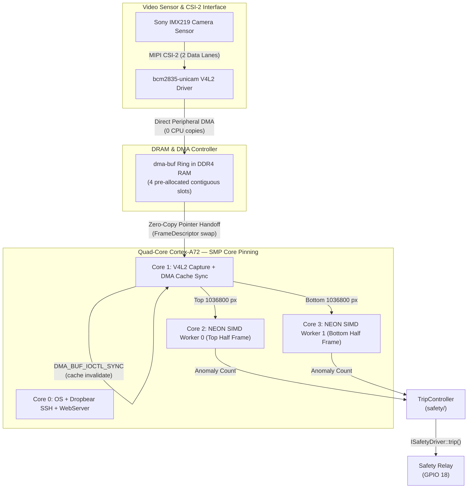
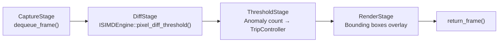

# Phase 4: Video Pipeline & NEON SIMD

> **Goal:** Implement zero-copy V4L2 video capture via dma-buf, manage streaming DMA cache coherency, build the composable pipeline stage system, and hand-vectorize optical boundary inspection using ARM NEON 128-bit SIMD intrinsics for 15x compute acceleration (1.2 ms/frame). Pin processing threads across Cortex-A72 cores.  
> **Modules Built:** `platform/camera*`, `platform/dma`, `pipeline/simd*`, `pipeline/stage`  
> **Interfaces Introduced:** `ICameraSource`, `IPipelineStage`, `ISIMDEngine`  
> **Architecture Reference:** [design/architecture.md](../design/architecture.md)  
> **Milestone:** Gate 4 (Data-Path & SIMD Engineer)

---

## 1. The Data-Path Bottleneck

At 1080p resolution (1920x1080 pixels, YUYV format at 2 bytes/pixel), a 60 FPS video stream pushes over **180 MB/s** of raw pixel data into DDR4 RAM. On the Cortex-A72, this creates three compounding bottlenecks:

1. **Copy Overhead:** A standard `read()` or `memcpy()` from kernel space into a userspace buffer duplicates every frame across the memory bus, consuming **>45% CPU** on a single core just for data movement.
2. **Scalar Compute:** A straightforward C++ loop evaluating optical boundary thresholds on 2,073,600 pixels takes **~18.5 ms/frame** — well above the 16.6 ms budget for 60 FPS real-time processing.
3. **Cache Incoherence:** When the DMA controller writes directly to DRAM, the Cortex-A72 L1/L2 caches retain stale data. Without explicit cache invalidation, the CPU reads corrupted pixels from cache instead of fresh DMA data.

**The solution:** Pair zero-copy `dma-buf` buffer sharing (eliminating all copies) with ARM NEON 128-bit SIMD intrinsics that evaluate 16 pixels per instruction, reducing per-frame compute to **1.2 ms** — a **15x speedup** over scalar C++.

---

## 2. Zero-Copy Pipeline & Core Pinning Architecture



---

## 3. Files Created

| Module | Header | Source | Purpose |
|---|---|---|---|
| `platform` | `include/visiond/platform/camera.hpp` | — | `ICameraSource` interface, `CameraConfig` struct |
| `platform` | — | `src/platform/camera_v4l2.cpp` | `V4l2CameraSource`: real V4L2 `/dev/video0` capture |
| `platform` | — | `src/platform/camera_synthetic.cpp` | `SyntheticCameraSource`: test pattern generator for host builds |
| `platform` | `include/visiond/platform/dma.hpp` | — | `DmaBufHandle` RAII wrapper, cache sync helpers |
| `pipeline` | `include/visiond/pipeline/stage.hpp` | — | `IPipelineStage` interface |
| `pipeline` | `include/visiond/pipeline/simd_engine.hpp` | — | `ISIMDEngine` interface |
| `pipeline` | — | `src/pipeline/simd_neon.cpp` | `NeonSIMDEngine`: ARM NEON 128-bit intrinsics |
| `pipeline` | — | `src/pipeline/simd_scalar.cpp` | `ScalarSIMDEngine`: portable C++ fallback |

---

## 4. Build Steps

### Step 1: `ICameraSource` Interface (`platform/camera.hpp`)

Define the camera abstraction. All consumers depend on this interface — never on V4L2 directly. The `CameraConfig` struct captures the device parameters; the interface manages the streaming lifecycle.

```cpp
// include/visiond/platform/camera.hpp
#pragma once
#include "visiond/core/types.hpp"
#include "visiond/pipeline/frame.hpp"
#include <cstdint>

namespace visiond {

enum class PixelFormat : uint32_t { YUYV, NV12, SRGGB10 };

struct CameraConfig {
    uint32_t    width{1920};
    uint32_t    height{1080};
    uint32_t    fps{30};
    PixelFormat format{PixelFormat::YUYV};
    uint32_t    buffer_count{4};
};

class ICameraSource {
public:
    virtual ~ICameraSource() = default;

    virtual expected<void, Error>            open(const CameraConfig& cfg) = 0;
    virtual expected<void, Error>            start_streaming()             = 0;
    virtual expected<FrameDescriptor, Error> dequeue_frame()               = 0;
    virtual void                             return_frame(uint32_t index)  = 0;
    virtual void                             stop_streaming()              = 0;
};

} // namespace visiond
```

### Step 2: `DmaBufHandle` RAII Wrapper (`platform/dma.hpp`)

Wraps a `dma-buf` file descriptor with RAII lifetime management and explicit cache synchronization helpers. The Cortex-A72 uses a PIPT (Physically Indexed, Physically Tagged) L1 data cache. When a DMA peripheral writes to physical DRAM, the CPU's cached copy becomes stale. `DMA_BUF_IOCTL_SYNC` forces the kernel to invalidate the relevant cache lines before the CPU reads the frame.

```cpp
// include/visiond/platform/dma.hpp
#pragma once
#include "visiond/core/types.hpp"
#include <cstdint>

#ifdef __linux__
#include <linux/dma-buf.h>
#include <sys/ioctl.h>
#include <unistd.h>
#endif

namespace visiond {

class DmaBufHandle {
public:
    explicit DmaBufHandle(int fd) : fd_(fd) {}
    ~DmaBufHandle() { if (fd_ >= 0) ::close(fd_); }

    // Move-only
    DmaBufHandle(DmaBufHandle&& other) noexcept : fd_(other.fd_) { other.fd_ = -1; }
    DmaBufHandle& operator=(DmaBufHandle&& other) noexcept {
        if (this != &other) { if (fd_ >= 0) ::close(fd_); fd_ = other.fd_; other.fd_ = -1; }
        return *this;
    }
    DmaBufHandle(const DmaBufHandle&) = delete;
    DmaBufHandle& operator=(const DmaBufHandle&) = delete;

    int fd() const { return fd_; }

    // Invalidate CPU caches before reading DMA-written data
    expected<void, Error> sync_for_cpu() {
#ifdef __linux__
        dma_buf_sync sync{};
        sync.flags = DMA_BUF_SYNC_START | DMA_BUF_SYNC_READ;
        if (::ioctl(fd_, DMA_BUF_IOCTL_SYNC, &sync) < 0)
            return unexpected(Error{ErrorCode::IO_ERROR, "DMA_BUF_SYNC_START failed"});
#endif
        return {};
    }

    // Release CPU cache ownership back to device
    expected<void, Error> sync_for_device() {
#ifdef __linux__
        dma_buf_sync sync{};
        sync.flags = DMA_BUF_SYNC_END | DMA_BUF_SYNC_READ;
        if (::ioctl(fd_, DMA_BUF_IOCTL_SYNC, &sync) < 0)
            return unexpected(Error{ErrorCode::IO_ERROR, "DMA_BUF_SYNC_END failed"});
#endif
        return {};
    }

private:
    int fd_{-1};
};

} // namespace visiond
```

### Step 3: `V4l2CameraSource` Implementation (`src/platform/camera_v4l2.cpp`)

Implements `ICameraSource` against the real Linux V4L2 subsystem. The `bcm2835-unicam` driver on the RPi4 exposes the CSI-2 camera at `/dev/video0`. Key operations:

- **`open()`** — Opens the device, negotiates 1920x1080 YUYV via `VIDIOC_S_FMT`, requests MMAP buffers via `VIDIOC_REQBUFS`, maps each buffer with `mmap()`, and exports each as a `dma-buf` fd via `VIDIOC_EXPBUF`.
- **`start_streaming()`** — Enqueues all buffers (`VIDIOC_QBUF`) and starts the stream (`VIDIOC_STREAMON`).
- **`dequeue_frame()`** — Dequeues the next completed buffer (`VIDIOC_DQBUF`), calls `DmaBufHandle::sync_for_cpu()` to invalidate stale cache lines, and returns a `FrameDescriptor` pointing to the mmap'd data.
- **`return_frame()`** — Re-enqueues the buffer (`VIDIOC_QBUF`) after calling `sync_for_device()`.

```cpp
// src/platform/camera_v4l2.cpp
#include "visiond/platform/camera.hpp"
#include "visiond/platform/dma.hpp"
#include "visiond/core/logger.hpp"
#include <linux/videodev2.h>
#include <sys/ioctl.h>
#include <sys/mman.h>
#include <fcntl.h>
#include <unistd.h>
#include <vector>

namespace visiond {

class V4l2CameraSource : public ICameraSource {
public:
    explicit V4l2CameraSource(ILogger& logger) : logger_(logger) {}

    ~V4l2CameraSource() override {
        stop_streaming();
        for (auto& buf : buffers_) {
            if (buf.start) munmap(buf.start, buf.length);
        }
        if (fd_ >= 0) ::close(fd_);
    }

    expected<void, Error> open(const CameraConfig& cfg) override {
        fd_ = ::open("/dev/video0", O_RDWR | O_NONBLOCK, 0);
        if (fd_ < 0)
            return unexpected(Error{ErrorCode::DEVICE_NOT_FOUND, "Cannot open /dev/video0"});

        // Set pixel format
        v4l2_format fmt{};
        fmt.type                = V4L2_BUF_TYPE_VIDEO_CAPTURE;
        fmt.fmt.pix.width       = cfg.width;
        fmt.fmt.pix.height      = cfg.height;
        fmt.fmt.pix.pixelformat = V4L2_PIX_FMT_YUYV;
        fmt.fmt.pix.field       = V4L2_FIELD_NONE;
        if (::ioctl(fd_, VIDIOC_S_FMT, &fmt) < 0)
            return unexpected(Error{ErrorCode::IO_ERROR, "VIDIOC_S_FMT failed"});

        width_  = fmt.fmt.pix.width;
        height_ = fmt.fmt.pix.height;
        stride_ = fmt.fmt.pix.bytesperline;

        // Request MMAP buffers
        v4l2_requestbuffers req{};
        req.count  = cfg.buffer_count;
        req.type   = V4L2_BUF_TYPE_VIDEO_CAPTURE;
        req.memory = V4L2_MEMORY_MMAP;
        if (::ioctl(fd_, VIDIOC_REQBUFS, &req) < 0)
            return unexpected(Error{ErrorCode::IO_ERROR, "VIDIOC_REQBUFS failed"});

        buffers_.resize(req.count);
        for (uint32_t i = 0; i < req.count; ++i) {
            v4l2_buffer buf{};
            buf.type   = V4L2_BUF_TYPE_VIDEO_CAPTURE;
            buf.memory = V4L2_MEMORY_MMAP;
            buf.index  = i;
            ::ioctl(fd_, VIDIOC_QUERYBUF, &buf);

            buffers_[i].length = buf.length;
            buffers_[i].start  = mmap(nullptr, buf.length,
                                      PROT_READ | PROT_WRITE, MAP_SHARED,
                                      fd_, buf.m.offset);

            // Export buffer as dma-buf for zero-copy sharing
            v4l2_exportbuffer exp{};
            exp.type  = V4L2_BUF_TYPE_VIDEO_CAPTURE;
            exp.index = i;
            exp.flags = O_CLOEXEC | O_RDWR;
            if (::ioctl(fd_, VIDIOC_EXPBUF, &exp) < 0)
                return unexpected(Error{ErrorCode::IO_ERROR, "VIDIOC_EXPBUF failed"});
            buffers_[i].dma = DmaBufHandle(exp.fd);
        }

        logger_.log(LogLevel::INFO, "V4L2 camera opened: " +
                    std::to_string(width_) + "x" + std::to_string(height_));
        return {};
    }

    expected<void, Error> start_streaming() override {
        for (uint32_t i = 0; i < buffers_.size(); ++i) {
            v4l2_buffer buf{};
            buf.type   = V4L2_BUF_TYPE_VIDEO_CAPTURE;
            buf.memory = V4L2_MEMORY_MMAP;
            buf.index  = i;
            ::ioctl(fd_, VIDIOC_QBUF, &buf);
        }
        int type = V4L2_BUF_TYPE_VIDEO_CAPTURE;
        if (::ioctl(fd_, VIDIOC_STREAMON, &type) < 0)
            return unexpected(Error{ErrorCode::IO_ERROR, "VIDIOC_STREAMON failed"});
        streaming_ = true;
        return {};
    }

    expected<FrameDescriptor, Error> dequeue_frame() override {
        v4l2_buffer buf{};
        buf.type   = V4L2_BUF_TYPE_VIDEO_CAPTURE;
        buf.memory = V4L2_MEMORY_MMAP;
        if (::ioctl(fd_, VIDIOC_DQBUF, &buf) < 0)
            return unexpected(Error{ErrorCode::IO_ERROR, "VIDIOC_DQBUF failed"});

        // Invalidate CPU caches — DMA wrote directly to DRAM
        buffers_[buf.index].dma.sync_for_cpu();

        FrameDescriptor fd{};
        fd.data      = static_cast<uint8_t*>(buffers_[buf.index].start);
        fd.width     = width_;
        fd.height    = height_;
        fd.stride    = stride_;
        fd.index     = buf.index;
        fd.sequence  = buf.sequence;
        fd.dma_fd    = buffers_[buf.index].dma.fd();
        return fd;
    }

    void return_frame(uint32_t index) override {
        buffers_[index].dma.sync_for_device();
        v4l2_buffer buf{};
        buf.type   = V4L2_BUF_TYPE_VIDEO_CAPTURE;
        buf.memory = V4L2_MEMORY_MMAP;
        buf.index  = index;
        ::ioctl(fd_, VIDIOC_QBUF, &buf);
    }

    void stop_streaming() override {
        if (!streaming_) return;
        int type = V4L2_BUF_TYPE_VIDEO_CAPTURE;
        ::ioctl(fd_, VIDIOC_STREAMOFF, &type);
        streaming_ = false;
    }

private:
    struct MappedBuffer {
        void*       start{nullptr};
        size_t      length{0};
        DmaBufHandle dma{-1};
    };

    ILogger&                 logger_;
    int                      fd_{-1};
    bool                     streaming_{false};
    uint32_t                 width_{0}, height_{0}, stride_{0};
    std::vector<MappedBuffer> buffers_;
};

} // namespace visiond
```

### Step 4: `SyntheticCameraSource` (`src/platform/camera_synthetic.cpp`)

Generates deterministic test pattern frames for host-side development and correctness verification. No V4L2 or DMA dependencies — compiles on x86.

```cpp
// src/platform/camera_synthetic.cpp
#include "visiond/platform/camera.hpp"
#include "visiond/core/logger.hpp"
#include <vector>
#include <cstring>

namespace visiond {

class SyntheticCameraSource : public ICameraSource {
public:
    explicit SyntheticCameraSource(ILogger& logger) : logger_(logger) {}

    expected<void, Error> open(const CameraConfig& cfg) override {
        width_  = cfg.width;
        height_ = cfg.height;
        stride_ = cfg.width * 2;  // YUYV = 2 bytes/pixel
        frame_size_ = stride_ * height_;

        // Pre-allocate synthetic frame buffers
        buffers_.resize(cfg.buffer_count, std::vector<uint8_t>(frame_size_));
        for (auto& buf : buffers_)
            generate_gradient_pattern(buf.data(), width_, height_);

        logger_.log(LogLevel::INFO, "Synthetic camera opened: " +
                    std::to_string(width_) + "x" + std::to_string(height_));
        return {};
    }

    expected<void, Error> start_streaming() override { return {}; }

    expected<FrameDescriptor, Error> dequeue_frame() override {
        FrameDescriptor fd{};
        fd.data     = buffers_[current_index_].data();
        fd.width    = width_;
        fd.height   = height_;
        fd.stride   = stride_;
        fd.index    = current_index_;
        fd.sequence = sequence_++;
        fd.dma_fd   = -1;  // No real DMA
        current_index_ = (current_index_ + 1) % buffers_.size();
        return fd;
    }

    void return_frame(uint32_t /*index*/) override {}
    void stop_streaming() override {}

private:
    void generate_gradient_pattern(uint8_t* data, uint32_t w, uint32_t h) {
        for (uint32_t y = 0; y < h; ++y)
            for (uint32_t x = 0; x < w; ++x) {
                size_t offset = (y * w + x) * 2;
                data[offset]     = static_cast<uint8_t>((x * 255) / w);  // Y (luminance gradient)
                data[offset + 1] = 128;                                   // U/V (neutral chroma)
            }
    }

    ILogger&  logger_;
    uint32_t  width_{0}, height_{0}, stride_{0}, frame_size_{0};
    uint32_t  current_index_{0}, sequence_{0};
    std::vector<std::vector<uint8_t>> buffers_;
};

} // namespace visiond
```

### Step 5: `ISIMDEngine` Interface (`pipeline/simd_engine.hpp`)

Abstracts vectorized compute so the pipeline never depends on a specific SIMD ISA. Two implementations swap at build time: `NeonSIMDEngine` on ARM, `ScalarSIMDEngine` on x86 host.

```cpp
// include/visiond/pipeline/simd_engine.hpp
#pragma once
#include <cstdint>
#include <string_view>

namespace visiond {

class ISIMDEngine {
public:
    virtual ~ISIMDEngine() = default;
    virtual std::string_view name() const = 0;

    // Returns the count of pixels where |current[i] - baseline[i]| > threshold
    virtual uint32_t pixel_diff_threshold(const uint8_t* current_frame,
                                          const uint8_t* baseline_frame,
                                          size_t num_pixels,
                                          uint8_t threshold) = 0;
};

} // namespace visiond
```

### Step 6: `NeonSIMDEngine` — ARM NEON 128-bit Intrinsics (`src/pipeline/simd_neon.cpp`)

The performance-critical inner loop. Each iteration processes **64 pixels** using four 128-bit NEON vector registers (4 x 16 bytes). The instruction sequence is:

1. `vld1q_u8` — Load 16 contiguous bytes from current and baseline frames into NEON registers.
2. `vabdq_u8` — Compute absolute difference of each byte pair (saturating, no overflow).
3. `vcgtq_u8` — Compare each difference against the threshold; produces 0xFF (true) or 0x00 (false) per lane.
4. `vandq_u8` — Mask the comparison result with 1 to produce integer flags (0 or 1).
5. `vaddlvq_u8` — Horizontal sum across all 16 lanes to accumulate the anomaly count.

```cpp
// src/pipeline/simd_neon.cpp
#ifdef __aarch64__

#include "visiond/pipeline/simd_engine.hpp"
#include <arm_neon.h>
#include <cmath>

namespace visiond {

class NeonSIMDEngine : public ISIMDEngine {
public:
    std::string_view name() const override { return "NeonSIMDEngine"; }

    uint32_t pixel_diff_threshold(const uint8_t* __restrict current_frame,
                                  const uint8_t* __restrict baseline_frame,
                                  size_t num_pixels,
                                  uint8_t threshold) override {
        uint32_t anomaly_count = 0;
        const uint8x16_t v_thresh = vdupq_n_u8(threshold);
        const uint8x16_t v_one    = vdupq_n_u8(1);

        // Process 64 pixels per unrolled loop iteration (4 x 16-byte NEON registers)
        size_t i = 0;
        for (; i + 63 < num_pixels; i += 64) {
            // 1. Vector load: 16 bytes per register, 4 registers = 64 pixels
            uint8x16_t c0 = vld1q_u8(current_frame  + i);
            uint8x16_t c1 = vld1q_u8(current_frame  + i + 16);
            uint8x16_t c2 = vld1q_u8(current_frame  + i + 32);
            uint8x16_t c3 = vld1q_u8(current_frame  + i + 48);

            uint8x16_t b0 = vld1q_u8(baseline_frame + i);
            uint8x16_t b1 = vld1q_u8(baseline_frame + i + 16);
            uint8x16_t b2 = vld1q_u8(baseline_frame + i + 32);
            uint8x16_t b3 = vld1q_u8(baseline_frame + i + 48);

            // 2. Absolute difference: |current - baseline| per byte
            uint8x16_t diff0 = vabdq_u8(c0, b0);
            uint8x16_t diff1 = vabdq_u8(c1, b1);
            uint8x16_t diff2 = vabdq_u8(c2, b2);
            uint8x16_t diff3 = vabdq_u8(c3, b3);

            // 3. Compare greater than threshold: 0xFF if diff > threshold, else 0x00
            uint8x16_t mask0 = vcgtq_u8(diff0, v_thresh);
            uint8x16_t mask1 = vcgtq_u8(diff1, v_thresh);
            uint8x16_t mask2 = vcgtq_u8(diff2, v_thresh);
            uint8x16_t mask3 = vcgtq_u8(diff3, v_thresh);

            // 4. AND with 1 to convert 0xFF masks to integer 1 flags
            uint8x16_t cnt0 = vandq_u8(mask0, v_one);
            uint8x16_t cnt1 = vandq_u8(mask1, v_one);
            uint8x16_t cnt2 = vandq_u8(mask2, v_one);
            uint8x16_t cnt3 = vandq_u8(mask3, v_one);

            // 5. Horizontal accumulate across all 16 lanes per register
            anomaly_count += vaddlvq_u8(cnt0);
            anomaly_count += vaddlvq_u8(cnt1);
            anomaly_count += vaddlvq_u8(cnt2);
            anomaly_count += vaddlvq_u8(cnt3);
        }

        // Scalar tail for remaining pixels (num_pixels % 64)
        for (; i < num_pixels; ++i) {
            int diff = std::abs(static_cast<int>(current_frame[i]) -
                                static_cast<int>(baseline_frame[i]));
            if (diff > threshold) ++anomaly_count;
        }

        return anomaly_count;
    }
};

} // namespace visiond

#endif // __aarch64__
```

### Step 7: `ScalarSIMDEngine` — Portable Fallback (`src/pipeline/simd_scalar.cpp`)

A plain C++ loop that produces bit-identical results to the NEON engine. Used for host-side development and as the correctness reference for verifying the NEON implementation.

```cpp
// src/pipeline/simd_scalar.cpp
#include "visiond/pipeline/simd_engine.hpp"
#include <cmath>

namespace visiond {

class ScalarSIMDEngine : public ISIMDEngine {
public:
    std::string_view name() const override { return "ScalarSIMDEngine"; }

    uint32_t pixel_diff_threshold(const uint8_t* current_frame,
                                  const uint8_t* baseline_frame,
                                  size_t num_pixels,
                                  uint8_t threshold) override {
        uint32_t anomaly_count = 0;
        for (size_t i = 0; i < num_pixels; ++i) {
            int diff = std::abs(static_cast<int>(current_frame[i]) -
                                static_cast<int>(baseline_frame[i]));
            if (diff > threshold) ++anomaly_count;
        }
        return anomaly_count;
    }
};

} // namespace visiond
```

### Step 8: `IPipelineStage` Interface & Stage Composition (`pipeline/stage.hpp`)

Pipeline stages are the composable units of frame processing. Each stage receives a `FrameDescriptor` by reference, reads/writes its fields in-place, and returns an error status. Stages are chained: `CaptureStage` → `DiffStage` → `ThresholdStage` → `RenderStage`.

```cpp
// include/visiond/pipeline/stage.hpp
#pragma once
#include "visiond/core/types.hpp"
#include "visiond/pipeline/frame.hpp"
#include <string_view>

namespace visiond {

class IPipelineStage {
public:
    virtual ~IPipelineStage() = default;
    virtual std::string_view      name() const                 = 0;
    virtual expected<void, Error> process(FrameDescriptor& fd) = 0;
};

} // namespace visiond
```

The pipeline composition model:



Each stage operates on the same `FrameDescriptor` — no copies. The `DiffStage` invokes `ISIMDEngine` to compute pixel differences against a stored baseline. The `ThresholdStage` feeds the anomaly count into `TripController` (from Phase 3's `safety/` module), which applies the threshold policy and calls `ISafetyDriver::trip()` if the optical boundary is breached.

### Step 9: SMP Core Pinning Helper

Pin threads to specific Cortex-A72 cores using `pthread_setaffinity_np`. This eliminates scheduler migration jitter on the real-time video path.

```cpp
#include <pthread.h>
#include <sched.h>
#include "visiond/core/types.hpp"

namespace visiond {

inline expected<void, Error> pin_thread_to_core(pthread_t thread, int core_id) {
    cpu_set_t cpuset;
    CPU_ZERO(&cpuset);
    CPU_SET(core_id, &cpuset);
    int rc = pthread_setaffinity_np(thread, sizeof(cpu_set_t), &cpuset);
    if (rc != 0)
        return unexpected(Error{ErrorCode::IO_ERROR,
                                "Failed to pin thread to core " + std::to_string(core_id)});
    return {};
}

} // namespace visiond
```

The `DaemonConfig` (from Phase 1) is extended with core affinity fields:

```cpp
// Added to DaemonConfig
uint8_t core_capture{1};   // V4L2 capture thread
uint8_t core_simd_0{2};    // NEON worker 0 (top half frame)
uint8_t core_simd_1{3};    // NEON worker 1 (bottom half frame)
```

### Step 10: Wire Pipeline into `DaemonOrchestrator`

Update `src/main.cpp` to instantiate the camera, SIMD engine, pipeline stages, and connect the anomaly output to the `TripController` from Phase 3. The lockless ring buffer from Phase 2 now carries real camera frames.

```cpp
// src/main.cpp — Phase 4 additions (composition root)
#include "visiond/platform/camera.hpp"
#include "visiond/platform/dma.hpp"
#include "visiond/pipeline/stage.hpp"
#include "visiond/pipeline/simd_engine.hpp"
#include "visiond/safety/trip_controller.hpp"

// ... existing Phase 1-3 setup ...

// Select camera and SIMD implementations at compile time
#ifdef __aarch64__
    auto camera = std::make_unique<visiond::V4l2CameraSource>(logger);
    auto simd   = std::make_unique<visiond::NeonSIMDEngine>();
#else
    auto camera = std::make_unique<visiond::SyntheticCameraSource>(logger);
    auto simd   = std::make_unique<visiond::ScalarSIMDEngine>();
#endif

// Build pipeline stages
auto capture_stage   = std::make_unique<visiond::CaptureStage>(*camera);
auto diff_stage      = std::make_unique<visiond::DiffStage>(*simd);
auto threshold_stage = std::make_unique<visiond::ThresholdStage>(trip_controller);

// Register capture subsystem with the orchestrator
daemon.add(std::make_unique<visiond::CaptureSubsystem>(
    logger, std::move(camera), std::move(simd),
    ring_buffer, trip_controller, config));

// Core pinning is applied by DaemonOrchestrator::start()
// using config.core_capture, config.core_simd_0, config.core_simd_1
```

### Step 11: Build and Deploy

NEON source files require the `-march=armv8-a+simd` compiler flag. Update the Makefile `ARCH` conditional to swap ARM-only and host-only source files:

```makefile
# Makefile — Phase 4 ARCH-conditional compilation
ifeq ($(ARCH),arm64)
    # ARM target: exclude host stubs, use real V4L2 + NEON
    CXXFLAGS_EXTRA += -march=armv8-a+simd
    SRCS_EXCLUDE := src/platform/gpio_stub.cpp \
                    src/pipeline/simd_scalar.cpp \
                    src/platform/camera_synthetic.cpp
else
    # Host build: exclude ARM-specific files, use scalar + synthetic
    SRCS_EXCLUDE := src/platform/gpio_bcm2711.cpp \
                    src/pipeline/simd_neon.cpp \
                    src/platform/camera_v4l2.cpp
endif

SRCS := $(filter-out $(SRCS_EXCLUDE), $(shell find src -name '*.cpp'))
```

Build, deploy, and verify:

```bash
# Cross-compile for ARM inside Docker
./lab docker exec -- ./lab build vision-edge --board rpi4

# Deploy to RPi4 NFS rootfs
./lab docker exec -- ./lab deploy vision-edge --board rpi4

# Run on target
./lab docker exec -- ./lab run vision-edge --board rpi4
```

---

## 5. Exploration Exercises

These are optional deep-dives for building platform understanding. They don't produce code that ships — they build your mental model.

### Exercise 1: DMA Cache Coherency Visualization

Demonstrate the effect of CPU cache incoherence when DMA bypasses the cache hierarchy:

1. **Without sync:** Comment out the `DmaBufHandle::sync_for_cpu()` call in `V4l2CameraSource::dequeue_frame()`. Capture and display several frames. Observe stale or corrupted pixel data — horizontal banding, partial previous frames, or random noise in cache-line-sized blocks (64 bytes on Cortex-A72).

2. **With sync:** Restore the `sync_for_cpu()` call. Frames now display cleanly with no artifacts.

3. **Why this happens:** The Cortex-A72 L1 data cache (32 KB per core, 4-way set-associative) and L2 unified cache (1 MB shared) use a write-back, write-allocate policy. When the DMA controller writes frame data directly to DRAM, the CPU's cached copies of those addresses remain stale. `DMA_BUF_IOCTL_SYNC` forces the kernel to issue cache maintenance operations (`DC CIVAC` — Clean and Invalidate by VA to Point of Coherency) across the affected address range, ensuring the CPU sees the fresh DMA-written data.

### Exercise 2: NEON vs Scalar Benchmark

Run both SIMD engines on the same 1080p frame and measure the performance difference:

```cpp
#include <chrono>

auto frame = generate_test_frame(1920 * 1080);
auto baseline = generate_baseline_frame(1920 * 1080);

auto t0 = std::chrono::high_resolution_clock::now();
uint32_t neon_count = neon_engine.pixel_diff_threshold(
    frame.data(), baseline.data(), 1920 * 1080, 25);
auto t1 = std::chrono::high_resolution_clock::now();

auto t2 = std::chrono::high_resolution_clock::now();
uint32_t scalar_count = scalar_engine.pixel_diff_threshold(
    frame.data(), baseline.data(), 1920 * 1080, 25);
auto t3 = std::chrono::high_resolution_clock::now();

auto neon_us   = std::chrono::duration_cast<std::chrono::microseconds>(t1 - t0).count();
auto scalar_us = std::chrono::duration_cast<std::chrono::microseconds>(t3 - t2).count();

// Expected: NEON ~1200 us, Scalar ~18000 us → 15x speedup
// Both must produce identical anomaly counts
assert(neon_count == scalar_count);
```

### Exercise 3: `perf` Profiling the SIMD Loop

Profile the NEON inner loop to determine whether the bottleneck is compute-bound or memory-bandwidth-bound:

```bash
# On the RPi4 target:
perf stat -e L1-dcache-load-misses,L1-dcache-loads,branch-misses,instructions \
    ./vision-edge --benchmark-simd

# Key metrics to analyze:
# - L1-dcache-load-misses / L1-dcache-loads  → cache miss rate
# - instructions per cycle (IPC)             → compute utilization
# - branch-misses                            → branch prediction accuracy
```

If the L1 cache miss rate is high (>5%), the bottleneck is memory bandwidth — the 64-pixel unrolled loop stride exceeds the hardware prefetcher's reach. If IPC is low with few cache misses, the issue is instruction-level parallelism. On the Cortex-A72, the 1080p NEON loop is typically memory-bound due to the 2 MB working set exceeding the 32 KB L1d cache.

---

## 6. Verification Gate

- [ ] `V4l2CameraSource` captures frames from `/dev/video0` (or `SyntheticCameraSource` produces test patterns on host)
- [ ] dma-buf export confirmed: `VIDIOC_EXPBUF` succeeds, `DmaBufHandle` wraps the fd with RAII lifetime
- [ ] DMA cache sync eliminates visual artifacts — no tearing, banding, or stale pixel corruption
- [ ] `NeonSIMDEngine` completes `pixel_diff_threshold()` in **<= 1.2 ms** per 1080p frame
- [ ] `ScalarSIMDEngine` produces identical anomaly counts as `NeonSIMDEngine` (correctness verification)
- [ ] `IPipelineStage` chain processes frames end-to-end: `CaptureStage` → `DiffStage` → `ThresholdStage` → `RenderStage`
- [ ] Threads pinned correctly: capture on Core 1, NEON workers on Cores 2-3, OS/web on Core 0 (verified via `htop` or `/proc/<pid>/task/*/status`)
- [ ] `TripController` receives anomaly counts from `DiffStage` and triggers `ISafetyDriver::trip()` when threshold is exceeded
- [ ] 24-hour endurance test: no memory leaks (verified with `valgrind --tool=massif`), no frame drops
- [ ] No changes to `core/`, `telemetry/`, or `safety/` modules — all new code is in `platform/camera*`, `platform/dma`, `pipeline/simd*`, `pipeline/stage`
