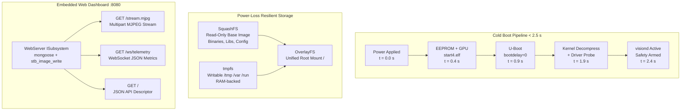
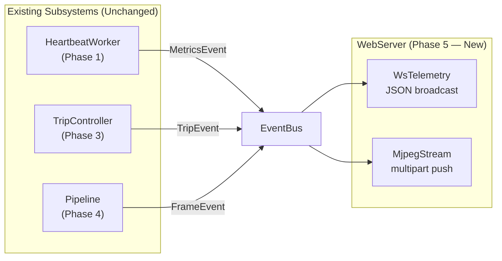

# Phase 5: Productization & Instant Boot

> **Goal:** Build the embedded web dashboard (HTTP + MJPEG + WebSocket), assemble a minimal read-only SquashFS + OverlayFS root filesystem via Buildroot (<25 MB), optimize cold-boot to sub-2.5 seconds, and validate power-loss immunity.  
> **Modules Built:** `web/*`, Buildroot configs  
> **Interfaces Introduced:** `WebServer`, `MjpegStream`, `WsTelemetry`  
> **Architecture Reference:** [design/architecture.md](../design/architecture.md)  
> **Milestone:** Gate 5 (Production Appliance)

---

## 1. The Appliance Engineering Challenge

An industrial edge gateway cannot run like a desktop Linux workstation. Three realities dictate the entire Phase 5 design:

1. **Unforgiving Factory Power:** Operators cut machine power abruptly — no graceful shutdown. A standard ext4 root filesystem risks journal corruption and boot failure, turning a power glitch into a maintenance incident.
2. **Instant Operational Readiness:** The safety interlock must arm and the camera must stream within **2.5 seconds of power application**. A 30-second `systemd` startup is unacceptable when the interlock guards a physical barrier on a live production line.
3. **Web Telemetry Without Custom Software:** Operators need a live visual inspection feed and diagnostic health gauges in any standard web browser — Chrome, Firefox, or a ruggedized panel PC. No native client installs, no VPN setup, no IT tickets.

---

## 2. Appliance Architecture

The production appliance rests on three pillars: a deterministic cold-boot pipeline, a power-loss-resilient storage stack, and an embedded web server — all unified inside the single `visiond` binary.



---

## 3. Files Created

| Module | Header | Source | Purpose |
|---|---|---|---|
| `core` | `include/visiond/core/events.hpp` | — | Consolidated event types: `MetricsEvent`, `FrameEvent`, `TripEvent` |
| `web` | `include/visiond/web/server.hpp` | `src/web/server.cpp` | `WebServer` `ISubsystem`: mongoose HTTP + WS routing |
| `web` | `include/visiond/web/stream.hpp` | `src/web/stream.cpp` | `MjpegStream` (frame → JPEG → SharedState) |
| `web` | `include/visiond/web/jpeg.hpp` | `src/web/jpeg.cpp` | JPEG encoding utility (stb_image_write wrapper) |
| `web` | `include/visiond/web/shared_state.hpp` | — | Thread-safe bridge between EventBus and mongoose poll loop |
| `web` | — | `src/web/telemetry.cpp` | `WsTelemetry` (metrics/trip → JSON → SharedState) |
| `web` | — | `src/web/vendor_mongoose.c` | Compiles mongoose v7.14 from `shared/lib/vendor/` |
| `web` | — | `src/web/vendor_stb.cpp` | Compiles stb_image_write v1.16 from `shared/lib/vendor/` |
| — | — | `web/dashboard.html` | Dashboard source (embedded in binary at build time via `xxd -i`) |
| — | `buildroot/configs/visiond_rpi4_defconfig` | — | Buildroot defconfig for minimal rootfs |
| — | `buildroot/overlay/` | — | Rootfs overlay (init script, fstab, visiond binary) |

---

## 4. Build Steps

### Step 1: WebServer ISubsystem (`web/server.hpp`, `src/web/server.cpp`)

`WebServer` implements `ISubsystem` exactly like `HeartbeatWorker` from Phase 1 — the orchestrator manages it generically. It binds to a configurable port (default `:8080`) and serves three routes:

| Route | Method | Content-Type | Purpose |
|---|---|---|---|
| `/` | `GET` | `text/html` | Embedded dashboard (compiled into binary at build time) |
| `/api/info` | `GET` | `application/json` | JSON API descriptor (name, version, endpoints) |
| `/stream.mjpg` | `GET` | `multipart/x-mixed-replace` | Live MJPEG video stream |
| `/ws/telemetry` | Upgrade | WebSocket | Real-time JSON metrics push |

The dashboard HTML (`web/dashboard.html`) is **embedded in the binary** at build time via `xxd -i`. Operators navigate to `http://<rpi4-ip>:8080/` and get the full UI — no files to distribute. The source file is kept for local development (auto-detects `localhost` vs serving host).

The critical architectural decision: `WebServer` **subscribes to `EventBus` events** rather than polling or calling into other subsystems. It receives `MetricsEvent` from `HeartbeatWorker` and `FrameEvent` from the pipeline via the same typed pub/sub dispatcher used throughout the system. This means **zero changes to `pipeline/`, `safety/`, `telemetry/`, or `core/` modules**.

The HTTP/WebSocket server uses **mongoose v7.14** (GPLv2) and JPEG encoding uses **stb_image_write v1.16** (public domain), both vendored in `shared/lib/vendor/`.



Class declaration:

```cpp
// include/visiond/web/server.hpp
#pragma once
#include "visiond/core/lifecycle.hpp"
#include "visiond/core/event.hpp"
#include "visiond/core/config.hpp"
#include "visiond/core/logger.hpp"
#include "visiond/web/stream.hpp"
#include <thread>
#include <atomic>

namespace visiond {

class WebServer : public ISubsystem {
public:
    WebServer(ILogger& logger, EventBus& bus, const DaemonConfig& config);
    ~WebServer() override;

    expected<void, Error> init()  override;
    expected<void, Error> start() override;
    void                  stop()  override;
    std::string_view  name()  const override { return "webserver"; }
    SubsystemState    state() const override { return state_; }

private:
    void accept_loop();
    void handle_request(int client_fd);
    void route_dashboard(int client_fd);
    void route_mjpeg(int client_fd);
    void route_websocket(int client_fd);

    ILogger&       logger_;
    EventBus&      bus_;
    uint16_t       port_;
    int            listen_fd_{-1};
    SubsystemState state_{SubsystemState::CREATED};
    std::atomic<bool> running_{false};
    std::thread       accept_thread_;

    MjpegStream    mjpeg_;
    WsTelemetry    ws_telemetry_;
};

} // namespace visiond
```

The constructor receives `ILogger&`, `EventBus&`, and `DaemonConfig&` via dependency injection — no globals, no singletons. During `init()`, the server creates a TCP socket and binds to the configured port. During `start()`, it launches the accept thread and registers its `EventBus` subscriptions. During `stop()`, it closes the listen socket, joins the accept thread, and disconnects all clients.

### Step 2: MjpegStream (`web/stream.hpp`)

`MjpegStream` subscribes to `FrameEvent` from the pipeline's `EventBus` publications. When a processed frame arrives, it JPEG-encodes the pixel data and pushes it to all connected HTTP clients using the `multipart/x-mixed-replace` protocol.

The multipart boundary format:

```
HTTP/1.1 200 OK\r\n
Content-Type: multipart/x-mixed-replace; boundary=visiond-frame\r\n
\r\n
--visiond-frame\r\n
Content-Type: image/jpeg\r\n
Content-Length: <size>\r\n
\r\n
<JPEG bytes>
--visiond-frame\r\n
Content-Type: image/jpeg\r\n
Content-Length: <size>\r\n
\r\n
<JPEG bytes>
...
```

Each connected browser receives a continuous stream of JPEG frames separated by multipart boundaries. The browser's native `` tag or `fetch()` API renders the stream as a live video feed without any JavaScript decoding.

```cpp
// include/visiond/web/stream.hpp (MjpegStream portion)
#pragma once
#include "visiond/core/event.hpp"
#include "visiond/pipeline/frame.hpp"
#include <vector>
#include <mutex>
#include <set>

namespace visiond {

// Published by pipeline stages when a processed frame is ready
struct FrameEvent {
    const uint8_t* data;
    uint32_t       width;
    uint32_t       height;
    uint32_t       stride;
    uint64_t       timestamp_ns;
};

class MjpegStream {
public:
    void register_events(EventBus& bus);

    void add_client(int fd);
    void remove_client(int fd);

private:
    void on_frame(const FrameEvent& event);
    std::vector<uint8_t> jpeg_encode(const uint8_t* data,
                                     uint32_t width, uint32_t height,
                                     uint32_t stride);
    void push_to_clients(const std::vector<uint8_t>& jpeg);

    std::mutex         mtx_;
    std::set<int>      client_fds_;
    static constexpr const char* BOUNDARY = "visiond-frame";
};
```

### Step 3: WsTelemetry (`web/stream.hpp`)

`WsTelemetry` subscribes to `MetricsEvent` (from `HeartbeatWorker`) and `TripEvent` (from `TripController`), then broadcasts compact JSON payloads to all connected WebSocket clients:

```json
{
    "cpu_load": 12.5,
    "mem_used_pct": 34.2,
    "fps": 58,
    "dma_latency_us": 45.2,
    "safety_armed": true,
    "safety_tripped": false,
    "trip_count": 0
}
```

The JSON is assembled with `snprintf` — no external JSON library required for this handful of fields. Payloads are small (~120 bytes) and sent at the heartbeat interval (default 1 Hz).

```cpp
// include/visiond/web/stream.hpp (WsTelemetry portion)

// Published by TripController when safety state changes
struct TripEvent {
    bool     armed;
    bool     tripped;
    uint32_t trip_count;
};

class WsTelemetry {
public:
    void register_events(EventBus& bus);

    void add_client(int fd);
    void remove_client(int fd);

private:
    void on_metrics(const MetricsEvent& event);
    void on_trip(const TripEvent& event);
    void broadcast(const std::string& json);

    std::mutex         mtx_;
    std::set<int>      client_fds_;

    // Cached latest state for newly connecting clients
    float    last_cpu_load_{0.0f};
    float    last_mem_used_pct_{0.0f};
    uint32_t last_fps_{0};
    float    last_dma_latency_us_{0.0f};
    bool     last_armed_{false};
    bool     last_tripped_{false};
    uint32_t last_trip_count_{0};
};

} // namespace visiond
```

### Step 4: Wire WebServer into DaemonOrchestrator

Adding `WebServer` to the daemon requires exactly **one line** in `main.cpp`. The `DaemonOrchestrator` manages it identically to every other `ISubsystem`:

```cpp
// src/main.cpp — Phase 5 addition (single line)
#include "visiond/web/server.hpp"

// ... existing composition root ...

visiond::DaemonOrchestrator daemon(logger, config);
daemon.add(std::make_unique<visiond::HeartbeatWorker>(
    logger, metrics_source, event_bus, config.heartbeat_interval_ms));
// Phase 2+: daemon.add<GpioSubsystem>(...);
// Phase 3+: daemon.add<SafetySubsystem>(...);
// Phase 4+: daemon.add<CaptureSubsystem>(...);

// Phase 5: one new line — zero changes to any existing subsystem
daemon.add(std::make_unique<visiond::WebServer>(logger, event_bus, config));

return daemon.run();
```

The orchestrator calls `init()` → `start()` in registration order and `stop()` in reverse order. `WebServer` starts last (after the pipeline and safety subsystems are already streaming) and stops first (draining client connections before tearing down data producers).

**Zero changes** to `pipeline/`, `safety/`, `telemetry/`, or `core/` modules. This is the direct result of the `EventBus` decoupling established in Phase 1.

### Step 5: Buildroot Minimal SquashFS Rootfs

Configure Buildroot to assemble a production root filesystem under 25 MB. The defconfig lives at `buildroot/configs/visiond_rpi4_defconfig`:

**Target Options:**
- Target Architecture: `AArch64 (little endian)`
- Target Architecture Variant: `cortex-A72`
- Target ABI: `LP64`

**Toolchain:**
- Toolchain type: Buildroot internal toolchain (avoids distribution toolchain issues)
- C library: glibc

**System Configuration:**
- Init system: BusyBox init (or custom `/sbin/init` script for fastest boot)
- `/dev` management: devtmpfs + mdev
- Root password: (none — serial console only, no SSH in production)
- Custom scripts: `/etc/init.d/S99visiond` — launches `/usr/local/bin/visiond`

**Filesystem Images:**
- Enable `squashfs` root filesystem
- Compression: `xz` (best ratio for embedded)
- Disable ext2/ext3/ext4 — no writable filesystem image

**Packages:**
- BusyBox (minimal applet set — `sh`, `mount`, `cat`, `ls`, `dmesg`)
- Kernel modules: `vision_safety.ko`, `bcm2835-unicam`, `videobuf2`
- Device tree overlay: `bcm2711-visionedge-overlay.dtbo`
- Application binary: `visiond` (statically linked)

**Target rootfs size:** < 25 MB compressed with xz.

```
buildroot/
├── configs/
│   └── visiond_rpi4_defconfig        # make visiond_rpi4_defconfig
├── overlay/
│   ├── etc/
│   │   ├── fstab                      # tmpfs mounts for /tmp, /var, /run
│   │   └── init.d/
│   │       └── S99visiond             # Start visiond daemon
│   └── usr/
│       └── local/
│           └── bin/
│               └── visiond            # Statically linked binary
└── post-build.sh                      # Strip debug symbols, remove docs
```

### Step 6: OverlayFS RAM Integration

The SquashFS image is mounted read-only as the base layer. All writable state is directed to RAM-backed `tmpfs` mounts. This eliminates filesystem corruption entirely — a power cut simply discards volatile RAM, and the immutable SquashFS base is intact for the next boot.

In `buildroot/overlay/etc/fstab`:

```fstab
# Read-only SquashFS base — no writes ever touch persistent storage
# Writable directories are RAM-backed tmpfs — lost on power-off (by design)
none    /tmp    tmpfs   defaults,nosuid,nodev       0 0
none    /var    tmpfs   defaults,nosuid,nodev       0 0
none    /run    tmpfs   defaults,nosuid,nodev       0 0
```

The storage architecture guarantees:

| Layer | Type | Writable | Survives Power Cut |
|---|---|---|---|
| `/` (base) | SquashFS on SD/eMMC | No | Yes — immutable image |
| `/tmp` | tmpfs (RAM) | Yes | No — volatile by design |
| `/var` | tmpfs (RAM) | Yes | No — volatile by design |
| `/run` | tmpfs (RAM) | Yes | No — volatile by design |

**Power cut = clean reboot.** No `fsck`, no journal recovery, no corruption. The system boots identically every time because the root filesystem is a read-only compressed block image.

### Step 7: Cold Boot Optimization (< 2.5 s)

Achieving sub-2.5-second boot requires optimizations at every stage of the boot chain — firmware, bootloader, kernel, and userspace.

**Level 1: EEPROM & VideoCore (`config.txt`)**

```ini
# Disable splash screen and boot delays
disable_splash=1
boot_delay=0

# Boost ARM clock to maximum at boot
arm_boost=1

# Load the VisionEdge device tree overlay
dtoverlay=bcm2711-visionedge
```

These settings shave ~400 ms off the GPU firmware stage by eliminating the rainbow splash and diagnostic delays.

**Level 2: U-Boot (`bootdelay=0`, hardcoded boot command)**

```
setenv bootdelay 0
setenv bootcmd "booti ${kernel_addr_r} - ${fdt_addr}"
saveenv
```

Setting `bootdelay=0` eliminates the interactive countdown. The hardcoded `bootcmd` skips menu traversal and device scanning — the kernel image address and device tree address are fixed.

**Level 3: Kernel command line (`cmdline.txt`)**

```
console=ttyAMA0,115200 root=/dev/ram0 rw init=/usr/local/bin/visiond quiet loglevel=0 lpj=1500000 raid=noautodetect
```

Three critical optimizations in this command line:

| Parameter | Savings | Mechanism |
|---|---|---|
| `quiet loglevel=0` | ~200 ms | Suppresses all kernel console output during boot |
| `lpj=1500000` | ~100 ms | Pre-calibrated loops-per-jiffy skips the delay loop calibration |
| `init=/usr/local/bin/visiond` | ~300 ms | Kernel executes `visiond` directly as PID 1 — skips BusyBox init, `/etc/inittab`, and all init scripts entirely |

By pointing `init` directly at `visiond`, the kernel hands execution to the vision daemon as soon as it finishes driver probing. There is no init system, no shell, no `rc.d` script sequencing. The daemon is PID 1 and manages its own lifecycle (signal handling, child reaping if needed). This is the single largest boot time optimization.

**Boot timeline summary:**

```mermaid
gantt
    title Cold Boot Timeline (Target &lt; 2.5 s)
    dateFormat X
    axisFormat %s s

    section Firmware
    EEPROM + GPU (start4.elf)       :a1, 0, 400
    section Bootloader
    U-Boot (bootdelay=0)            :a2, 400, 900
    section Kernel
    Decompress + driver probe       :a3, 900, 1900
    section Userspace
    visiond init + start            :a4, 1900, 2400
    Safety armed + video streaming  :milestone, 2400, 2400
```



### Step 8: Build the Production Image

**Build the SquashFS image with Buildroot:**

```bash
# Clone Buildroot (or use a git submodule)
cd buildroot/
make visiond_rpi4_defconfig
make -j$(nproc)

# Output: output/images/rootfs.squashfs (target < 25 MB)
ls -lh output/images/rootfs.squashfs
```

**Assemble the boot SD card / eMMC image:**

```bash
# Partition layout:
#   Partition 1: FAT32 (boot) — start4.elf, config.txt, u-boot.bin, Image, DTB
#   Partition 2: SquashFS (rootfs) — the read-only system image

# Write the boot partition
sudo dd if=output/images/boot.vfat of=/dev/sdX1 bs=4M
# Write the rootfs partition
sudo dd if=output/images/rootfs.squashfs of=/dev/sdX2 bs=4M
sync
```

**Flash and verify:**

```bash
# Insert SD card into RPi4, connect serial console
# Power on — observe boot timing via grabserial or serial terminal
# Expected: visiond banner within 2.5 seconds of power application
```

---

## 5. End-to-End Demo Scenario

The complete production demo validates all four pillars of the appliance in sequence:

1. **Instant Power-On:** Plug 5V 3A USB-C power into the Raspberry Pi 4. The cold-boot completes to operational video streaming in **< 2.5 seconds**. The serial console shows the `visiond` banner, followed by `[webserver] Listening on :8080`. The safety interlock is armed before the operator's hand leaves the power cable.

2. **Deterministic Safety Cutoff:** Wave an object across the optical safety barrier. The top-half hardware interrupt trips the relay in **< 10 microseconds**, illuminating the emergency strobe. The pipeline freezes the incident frame and publishes a `TripEvent` to the `EventBus`. The web dashboard immediately reflects the tripped state.

3. **Live Web Inspection:** Open `http://<rpi4-ip>:8080` in Chrome or Firefox. The dashboard renders a live 60 FPS MJPEG video feed at `/stream.mjpg` with red defect bounding boxes overlaid by the render stage. Alongside the video, WebSocket-driven gauges display real-time CPU load, memory usage, DMA latency, and safety status — all updating at the heartbeat interval.

4. **Power-Cut Resilience:** Pull the power plug during active streaming with connected browser clients. Wait 3 seconds. Reapply power. The board boots cleanly in < 2.5 seconds with zero filesystem corruption, zero `fsck` delays, and zero data loss. The SquashFS image is byte-identical to its pre-cut state. The dashboard is immediately available again.

---

## 6. Exploration Exercises

### Exercise 1: Boot Time Profiling

Measure the actual duration of each boot stage to identify the slowest link:

```bash
# Option A: grabserial (requires host serial connection)
grabserial -d /dev/ttyUSB0 -t -m "^NOTICE" -q "Listening on"

# Option B: kernel printk timestamps
# Temporarily set loglevel=7 in cmdline.txt, then:
dmesg | grep -E '^\[.*\]' | head -50
```

Identify the slowest stage (firmware, bootloader, kernel, or userspace init). Target that stage for further optimization. Common wins: removing unused kernel modules from the initramfs, disabling unused bus probes, or pre-linking the visiond binary.

### Exercise 2: Power-Cut Torture Test

Build an automated test rig using a USB-controlled relay (or a simple GPIO-driven power switch on a second Pi):

```bash
#!/bin/bash
# power_torture.sh — automated 20-cycle power-cut test
for i in $(seq 1 20); do
    echo "=== Cycle $i/20 ==="
    relay_on                              # Apply power
    sleep 5                               # Let visiond fully boot and stream
    curl -s http://<rpi4-ip>:8080/ > /dev/null && echo "PASS: dashboard up"
    relay_off                             # Hard power cut (no shutdown)
    sleep 2                               # Ensure full power-down
done
relay_on
sleep 5
# Final verification
curl -s http://<rpi4-ip>:8080/ > /dev/null && echo "FINAL: clean boot after 20 cuts"
```

Success criteria: clean boot and dashboard accessible on all 20 cycles, zero `fsck` errors, identical `sha256sum` of the SquashFS partition before and after the test.

### Exercise 3: SquashFS Size Optimization

Measure the impact of each optimization on the compressed rootfs size:

```bash
# Baseline
ls -lh output/images/rootfs.squashfs

# Strip all debug symbols from binaries and libraries
aarch64-linux-gnu-strip --strip-all output/target/usr/local/bin/visiond
# Rebuild squashfs
mksquashfs output/target/ rootfs_stripped.squashfs -comp xz
ls -lh rootfs_stripped.squashfs

# Remove unused BusyBox applets (edit .config → BR2_PACKAGE_BUSYBOX_CONFIG)
# Keep only: sh, mount, cat, ls, dmesg, init
# Rebuild and compare

# Remove documentation and man pages
rm -rf output/target/usr/share/doc output/target/usr/share/man
# Rebuild and compare
```

Track the delta at each step. A well-optimized VisionEdge rootfs should compress under 20 MB.

---

## 7. Verification Gate

- [ ] `WebServer` binds to `:8080` and serves embedded dashboard at `GET /`
- [ ] MJPEG stream renders live video in Chrome/Firefox at `/stream.mjpg`
- [ ] WebSocket telemetry pushes JSON metrics at `/ws/telemetry`
- [ ] SquashFS rootfs is under 25 MB compressed
- [ ] Cold-boot time from power-on to first video frame < 2.5 seconds
- [ ] 20 consecutive hard power cuts — zero corruption, clean boot every time
- [ ] No changes to `pipeline/`, `safety/`, `telemetry/`, or `core/` modules
- [ ] Complete system demo passes all 4 scenarios
