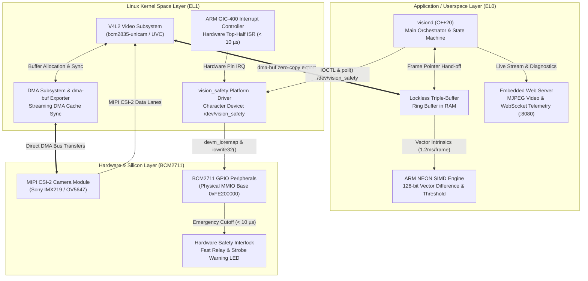
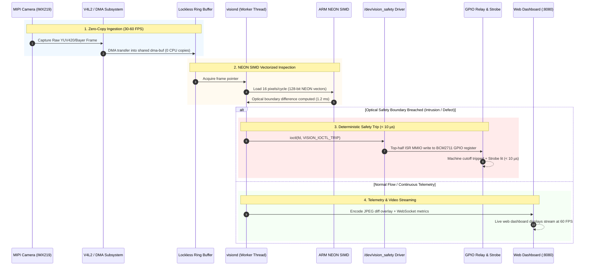

# VisionEdge: Step-by-Step Implementation Roadmap

> **Target Platform:** Raspberry Pi 4 Model B (Broadcom BCM2711 / Quad-Core Cortex-A72 @ 1.5GHz / AArch64)  
> **Development Environment:** Docker Container (`arm-lab-dev`) via `./lab` CLI  
> **Target Access:** SD-Free Network Boot (U-Boot TFTP + NFS RootFS + Dropbear SSH)

---

## 1. Monorepo Infrastructure vs. VisionEdge Status

The Soliton ARM Embedded Linux Lab monorepo already provides a production-grade development and bringup foundation for the Raspberry Pi 4. The table below maps current lab infrastructure to the VisionEdge platform engineering track:

| Infrastructure Layer | Monorepo Current State | VisionEdge Role & Integration | Status |
| :--- | :--- | :--- | :--- |
| **Toolchain & Container** | Dockerized `aarch64-linux-gnu-gcc/g++` (C++20 enabled) | Cross-compiles `visiond`, kernel modules, and libraries | **Ready** |
| **Board Bootloader** | U-Boot 2024.07 AArch64 via TFTP + PXE boot | Boots kernel `Image` over TFTP without SD card swaps | **Ready** |
| **Linux Kernel** | 64-bit Linux kernel (5.x/6.x) with high-mem DTB passthrough | Hosts V4L2 camera driver and custom `vision_safety` LKM | **Ready** |
| **Root Filesystem** | BusyBox NFS rootfs exported from Docker (`/workspace/nfs/rpi4-rootfs/`) | Fast iteration loop: compiled binaries deploy directly to NFS | **Ready** |
| **Device Communication** | Dropbear SSH (`./lab ssh --board=rpi4`), Serial UART (`./lab console`) | Remote execution, daemon telemetry inspection, GDB debugging | **Ready** |
| **Build & Deploy CLI** | `./lab build`, `./lab deploy`, `./lab run` | Orchestrates build, packaging, target deployment, and execution | **Ready** |
| **Application Layer** | Minimal scaffold `projects/vision-edge/src/main.cpp` | Needs full C++20 `visiond` daemon with multithreading | **Phase 1** |
| **Memory & CPU Profiling** | Remote GDB support (`./lab gdb`), strace/perf available | MMU translation, `/dev/mem` MMIO, lockless ring buffers | **Phase 2** |
| **Safety Platform Driver** | Clean kernel source tree available in workspace | Out-of-tree `vision_safety` LKM, DT overlay, <10µs IRQ trip | **Phase 3** |
| **Video & NEON Acceleration**| MIPI CSI-2 / V4L2 Unicam interfaces present in kernel | Zero-copy `dma-buf`, 128-bit NEON SIMD pixel differencing | **Phase 4** |
| **Production Appliance** | Buildroot tree configured in repo root | Read-only SquashFS + OverlayFS, <2.5s cold-boot optimization | **Phase 5** |

---

## 2. System Architecture



---

## 3. End-to-End Execution & Data-Path Flow



---

## 4. Hardware Wiring & BCM2711 Pinout

For bench testing, the following pin connections are established on the Raspberry Pi 4 40-pin GPIO header:

```
Raspberry Pi 4 40-Pin Header (J8)
Pin 01: 3.3V Power ------------> Logic VDD
Pin 02: 5.0V Power ------------> Relay Module VCC
Pin 06: Ground ----------------> Common GND
Pin 08: GPIO 14 (TXD0) --------> USB-UART RX (Serial Console: 115200 baud)
Pin 10: GPIO 15 (RXD0) --------> USB-UART TX (Serial Console: 115200 baud)
Pin 12: GPIO 18 (PWM0 / OUT) --> Hardware Interlock Relay Signal (Active LOW)
Pin 16: GPIO 23 (IN / IRQ) ----> Optical Safety Trigger Sensor (Falling Edge)
Pin 18: GPIO 24 (OUT) ---------> Emergency Strobe Warning LED
```

---

## 5. Phase-by-Phase Implementation Roadmap

The implementation is structured into 5 cohesive phases, taking the project from baseline userspace daemon architecture through to a hardened, sub-2.5-second boot industrial appliance:

| Phase | Title | Focus Area | Detailed Guide |
| :--- | :--- | :--- | :--- |
| **Phase 1** | **Daemon Architecture & Baseline Bringup** | C++20 `visiond`, POSIX signals, structured logging, heartbeat worker, `./lab` build and NFS deployment | [Phase 1 Guide](phase1_daemon_bringup.md) |
| **Phase 2** | **CPU Internals, Memory & Userspace MMIO** | Remote GDB debugging, crash inspection, pagemap address translation, `/dev/mem` GPIO control, lockless ring buffer | [Phase 2 Guide](phase2_cpu_memory_mmio.md) |
| **Phase 3** | **Linux Kernel Platform Driver & Fast-Trip IRQ** | Device Tree Overlay, `vision_safety` LKM, BCM2711 MMIO, top-half ISR (<10µs response), `cyclictest` latency audit | [Phase 3 Guide](phase3_kernel_safety_driver.md) |
| **Phase 4** | **High-Throughput Video, Zero-Copy DMA & NEON** | V4L2 streaming, `dma-buf` zero-copy memory, streaming cache coherency, 128-bit NEON SIMD vectorization, SMP CPU pinning | [Phase 4 Guide](phase4_video_dma_neon.md) |
| **Phase 5** | **System Productization & Instant-Boot Hardening** | Embedded web dashboard (`:8080`), cold-boot optimization (<2.5s), read-only SquashFS + OverlayFS rootfs via Buildroot | [Phase 5 Guide](phase5_productization.md) |

---

## 6. Verification & Competency Gates

Each phase concludes with a mandatory validation gate to ensure platform stability and engineering mastery:

```
[Phase 1] Gate 1: Boot & Daemon Bringup
   └── visiond executes on Pi 4 over NFS rootfs, clean shutdown on SIGINT/SIGTERM, heartbeat logged.
[Phase 2] Gate 2 & 3: Execution & Memory Engineering
   └── GDB remote crash inspection, register analysis (far_el1, pc), physical GPIO toggle via /dev/mem.
[Phase 3] Gate 4: Embedded Linux Platform Engineering
   └── /dev/vision_safety character driver active, Device Tree node bound, top-half IRQ response < 10 µs.
[Phase 4] Gate 5: Data-Path & Vectorization Engineering
   └── Zero-copy dma-buf video capture, 15x NEON SIMD vector acceleration (1.2 ms/frame), 24h soak test.
[Phase 5] Gate 6: Master Platform Engineering
   └── Complete turnkey appliance: < 2.5s cold boot to video, live web UI at :8080, power-loss immune.
```
