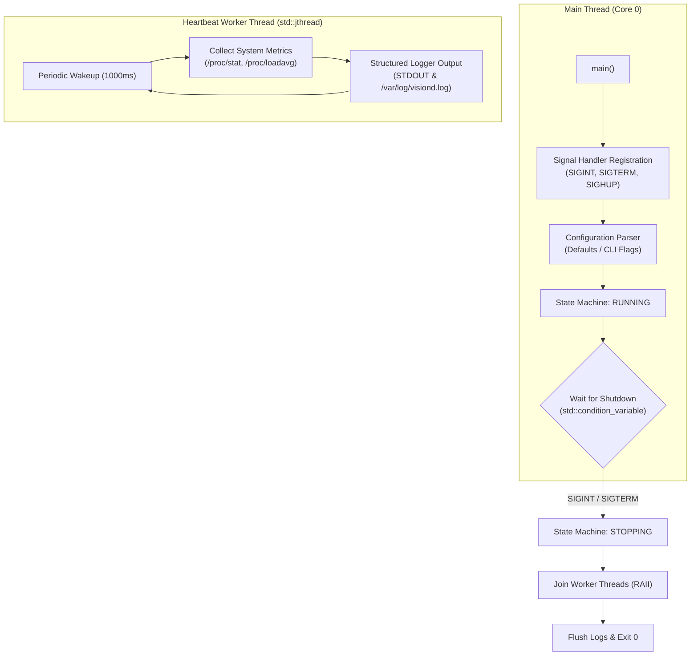

# Phase 1: Daemon Architecture & Baseline Bringup (`visiond` v0.1)

> **Goal:** Transition from a "Hello World" placeholder to a production-grade, multithreaded C++20 daemon (`visiond`) cross-compiled inside Docker and deployed to the live Raspberry Pi 4 over the NFS root filesystem.  
> **Milestone:** Competency Gate 1 (Boot & Daemon Bringup)

---

## 1. Context & Existing Monorepo Infrastructure

Before starting, verify the lab infrastructure is active:
- **Docker Environment:** Running with toolchain `aarch64-linux-gnu-g++` (supports C++20).
- **Target Connection:** RPi4 booted via U-Boot TFTP with BusyBox NFS rootfs exported from Docker at `/workspace/nfs/rpi4-rootfs/`.
- **Remote Access:** Dropbear SSH is available at `192.168.1.150` via `./lab ssh --board=rpi4`.

Check target reachability:
```bash
./lab ssh --board=rpi4 "uname -a; free -h"
```

---

## 2. Architecture & Component Design



---

## 3. Step-by-Step Implementation

### Step 1: Establish Code Structure

Refactor `projects/vision-edge/` into a modular header/source layout:

```
projects/vision-edge/
├── Makefile
├── README.md
├── include/
│   └── visiond/
│       ├── config.hpp         # CLI arguments & runtime configuration
│       ├── logger.hpp         # Thread-safe structured logging
│       ├── state.hpp          # State machine enum & atomic state
│       └── heartbeat.hpp      # Background telemetry thread
└── src/
    ├── main.cpp               # Entry point & signal handling
    ├── config.cpp             # CLI argument parser
    ├── logger.cpp             # Formatted timestamp output
    └── heartbeat.cpp          # CPU load & uptime sampler
```

### Step 2: Implement Thread-Safe Structured Logger (`logger.hpp`)

```cpp
#pragma once
#include <string_view>
#include <mutex>
#include <chrono>
#include <format>
#include <iostream>

namespace visiond {

enum class LogLevel { DEBUG, INFO, WARN, ERROR };

class Logger {
public:
    static Logger& instance() {
        static Logger logger;
        return logger;
    }

    void log(LogLevel level, std::string_view msg) {
        std::lock_guard<std::mutex> lock(mtx_);
        auto now = std::chrono::system_clock::now();
        std::string_view tag = "INFO";
        const char* color = "\033[32m";

        switch (level) {
            case LogLevel::DEBUG: tag = "DEBUG"; color = "\033[36m"; break;
            case LogLevel::INFO:  tag = "INFO "; color = "\033[32m"; break;
            case LogLevel::WARN:  tag = "WARN "; color = "\033[33m"; break;
            case LogLevel::ERROR: tag = "ERROR"; color = "\033[31m"; break;
        }

        std::cout << color << "[" << tag << "]\033[0m "
                  << msg << "\n";
    }

private:
    Logger() = default;
    std::mutex mtx_;
};

#define LOG_INFO(msg)  ::visiond::Logger::instance().log(::visiond::LogLevel::INFO, (msg))
#define LOG_WARN(msg)  ::visiond::Logger::instance().log(::visiond::LogLevel::WARN, (msg))
#define LOG_ERROR(msg) ::visiond::Logger::instance().log(::visiond::LogLevel::ERROR, (msg))

} // namespace visiond
```

### Step 3: Implement Signal Handling and Daemon Lifecycle (`main.cpp`)

```cpp
#include "visiond/logger.hpp"
#include "visiond/heartbeat.hpp"
#include <csignal>
#include <atomic>
#include <condition_variable>
#include <thread>

namespace {
std::atomic<bool> g_running{true};
std::condition_variable g_shutdown_cv;
std::mutex g_shutdown_mtx;

void signal_handler(int sig) {
    LOG_WARN("Received shutdown signal: " + std::to_string(sig));
    g_running = false;
    g_shutdown_cv.notify_all();
}
}

int main(int argc, char* argv[]) {
    LOG_INFO("VisionEdge Inspection & Safety Gateway v0.1.0 starting...");

    // Register clean signal handling
    std::signal(SIGINT, signal_handler);
    std::signal(SIGTERM, signal_handler);

    // Start background heartbeat worker
    visiond::HeartbeatWorker heartbeat(g_running);
    heartbeat.start();

    LOG_INFO("Initialization complete. Entering main supervisory loop.");

    // Block until signal arrives
    {
        std::unique_lock<std::mutex> lock(g_shutdown_mtx);
        g_shutdown_cv.wait(lock, [] { return !g_running.load(); });
    }

    LOG_INFO("Initiating graceful shutdown sequence...");
    heartbeat.stop();
    LOG_INFO("Shutdown complete. Exiting.");
    return 0;
}
```

### Step 4: Configure `Makefile` for C++20 Cross-Compilation

Update `projects/vision-edge/Makefile`:

```makefile
PROJECT_NAME    := vision-edge
PROJECT_TYPE    := app
DEFAULT_BOARD   := rpi4

# Enable C++20 standard, optimization, and threading
CXXFLAGS_EXTRA  += -std=c++20 -O2 -pthread -Wall -Wextra
INCLUDES_EXTRA  += -I./include
LDLIBS_EXTRA    += -lpthread

include ../../shared/build_system/framework.mk
```

### Step 5: Build and Deploy

1. **Cross-compile inside Docker:**
   ```bash
   ./lab build --project=vision-edge --board=rpi4
   ```

2. **Deploy to Target:**
   Because our RPi4 uses an NFS root filesystem hosted by the Docker container, copying the binary into the NFS export directory makes it immediately accessible on the target board with zero network delay:
   ```bash
   ./lab deploy --project=vision-edge --board=rpi4
   ```

3. **Verify Execution on Hardware:**
   ```bash
   ./lab ssh --board=rpi4 "/usr/local/bin/vision-edge"
   ```

---

## 4. Verification & Validation Checklist

- [ ] Binary compiles cleanly with `aarch64-linux-gnu-g++` using `-std=c++20`.
- [ ] Executable format verified with `readelf -h build/rpi4/bin/vision-edge` (Machine: AArch64).
- [ ] Signal handling verified: pressing `Ctrl+C` sends `SIGINT`, logs graceful shutdown, and exits with code 0.
- [ ] Heartbeat logs system uptime and memory status every 1 second without CPU spinning.
- [ ] Self-assess against **Competency Gate 1 (Boot & Daemon Bringup)**.
