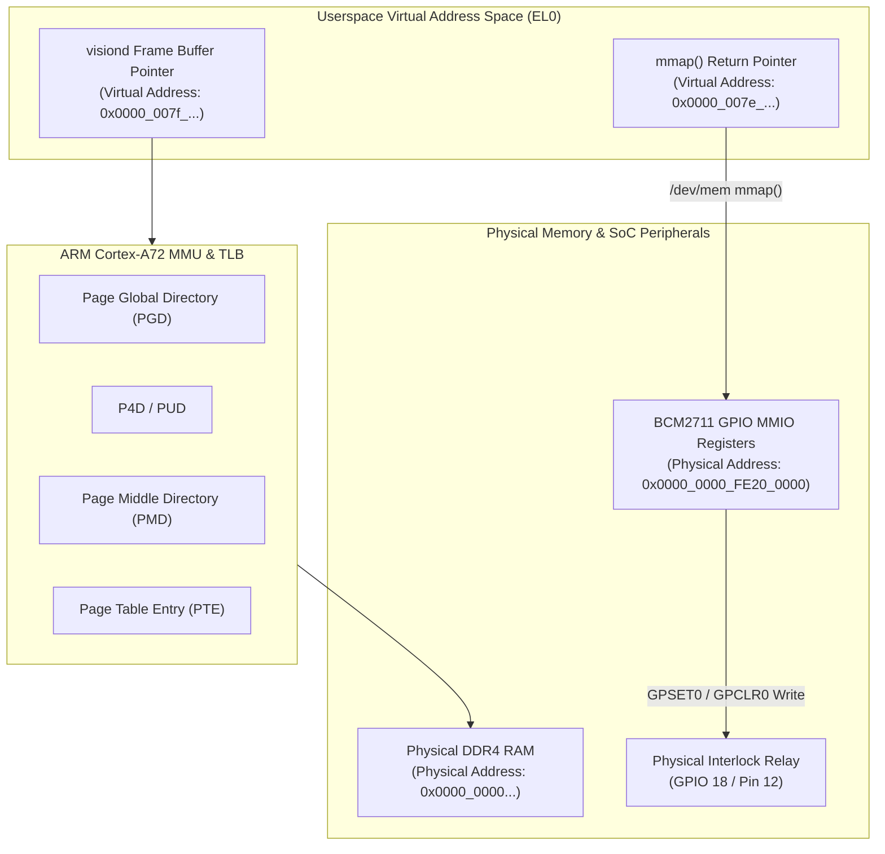

# Phase 2: CPU Internals, Memory & Userspace MMIO

> **Goal:** Deepen low-level platform literacy on the ARM Cortex-A72 cores. Master virtual-to-physical address translation, remote GDB crash reconstruction from CPU registers, direct userspace hardware control via `/dev/mem` MMIO, and lockless triple-buffering.  
> **Milestone:** Competency Gates 2 (Execution Engineer) & 3 (Memory Engineer)

---

## 1. Context & Objectives

Standard application developers treat memory as an infinite, flat address space and rely entirely on OS abstractions to talk to hardware. In this phase, we look under the hood:
1. **CPU Execution:** Trace ARM64 instructions, crash state, and registers (`x0-x30`, `sp`, `pc`, `far_el1`).
2. **MMU Translation:** Walk the 4-level ARMv8-A page tables from Virtual Addresses (VA) to Physical DRAM (PA).
3. **Userspace Hardware MMIO:** Bypass the kernel temporarily to toggle the BCM2711 GPIO hardware relay directly from userspace using `/dev/mem` and `mmap()`.
4. **Data Queuing:** Implement a high-performance lockless ring buffer to pass video frames between capture and processing threads with zero locking overhead.

---

## 2. Memory & Hardware Architecture



---

## 3. Step-by-Step Implementation

### Step 1: Remote GDB Debugging & Crash State Reconstruction

1. Enable core dumps on the target RPi4:
   ```bash
   ./lab ssh --board=rpi4 "ulimit -c unlimited; echo '/tmp/core.%e.%p' > /proc/sys/kernel/core_pattern"
   ```

2. Introduce a deliberate fault in `visiond` (e.g. unaligned pointer or null dereference):
   ```cpp
   void trigger_test_crash() {
       volatile int* bad_ptr = reinterpret_cast<volatile int*>(0xdeadbeef);
       *bad_ptr = 42; // Generates SIGSEGV (Data Abort)
   }
   ```

3. Launch remote GDB session from the host/Docker container:
   ```bash
   ./lab gdb --project=vision-edge --board=rpi4
   ```
   Inspect registers:
   ```gdb
   (gdb) info registers
   (gdb) print $pc
   (gdb) print $sp
   (gdb) bt
   ```

### Step 2: Virtual-to-Physical Address Translation (`pagemap`)

Implement a diagnostic helper in `visiond` to translate any virtual pointer to its underlying physical DRAM page by parsing `/proc/self/pagemap`:

```cpp
#include <fcntl.h>
#include <unistd.h>
#include <cstdint>
#include <iostream>

uintptr_t virt_to_phys(void* vaddr) {
    uintptr_t va = reinterpret_cast<uintptr_t>(vaddr);
    long page_size = sysconf(_SC_PAGESIZE);
    uintptr_t page_offset = va % page_size;
    uintptr_t pfn_index = va / page_size;

    int fd = open("/proc/self/pagemap", O_RDONLY);
    if (fd < 0) return 0;

    uint64_t entry = 0;
    off_t offset = pfn_index * sizeof(uint64_t);
    if (pread(fd, &entry, sizeof(entry), offset) != sizeof(entry)) {
        close(fd);
        return 0;
    }
    close(fd);

    // Check Bit 63 (Page Present)
    if (!(entry & (1ULL << 63))) return 0;

    uint64_t pfn = entry & ((1ULL << 55) - 1);
    return (pfn * page_size) + page_offset;
}
```

### Step 3: Direct Userspace GPIO MMIO via `/dev/mem`

On the Raspberry Pi 4 (Broadcom BCM2711), the peripheral base is `0xFE000000`, and the GPIO controller resides at offset `0x00200000` (physical address `0xFE200000`).

```cpp
#include <sys/mman.h>
#include <fcntl.h>
#include <unistd.h>
#include <cstdint>
#include "visiond/logger.hpp"

#define BCM2711_PERIPH_BASE 0xFE000000
#define BCM2711_GPIO_OFFSET 0x00200000
#define BCM2711_GPIO_BASE   (BCM2711_PERIPH_BASE + BCM2711_GPIO_OFFSET)
#define BLOCK_SIZE          4096

// BCM2711 GPIO Register offsets (32-bit words)
#define GPFSEL1  (0x04 / 4) // Function select for GPIO 10..19
#define GPSET0   (0x1C / 4) // Output set register
#define GPCLR0   (0x28 / 4) // Output clear register

class DirectGpioController {
public:
    bool init() {
        int fd = open("/dev/mem", O_RDWR | O_SYNC);
        if (fd < 0) {
            LOG_ERROR("Failed to open /dev/mem (requires root/CAP_SYS_RAWIO)");
            return false;
        }

        void* map = mmap(nullptr, BLOCK_SIZE, PROT_READ | PROT_WRITE,
                         MAP_SHARED, fd, BCM2711_GPIO_BASE);
        close(fd);

        if (map == MAP_FAILED) {
            LOG_ERROR("mmap failed for GPIO MMIO");
            return false;
        }

        gpio_regs_ = static_cast<volatile uint32_t*>(map);

        // Configure GPIO 18 as OUTPUT (bits 26-24 of GPFSEL1 = 001)
        uint32_t reg = gpio_regs_[GPFSEL1];
        reg &= ~(7 << 24); // Clear bits 26:24
        reg |= (1 << 24);  // Set as output
        gpio_regs_[GPFSEL1] = reg;

        LOG_INFO("Direct userspace GPIO 18 (Relay) configured via /dev/mem MMIO");
        return true;
    }

    void set_relay(bool active) {
        if (!gpio_regs_) return;
        if (active) {
            gpio_regs_[GPCLR0] = (1 << 18); // Active LOW relay energizes on LOW
        } else {
            gpio_regs_[GPSET0] = (1 << 18); // De-energize
        }
    }

    ~DirectGpioController() {
        if (gpio_regs_) {
            munmap(const_cast<uint32_t*>(gpio_regs_), BLOCK_SIZE);
        }
    }

private:
    volatile uint32_t* gpio_regs_{nullptr};
};
```

### Step 4: Lockless Triple-Buffering Queue for Video Frames

To eliminate lock contention between the camera ingestion thread and the SIMD processing worker, implement a lockless triple-buffer using `std::atomic`:

```cpp
#include <atomic>
#include <array>
#include <cstdint>

template <typename FrameType, size_t NumBuffers = 3>
class LocklessTripleBuffer {
public:
    LocklessTripleBuffer() {
        write_idx_.store(0);
        read_idx_.store(1);
        shared_idx_.store(2);
    }

    // Producer (Camera Capture Thread) acquires buffer to write into
    FrameType& get_write_buffer() {
        return buffers_[write_idx_.load(std::memory_order_relaxed)];
    }

    // Producer publishes completed frame
    void publish_write_buffer() {
        uint32_t old_write = write_idx_.load(std::memory_order_relaxed);
        // Swap write buffer with shared buffer
        uint32_t new_write = shared_idx_.exchange(old_write, std::memory_order_acq_rel);
        write_idx_.store(new_write, std::memory_order_release);
    }

    // Consumer (SIMD Processing Worker) acquires most recent completed frame
    FrameType& acquire_read_buffer() {
        // Swap read buffer with newest published shared buffer
        uint32_t old_read = read_idx_.load(std::memory_order_relaxed);
        uint32_t new_read = shared_idx_.exchange(old_read, std::memory_order_acq_rel);
        read_idx_.store(new_read, std::memory_order_acquire);
        return buffers_[new_read];
    }

private:
    std::array<FrameType, NumBuffers> buffers_;
    std::atomic<uint32_t> write_idx_;
    std::atomic<uint32_t> read_idx_;
    std::atomic<uint32_t> shared_idx_;
};
```

---

## 4. Verification & Validation Checklist

- [ ] Core dump generated upon intentional crash and analyzed via `./lab gdb`.
- [ ] CPU register state (`pc`, `sp`, `x0-x7`) matched to exact C++ source line.
- [ ] Virtual address successfully resolved to physical DDR4 DRAM page via `virt_to_phys()`.
- [ ] Direct `/dev/mem` MMIO toggles GPIO 18, physically clicking the relay or lighting the LED.
- [ ] Lockless triple-buffer sustains 60 FPS exchange between 2 threads with zero mutex locks.
- [ ] Self-assess against **Competency Gates 2 (Execution) & 3 (Memory)**.
