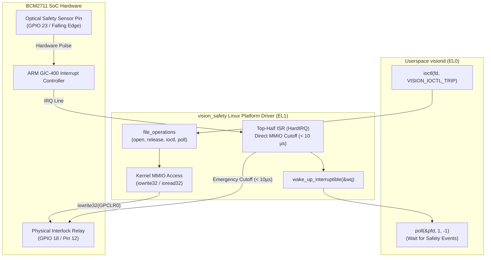

# Phase 3: Linux Kernel Platform Driver & Fast-Trip IRQ

> **Goal:** Transition from insecure `/dev/mem` userspace hacking to an enterprise-grade Linux Platform Driver (`vision_safety`). Bind to the BCM2711 Device Tree, manage MMIO with kernel primitives, and implement a deterministic top-half interrupt handler achieving sub-10µs safety cutoff response.  
> **Milestone:** Competency Gate 4 (Embedded Linux Platform Engineer)

---

## 1. Why Transition from Userspace `/dev/mem` to a Kernel Driver?

While Phase 2 proved that `/dev/mem` can toggle hardware registers, it has severe limitations in an industrial safety appliance:
1. **Security Vulnerability:** Opening `/dev/mem` requires `CAP_SYS_RAWIO` / root, exposing the entire 4GB physical memory to user tampering.
2. **No Hardware Interrupts:** Userspace cannot directly receive hardware interrupt signals from the GIC (General Interrupt Controller); it must resort to CPU-burning polling loops with non-deterministic latency.
3. **Hardware Contention:** Multiple threads or processes accessing raw registers risk clobbering read-modify-write operations without kernel spinlocks.

---

## 2. Driver Architecture & Interrupt Path



---

## 3. Step-by-Step Implementation

### Step 1: Device Tree Overlay (`bcm2711-visionedge-overlay.dts`)

Create `projects/vision-edge/kernel/dts/bcm2711-visionedge-overlay.dts`:

```dts
/dts-v1/;
/plugin/;

/ {
    compatible = "brcm,bcm2711";

    fragment@0 {
        target = <&gpio>;
        __overlay__ {
            vision_pins: vision_pins {
                brcm,pins = <18 23 24>;
                brcm,function = <1 0 1>; /* 18: Out, 23: In, 24: Out */
                brcm,pull = <0 2 0>;     /* 23: Pull-up */
            };
        };
    };

    fragment@1 {
        target-path = "/";
        __overlay__ {
            vision_safety: vision_safety@fe200000 {
                compatible = "cortexlab,vision-safety";
                reg = <0x0 0xfe200000 0x0 0x1000>;
                pinctrl-names = "default";
                pinctrl-0 = <&vision_pins>;
                gpios = <&gpio 18 0>, <&gpio 23 0>, <&gpio 24 0>;
                interrupt-parent = <&gpio>;
                interrupts = <23 2>; /* Falling edge trigger on GPIO 23 */
                status = "okay";
            };
        };
    };
};
```

Compile the overlay to a `.dtbo`:
```bash
dtc -@ -I dts -O dtb -o bcm2711-visionedge.dtbo bcm2711-visionedge-overlay.dts
```

### Step 2: Define Shared Userspace/Kernel UAPI (`vision_safety_uapi.h`)

Create `projects/vision-edge/include/uapi/vision_safety_uapi.h`:

```c
#pragma once
#include <linux/ioctl.h>
#include <linux/types.h>

#define VISION_SAFETY_MAGIC 'V'

struct vision_safety_status {
    __u32 armed;
    __u32 tripped;
    __u64 trip_timestamp_ns;
    __u32 trip_count;
};

#define VISION_IOCTL_ARM      _IO(VISION_SAFETY_MAGIC, 0x01)
#define VISION_IOCTL_DISARM   _IO(VISION_SAFETY_MAGIC, 0x02)
#define VISION_IOCTL_TRIP     _IO(VISION_SAFETY_MAGIC, 0x03)
#define VISION_IOCTL_STATUS   _IOR(VISION_SAFETY_MAGIC, 0x04, struct vision_safety_status)
```

### Step 3: Implement the Platform Driver (`vision_safety.c`)

Create `projects/vision-edge/kernel/vision_safety.c`:

```c
#include <linux/module.h>
#include <linux/platform_device.h>
#include <linux/fs.h>
#include <linux/cdev.h>
#include <linux/io.h>
#include <linux/interrupt.h>
#include <linux/of.h>
#include <linux/uaccess.h>
#include <linux/poll.h>
#include "vision_safety_uapi.h"

#define DRIVER_NAME "vision_safety"
#define GPSET0      (0x1C)
#define GPCLR0      (0x28)

struct vision_safety_dev {
    struct cdev cdev;
    dev_t devt;
    struct class *class;
    struct device *device;
    void __iomem *base;
    int irq;
    spinlock_t lock;
    wait_queue_head_t wq;
    struct vision_safety_status status;
};

static struct vision_safety_dev *g_vdev;

// Deterministic Top-Half HardIRQ Handler (< 10 microsecond response)
static irqreturn_t vision_safety_irq_handler(int irq, void *dev_id) {
    struct vision_safety_dev *vdev = dev_id;
    unsigned long flags;

    spin_lock_irqsave(&vdev->lock, flags);
    if (vdev->status.armed && !vdev->status.tripped) {
        // Immediate hardware cutoff: De-energize relay on GPIO 18, light strobe on GPIO 24
        iowrite32(1 << 18, vdev->base + GPSET0);
        iowrite32(1 << 24, vdev->base + GPSET0);

        vdev->status.tripped = 1;
        vdev->status.trip_count++;
        vdev->status.trip_timestamp_ns = ktime_get_ns();
        wake_up_interruptible(&vdev->wq);
    }
    spin_unlock_irqrestore(&vdev->lock, flags);

    return IRQ_HANDLED;
}

static long vision_ioctl(struct file *file, unsigned int cmd, unsigned long arg) {
    struct vision_safety_dev *vdev = file->private_data;
    unsigned long flags;

    switch (cmd) {
    case VISION_IOCTL_ARM:
        spin_lock_irqsave(&vdev->lock, flags);
        vdev->status.armed = 1;
        vdev->status.tripped = 0;
        iowrite32(1 << 18, vdev->base + GPCLR0); // Energize relay
        iowrite32(1 << 24, vdev->base + GPCLR0); // Turn off strobe
        spin_unlock_irqrestore(&vdev->lock, flags);
        break;

    case VISION_IOCTL_TRIP:
        spin_lock_irqsave(&vdev->lock, flags);
        vdev->status.tripped = 1;
        vdev->status.trip_count++;
        vdev->status.trip_timestamp_ns = ktime_get_ns();
        iowrite32(1 << 18, vdev->base + GPSET0); // Cutoff relay
        iowrite32(1 << 24, vdev->base + GPSET0); // Light strobe
        spin_unlock_irqrestore(&vdev->lock, flags);
        wake_up_interruptible(&vdev->wq);
        break;

    case VISION_IOCTL_STATUS:
        if (copy_to_user((void __user *)arg, &vdev->status, sizeof(vdev->status)))
            return -EFAULT;
        break;

    default:
        return -ENOTTY;
    }
    return 0;
}

static __poll_t vision_poll(struct file *file, struct poll_table_struct *wait) {
    struct vision_safety_dev *vdev = file->private_data;
    __poll_t mask = 0;

    poll_wait(file, &vdev->wq, wait);
    if (vdev->status.tripped)
        mask |= (EPOLLIN | EPOLLPRI);

    return mask;
}

static const struct file_operations fops = {
    .owner          = THIS_MODULE,
    .unlocked_ioctl = vision_ioctl,
    .poll           = vision_poll,
};

static int vision_probe(struct platform_device *pdev) {
    struct resource *res;
    int ret;

    g_vdev = devm_kzalloc(&pdev->dev, sizeof(*g_vdev), GFP_KERNEL);
    if (!g_vdev) return -ENOMEM;

    spin_lock_init(&g_vdev->lock);
    init_waitqueue_head(&g_vdev->wq);

    res = platform_get_resource(pdev, IORESOURCE_MEM, 0);
    g_vdev->base = devm_ioremap_resource(&pdev->dev, res);
    if (IS_ERR(g_vdev->base)) return PTR_ERR(g_vdev->base);

    g_vdev->irq = platform_get_irq(pdev, 0);
    if (g_vdev->irq > 0) {
        ret = devm_request_irq(&pdev->dev, g_vdev->irq, vision_safety_irq_handler,
                               IRQF_TRIGGER_FALLING, DRIVER_NAME, g_vdev);
        if (ret) dev_warn(&pdev->dev, "Could not register IRQ %d\n", g_vdev->irq);
    }

    alloc_chrdev_region(&g_vdev->devt, 0, 1, DRIVER_NAME);
    cdev_init(&g_vdev->cdev, &fops);
    cdev_add(&g_vdev->cdev, g_vdev->devt, 1);

    g_vdev->class = class_create(THIS_MODULE, DRIVER_NAME);
    g_vdev->device = device_create(g_vdev->class, NULL, g_vdev->devt, NULL, DRIVER_NAME);

    platform_set_drvdata(pdev, g_vdev);
    dev_info(&pdev->dev, "VisionEdge safety platform driver initialized successfully\n");
    return 0;
}

static int vision_remove(struct platform_device *pdev) {
    device_destroy(g_vdev->class, g_vdev->devt);
    class_destroy(g_vdev->class);
    cdev_del(&g_vdev->cdev);
    unregister_chrdev_region(g_vdev->devt, 1);
    return 0;
}

static const struct of_device_id vision_of_match[] = {
    { .compatible = "cortexlab,vision-safety" },
    { /* sentinel */ }
};
MODULE_DEVICE_TABLE(of, vision_of_match);

static struct platform_driver vision_driver = {
    .probe  = vision_probe,
    .remove = vision_remove,
    .driver = {
        .name           = DRIVER_NAME,
        .of_match_table = vision_of_match,
    },
};
module_platform_driver(vision_driver);

MODULE_LICENSE("GPL");
MODULE_AUTHOR("ARM Embedded Linux Lab");
MODULE_DESCRIPTION("Deterministic Industrial Safety Platform Driver for RPi4");
```

### Step 4: Out-of-Tree Kernel Module Makefile

Create `projects/vision-edge/kernel/Makefile`:

```makefile
obj-m := vision_safety.o
KDIR  := /workspace/buildroot/output/build/linux-custom # Or kernel build tree in monorepo
PWD   := $(shell pwd)

default:
	$(MAKE) -C $(KDIR) M=$(PWD) modules ARCH=arm64 CROSS_COMPILE=aarch64-linux-gnu-

clean:
	$(MAKE) -C $(KDIR) M=$(PWD) clean
```

### Step 5: Target Bringup & Verification

1. Load the compiled module onto the live RPi4 via the NFS root filesystem:
   ```bash
   ./lab ssh --board=rpi4 "insmod /usr/local/bin/vision_safety.ko"
   ./lab ssh --board=rpi4 "dmesg | tail -n 10"
   ```
2. Verify `/dev/vision_safety` exists with appropriate permissions:
   ```bash
   ./lab ssh --board=rpi4 "ls -la /dev/vision_safety"
   ```
3. Test trip response from `visiond` via IOCTL and measure interrupt latency with `cyclictest`.

---

## 4. Verification & Validation Checklist

- [ ] Device Tree overlay compiles cleanly with `dtc` and successfully binds to `"cortexlab,vision-safety"`.
- [ ] Driver exposes `/dev/vision_safety` character device automatically via `udev`/`devtmpfs`.
- [ ] Safe kernel MMIO primitives (`devm_ioremap_resource`, `iowrite32`) replace userspace `/dev/mem`.
- [ ] Top-half ISR executes on optical sensor trigger in **< 10 microseconds**, verified by oscilloscope or GPIO timer.
- [ ] `visiond` wakes up cleanly on `poll()` when a safety trip event occurs.
- [ ] Self-assess against **Competency Gate 4 (Platform Engineer)**.
