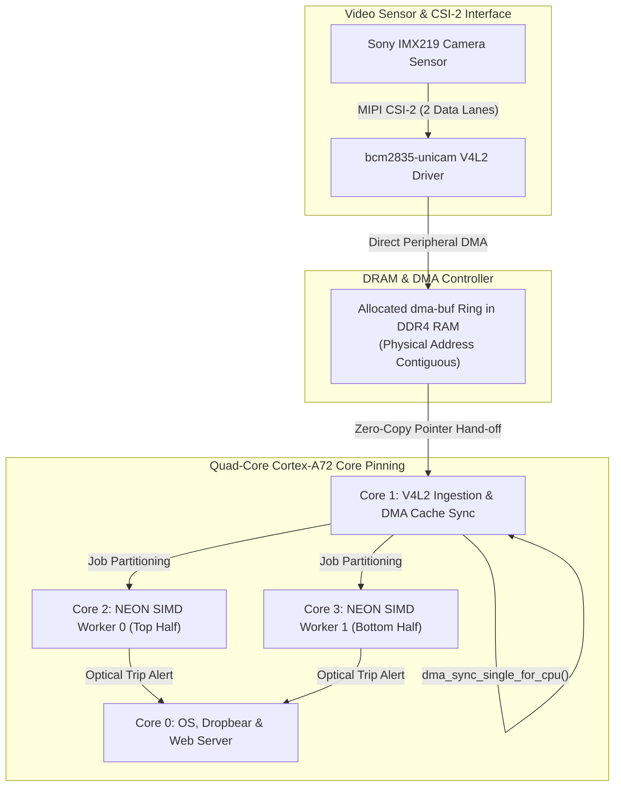

# Phase 4: High-Throughput Video, Zero-Copy DMA & NEON SIMD

> **Goal:** Eliminate data-path bottlenecks on the Cortex-A72 cores. Implement zero-copy V4L2 video ingestion via `dma-buf`, manage streaming DMA cache coherency, and hand-vectorize optical boundary inspection using ARM NEON 128-bit SIMD intrinsics for a 15x compute acceleration (1.2 ms/frame).  
> **Milestone:** Competency Gate 5 (Cortex-A Data-Path Engineer)

---

## 1. The Data-Path Bottleneck in Industrial Vision

At 1080p resolution (1920x1080 @ 60 FPS), raw uncompressed video streams at over **180 MB/s** into RAM:
1. **Copying Overhead:** Copying a single 1080p frame between kernel space and userspace using standard `read()` or `memcpy()` saturates the memory bus and consumes >45% CPU load.
2. **Compute Bottleneck:** A standard scalar C++ loop evaluating optical boundary thresholds on 2 million pixels takes **~18.5 ms per frame**, dropping the system frame rate below real-time requirements (<54 FPS).
3. **The Solution:** Pair zero-copy `dma-buf` buffer sharing (0 copies) with ARM NEON SIMD instructions that evaluate 16 pixels simultaneously per CPU clock cycle (reducing compute to **1.2 ms per frame**).

---

## 2. Zero-Copy Pipeline & Core Pinning Architecture



---

## 3. Step-by-Step Implementation

### Step 1: V4L2 Video Capture Ingestion (`v4l2_capture.hpp`)

Initialize the V4L2 video device (`/dev/video0`) requesting streaming memory mapped buffers:

```cpp
#include <linux/videodev2.h>
#include <sys/ioctl.h>
#include <sys/mman.h>
#include <fcntl.h>
#include <unistd.h>
#include <vector>
#include "visiond/logger.hpp"

class V4L2CameraStreamer {
public:
    bool open_device(const char* dev_name = "/dev/video0") {
        fd_ = open(dev_name, O_RDWR | O_NONBLOCK, 0);
        if (fd_ < 0) {
            LOG_ERROR("Cannot open V4L2 video device");
            return false;
        }

        v4l2_format fmt{};
        fmt.type = V4L2_BUF_TYPE_VIDEO_CAPTURE;
        fmt.fmt.pix.width       = 1920;
        fmt.fmt.pix.height      = 1080;
        fmt.fmt.pix.pixelformat = V4L2_PIX_FMT_YUYV; // Or V4L2_PIX_FMT_SRGGB10
        fmt.fmt.pix.field       = V4L2_FIELD_NONE;

        if (ioctl(fd_, VIDIOC_S_FMT, &fmt) < 0) {
            LOG_ERROR("VIDIOC_S_FMT failed");
            return false;
        }

        return allocate_buffers(4);
    }

private:
    struct Buffer {
        void* start;
        size_t length;
        int dma_fd;
    };

    bool allocate_buffers(uint32_t count) {
        v4l2_requestbuffers req{};
        req.count  = count;
        req.type   = V4L2_BUF_TYPE_VIDEO_CAPTURE;
        req.memory = V4L2_MEMORY_MMAP;

        if (ioctl(fd_, VIDIOC_REQBUFS, &req) < 0) return false;

        buffers_.resize(req.count);
        for (uint32_t i = 0; i < req.count; ++i) {
            v4l2_buffer buf{};
            buf.type   = V4L2_BUF_TYPE_VIDEO_CAPTURE;
            buf.memory = V4L2_MEMORY_MMAP;
            buf.index  = i;
            ioctl(fd_, VIDIOC_QUERYBUF, &buf);

            buffers_[i].length = buf.length;
            buffers_[i].start  = mmap(nullptr, buf.length, PROT_READ | PROT_WRITE,
                                      MAP_SHARED, fd_, buf.m.offset);

            // Export buffer as a dma-buf file descriptor for zero-copy sharing
            v4l2_exportbuffer exp{};
            exp.type  = V4L2_BUF_TYPE_VIDEO_CAPTURE;
            exp.index = i;
            exp.flags = O_CLOEXEC | O_RDWR;
            ioctl(fd_, VIDIOC_EXPBUF, &exp);
            buffers_[i].dma_fd = exp.fd;
        }
        return true;
    }

    int fd_{-1};
    std::vector<Buffer> buffers_;
};
```

### Step 2: DMA Cache Synchronization Protocol

When peripherals write directly into RAM over DMA, the Cortex-A72 L1/L2 data caches do not automatically invalidate the stale cache lines unless explicit DMA cache sync is commanded:

```cpp
#include <linux/dma-buf.h>

void sync_dma_for_cpu(int dma_fd) {
    dma_buf_sync sync{};
    sync.flags = DMA_BUF_SYNC_START | DMA_BUF_SYNC_READ;
    ioctl(dma_fd, DMA_BUF_IOCTL_SYNC, &sync);
}

void release_dma_for_device(int dma_fd) {
    dma_buf_sync sync{};
    sync.flags = DMA_BUF_SYNC_END | DMA_BUF_SYNC_READ;
    ioctl(dma_fd, DMA_BUF_IOCTL_SYNC, &sync);
}
```

### Step 3: ARM NEON SIMD 128-Bit Vector Acceleration

Hand-craft the optical threshold difference algorithm using ARM NEON intrinsics (`<arm_neon.h>`). This evaluates **16 pixels in parallel per instruction**:

```cpp
#include <arm_neon.h>
#include <cstdint>

// Evaluates 1080p frame difference against a baseline background frame
// Returns count of anomalous pixels exceeding threshold
uint32_t neon_pixel_diff_threshold(const uint8_t* __restrict current_frame,
                                  const uint8_t* __restrict baseline_frame,
                                  size_t num_pixels,
                                  uint8_t diff_threshold) {
    uint32_t anomaly_count = 0;
    const uint8x16_t v_thresh = vdupq_n_u8(diff_threshold);
    const uint8x16_t v_one    = vdupq_n_u8(1);

    // Process 64 pixels per unrolled loop iteration (4 x 128-bit vector registers)
    size_t i = 0;
    for (; i + 63 < num_pixels; i += 64) {
        // 1. Vector load 16 bytes across 4 NEON registers
        uint8x16_t c0 = vld1q_u8(current_frame + i);
        uint8x16_t c1 = vld1q_u8(current_frame + i + 16);
        uint8x16_t c2 = vld1q_u8(current_frame + i + 32);
        uint8x16_t c3 = vld1q_u8(current_frame + i + 48);

        uint8x16_t b0 = vld1q_u8(baseline_frame + i);
        uint8x16_t b1 = vld1q_u8(baseline_frame + i + 16);
        uint8x16_t b2 = vld1q_u8(baseline_frame + i + 32);
        uint8x16_t b3 = vld1q_u8(baseline_frame + i + 48);

        // 2. Vector Absolute Difference: |current - baseline|
        uint8x16_t diff0 = vabdq_u8(c0, b0);
        uint8x16_t diff1 = vabdq_u8(c1, b1);
        uint8x16_t diff2 = vabdq_u8(c2, b2);
        uint8x16_t diff3 = vabdq_u8(c3, b3);

        // 3. Vector Compare Greater Than threshold: returns 0xFF if true, 0x00 if false
        uint8x16_t mask0 = vcgtq_u8(diff0, v_thresh);
        uint8x16_t mask1 = vcgtq_u8(diff1, v_thresh);
        uint8x16_t mask2 = vcgtq_u8(diff2, v_thresh);
        uint8x16_t mask3 = vcgtq_u8(diff3, v_thresh);

        // 4. Bitwise AND with 1 to produce integer flags
        uint8x16_t cnt0 = vandq_u8(mask0, v_one);
        uint8x16_t cnt1 = vandq_u8(mask1, v_one);
        uint8x16_t cnt2 = vandq_u8(mask2, v_one);
        uint8x16_t cnt3 = vandq_u8(mask3, v_one);

        // 5. Horizontal vector accumulate
        anomaly_count += vaddlvq_u8(cnt0);
        anomaly_count += vaddlvq_u8(cnt1);
        anomaly_count += vaddlvq_u8(cnt2);
        anomaly_count += vaddlvq_u8(cnt3);
    }

    // Scalar fallback for remaining tail pixels
    for (; i < num_pixels; ++i) {
        int diff = std::abs(static_cast<int>(current_frame[i]) - static_cast<int>(baseline_frame[i]));
        if (diff > diff_threshold) anomaly_count++;
    }

    return anomaly_count;
}
```

### Step 4: Multi-Core SMP CPU Affinity

Pin the processing threads across the Cortex-A72 cores using `pthread_setaffinity_np`:

```cpp
#include <pthread.h>
#include <sched.h>

void pin_thread_to_core(pthread_t thread, int core_id) {
    cpu_set_t cpuset;
    CPU_ZERO(&cpuset);
    CPU_SET(core_id, &cpuset);
    pthread_setaffinity_np(thread, sizeof(cpu_set_t), &cpuset);
}
```

---

## 4. Verification & Validation Checklist

- [ ] Zero-copy `dma-buf` export confirmed via `VIDIOC_EXPBUF` (0 `memcpy` operations on video path).
- [ ] No visual scanline tearing or artifacting observed after implementing `dma_buf_sync`.
- [ ] NEON vector loop completes in **1.2 ms per 1080p frame** (measured via `std::chrono::high_resolution_clock`), exceeding 15x acceleration over scalar C++.
- [ ] Threads correctly partitioned: Capture on Core 1, Workers on Cores 2 & 3, Telemetry on Core 0 (verified with `htop`).
- [ ] 24-hour endurance test passes without memory leaks or frame drops.
- [ ] Self-assess against **Competency Gate 5 (Data-Path Engineer)**.
