# Phase 5: System Productization, Instant Boot & Hardening

> **Goal:** Transform the prototype into a production-grade, commercial industrial appliance. Assemble a minimal read-only SquashFS + OverlayFS root filesystem using Buildroot (<25MB), optimize cold-boot time to sub-2.5 seconds, deploy an embedded web dashboard (`http://<rpi4-ip>:8080`), and validate complete power-loss immunity.  
> **Milestone:** Competency Gate 6 (Master Platform Engineer)

---

## 1. The Appliance Engineering Challenge

An industrial edge gateway cannot run like a desktop PC:
1. **Unforgiving Factory Power:** Industrial operators cut machine power abruptly without shutting down cleanly. Standard ext4 filesystems risk journal corruption and boot failure.
2. **Instant Operational Readiness:** In an industrial safety interlock, waiting 30 seconds for `systemd` is unacceptable. The camera must stream and the safety interlock must be armed in **under 2.5 seconds from power application**.
3. **Embedded Web Telemetry:** Operators require a real-time visual inspection feed and diagnostic health gauges via any standard web browser without installing custom client software.

---

## 2. Appliance Architecture & Boot Pipeline

```mermaid
graph TD
    subgraph ColdBootPipeline ["Cold Boot Optimization Pipeline (< 2.5s)"]
        direction LR
        P1["Power Applied<br/>(t = 0.0s)"] --> P2["EEPROM & GPU<br/>(start4.elf: t = 0.4s)"]
        P2 --> P3["U-Boot (bootdelay=0)<br/>(t = 0.9s)"]
        P3 --> P4["Kernel Uncompress & Init<br/>(t = 1.9s)"]
        P4 --> P5["Fast Userspace Init<br/>(visiond Active: t = 2.4s)"]
    end

    subgraph StorageArchitecture ["Power-Loss Resilient Storage"]
        ROM["Read-Only SquashFS Base Image<br/>(System Binaries & Libraries)"]
        RAM["RAM tmpfs Upper Layer<br/>(Writable /tmp, /var, /run)"]
        OFS["OverlayFS Unified Mount<br/>(/)"]
        
        ROM --> OFS
        RAM --> OFS
    end

    subgraph TelemetryServer ["Embedded Web Dashboard (:8080)"]
        WEB["visiond Embedded HTTP Server"]
        MJPEG["/stream.mjpg: Live 60 FPS MJPEG Stream"]
        WS["/ws/telemetry: JSON Health & Latency Metrics"]
        BROWSER["Operator Web Browser<br/>(Live Bounding Box & Gauges)"]

        WEB --> MJPEG
        WEB --> WS
        MJPEG --> BROWSER
        WS --> BROWSER
    end
```



---

## 3. Step-by-Step Implementation

### Step 1: Embedded Web Dashboard Server (`web_server.hpp`)

Integrate a lightweight HTTP / WebSocket micro-service directly inside `visiond` listening on port `8080`:

```cpp
#include <string>
#include <sstream>
#include <vector>
#include "visiond/logger.hpp"

class EmbeddedWebServer {
public:
    void broadcast_telemetry(float cpu_load, float dma_latency_us, uint32_t fps, bool armed, bool tripped) {
        // Construct compact JSON payload for WebSocket clients
        std::stringstream ss;
        ss << "{"
           << "\"cpu_load\":" << cpu_load << ","
           << "\"dma_latency_us\":" << dma_latency_us << ","
           << "\"fps\":" << fps << ","
           << "\"safety_armed\":" << (armed ? "true" : "false") << ","
           << "\"safety_tripped\":" << (tripped ? "true" : "false")
           << "}";
        broadcast_ws_message(ss.str());
    }

    void push_mjpeg_frame(const std::vector<uint8_t>& jpeg_buffer) {
        // Push multipart/x-mixed-replace boundary to HTTP clients
    }

private:
    void broadcast_ws_message(const std::string& json_payload) {
        // Broadcast to connected WebSocket sessions
    }
};
```

### Step 2: Buildroot Minimal Read-Only SquashFS Appliance

Configure Buildroot in `buildroot/` to assemble a stripped root filesystem (< 25MB):

1. **Target Options:**
   - Target Architecture: `AArch64 (little endian)`
   - Target Architecture Variant: `cortex-A72`
2. **Filesystem Images:**
   - Enable `squashfs` with `xz` compression.
   - Disable standard mutable filesystem formats for the rootfs.
3. **Init System:**
   - Select `BusyBox init` or custom direct init script.
4. **OverlayFS RAM Integration:**
   In `/etc/fstab`:
   ```fstab
   # Mount read-only root with tmpfs overlay
   none /tmp tmpfs defaults 0 0
   none /var tmpfs defaults 0 0
   none /run tmpfs defaults 0 0
   ```

### Step 3: Sub-2.5-Second Cold Boot Optimization

To drop cold-boot time from 28 seconds to under 2.5 seconds:

1. **EEPROM & VideoCore:**
   In `config.txt`:
   ```ini
   # Disable rainbow splash screen and boot delays
   disable_splash=1
   boot_delay=0
   arm_boost=1
   dtoverlay=bcm2711-visionedge
   ```

2. **U-Boot Configuration:**
   Set `bootdelay=0` and hardcode the boot command to skip interactive menus:
   ```text
   setenv bootdelay 0
   setenv bootcmd "booti ${kernel_addr_r} - ${fdt_addr}"
   saveenv
   ```

3. **Kernel Command Line:**
   In `cmdline.txt` (or PXE `append`):
   ```text
   console=ttyAMA0,115200 root=/dev/ram0 rw init=/usr/local/bin/vision-edge quiet loglevel=0 lpj=1500000 raid=noautodetect
   ```
   *By pointing `init` directly to `/usr/local/bin/vision-edge`, the kernel hands execution directly to the vision daemon within 100ms of kernel initialization.*

---

## 4. End-to-End System Demonstration Scenario

1. **Instant Power-On:** Plug 5V 3A USB-C power into the Raspberry Pi 4 $\rightarrow$ cold-boot completes to operational video streaming in **< 2.5 seconds**.
2. **Deterministic Safety Cutoff:** Wave an object across the optical safety barrier $\rightarrow$ the top-half hardware interrupt trips the relay in **< 10 microseconds**, illuminating the emergency strobe and freezing the incident frame.
3. **Live Web Inspection:** Open `http://192.168.1.150:8080` in Chrome/Firefox $\rightarrow$ live 60 FPS MJPEG video displays with red defect bounding boxes, CPU utilization gauges, and DMA latency telemetry.
4. **Power Cut Resilience:** Pull the power plug during active streaming $\rightarrow$ reapply power $\rightarrow$ board boots cleanly with zero filesystem checks (`fsck`) and zero data corruption.

---

## 5. Verification & Validation Checklist

- [ ] Complete OS rootfs footprint verified under **25 MB** (SquashFS compressed).
- [ ] Cold-boot time measured from power-on to first video frame in **< 2.5 seconds** (using `grabserial`).
- [ ] Read-only SquashFS + OverlayFS survives 20 consecutive hard power cuts without corruption.
- [ ] Web dashboard streams live video and telemetry at `http://<rpi4-ip>:8080`.
- [ ] Full architecture review and defense against **Competency Gate 6 (Master Platform Engineer)**.
